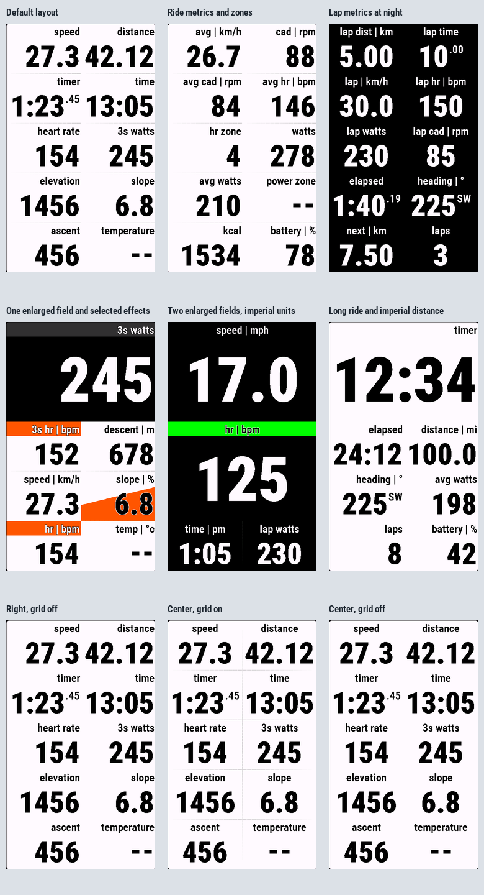

# Struktur

Struktur is a configurable Garmin Connect IQ **Data Field for cycling**. Keep your chosen ride metrics together in two independently configurable, two-column dashboards, with clear values, compact secondary units and up to two enlarged fields per set.

The project was made with the [AI Architect requirement service](https://ai-architect.link). Requirements guide the implementation and its validation; a portable documentation release is included in the [architecture archive](architecture/Struktur-0.1.1.zip).



The screenshots use sample data. Power zones show `--` while their data source awaits qualification. The sample images may show unavailable temperature.

## Features

- 32 selectable metrics: speed, distance, heart rate, cadence, power, elevation, ascent/descent, slope, timers, time of day, battery, heading, calories, completed laps and more.
- Six current-lap fields: distance, active time, average speed, heart rate, power and cadence.
- Two independent sets of ten saved field assignments, including temporarily hidden slots. Repeated metrics are supported.
- Choose a second-set trigger: **3s power**, **Heart rate**, **Manual lap** (factory default), **Workout started**, or **None** to disable switching without losing the saved set.
- Zero, one or two enlarged fields; each layout uses its full available capacity.
- Center or Right alignment, independently of **Grid type**: None, Horizontal lines or Full grid.
- Day, Night and automatic themes, optional theme inversion for enlarged fields, and independent background effects per slot.
- Metric and statute units, optional `label | unit` headers, and 12/24-hour clocks.
- Speed and distance use two decimals below 10, one below 100 and whole numbers from 100, after conversion and rounding carries. Slope always shows one decimal and averages the last three one-second estimates, using available estimates immediately.
- Small `.SS` timer seconds below ten hours; longer durations retain all hour digits.
- Exactly three bitmap font sizes per device, containing only the glyphs used by the app.

The first-set defaults are Right alignment, Horizontal lines, no enlarged fields, hidden physical units and background effects off. The field order is speed, distance, timer, time, heart rate, 3s power, elevation, slope, ascent and temperature. Four-row layouts initially show the first eight.

## Device profiles

| Garmin Edge | Rows | Fields with 0 / 1 / 2 enlarged fields |
| --- | ---: | --- |
| 530, 540, 550, 830, 840, 850 | 4 | 8 / 5 / 2 |
| 1030, 1040, 1050 | 5 | 10 / 7 / 4 |

These are development profiles. Emulator verification does not establish physical-device compatibility. The actual area assigned to the Data Field determines whether the layout fits.

## Installation and settings

For development sideloading, build a PRG for the matching device and copy it into the device's `GARMIN/APPS` directory. Add Struktur to a cycling activity using a full-page, single Data Field layout.

Application settings control field assignments, alignment, enlargement, grid type, themes, unit headers and per-slot backgrounds. Changing a layout retains assignments in hidden slots.

The **Second field set** section follows the default-set settings. Its activation selector controls when the entire second dashboard replaces the first. Each set saves ten assignments and independently configures fields, alignment, enlargement, themes, unit headers, backgrounds and grid.

| Trigger | Show the second set | Return to the first set |
| --- | --- | --- |
| **3s power** | Rolling three-second power reaches or exceeds your activation threshold | Power drops strictly below your separate return threshold |
| **Heart rate** | Heart rate reaches or exceeds your activation threshold | Heart rate drops strictly below your separate return threshold |
| **Manual lap** (factory default) | First qualifying Lap-button press | Next qualifying Lap-button press |
| **Workout started** | A workout-start event is received | The activity timer is reset |
| **None** | Never; switching is disabled | The first set remains active and second-set settings stay saved |

The second-set factory preset enlarges **3s watts**, followed by heart rate, cadence, slope, lap watts (current-lap average), speed, lap distance, lap time, elevation and temperature. Background effects default to ON for the first four slots and OFF for the rest. With one enlarged field, four-row layouts show the first five assignments and five-row layouts show the first seven; the other assignments remain saved. Factory defaults fill missing settings and preserve valid existing choices.

Power and heart-rate activation/return defaults are 250/220 W and 160/150 bpm, respectively. The return threshold must not exceed activation; an inconsistent selected pair keeps the default set. Missing source data returns to default; power needs three consecutive valid seconds. Pause/stop preserves the set until fresh running data is evaluated.

The app starts on the first set. Valid saved trigger selections are preserved, including None. **Edge 530/830/1030: disable Auto Lap. This device cannot distinguish manual from automatic lap events.** Other automatic/workout lap sources must also be absent for manual-only switching on those devices. Newer profiles filter manual lap events by their reported cause.

In Workout started mode, pause, stop, lap events and workout-step/workout completion keep the second set selected until timer reset. Selecting this mode after workout start waits for the next workout-start event. App restart, activity reset or changing trigger mode starts from the default set. Presentation-only edits preserve the active set; changing the selected thresholds resets it until a new sample is evaluated.

Lap values use intervals observed by the app. Measured zero power/cadence are included; missing readings are excluded. Loading during an existing ride leaves lap metrics unavailable until the next observed lap boundary. Completed laps require observation from a known fresh activity session.

## Build from source

The project uses Monkey C and the Garmin Connect IQ SDK. The toolchain is pinned in [config/toolchain.json](config/toolchain.json). Install the matching SDK, Java runtime and device packages using Garmin's SDK Manager. Keep your developer signing key outside the repository.

The generated font resources are included, so a normal SDK build does not require access to the requirements service or local authoring files. From the repository root in Windows PowerShell:

```powershell
$env:CONNECTIQ_SDK = Read-Host 'Connect IQ SDK directory'
$env:JAVA_HOME = Read-Host 'Java home directory'
$env:STRUKTUR_DEVELOPER_KEY = Read-Host 'External developer signing key file'
$env:PATH = (Join-Path $env:JAVA_HOME 'bin') + [IO.Path]::PathSeparator + $env:PATH
New-Item -ItemType Directory -Force bin | Out-Null

& (Join-Path $env:CONNECTIQ_SDK 'bin/monkeyc.bat') `
    -f monkey.jungle -d edge1040 -o bin/Struktur-edge1040.prg `
    -y $env:STRUKTUR_DEVELOPER_KEY
```

Replace `edge1040` with another product identifier from [config/devices.json](config/devices.json). To create a signed Connect IQ store-format candidate for all manifest products:

```powershell
& (Join-Path $env:CONNECTIQ_SDK 'bin/monkeyc.bat') `
    -f monkey.jungle -e -r -o bin/Struktur-candidate.iq `
    -y $env:STRUKTUR_DEVELOPER_KEY
```

A successful build creates an installation candidate; Garmin submission and device qualification are separate steps.

Generated font text uses LF line endings, and input hashes treat LF/CRLF source checkouts identically. Font images, metrics and resource checksums remain exact. After a real change to display text, font sizes or generation inputs, regenerate and validate with the pinned Python/Pillow environment:

```powershell
python tools/generate_fonts.py
python tools/validate_fonts.py
```

With SDK, Java and the external signing key configured, build and open the Edge 1040 app using `run-emulator.cmd edge1040 -Build`.

## Tests

The [suite definitions](tests/suites.json) keep three workflows separate:

| Suite | Coverage | When to run |
| --- | --- | --- |
| Core | Calculations, acquisition lifecycle, settings, formatting and normal-value drawing bounds | After app changes |
| Memory | Font loading and memory use in the actual Data Field runtime | Explicitly requested validation |
| Placement | Overflow, insufficient drawing areas and compact fallback | Explicitly requested validation |

Core contains 42 named Monkey C tests. To compile and run Core with the SDK simulator already open:

```powershell
& (Join-Path $env:CONNECTIQ_SDK 'bin/monkeyc.bat') `
    -f tests.jungle -d edge1040 -o bin/Struktur-core-tests.prg `
    -y $env:STRUKTUR_DEVELOPER_KEY --unit-test
& (Join-Path $env:CONNECTIQ_SDK 'bin/monkeydo.bat') `
    bin/Struktur-core-tests.prg edge1040 /t
```

Memory runs the 648-case layout/resource stress matrix and the 1000-transition/200-settings-change second-set scenario in separate normal Data Field programs. Both must pass within the device allocation; font probes alone do not establish memory qualification. Each report retains its source and binary hashes, used/free/total measurements and raw log.

Core does not launch Memory or Placement. Simulator results and sample screenshots do not qualify sensors, firmware behavior or physical lap-event delivery.

## Architecture and status

[Struktur 0.1.1 documentation release](architecture/Struktur-0.1.1.zip) is a single portable archive containing the captured specifications, design records, test definitions, relations and referenced diagrams/font assets. Extract it and open `specification.md`. Stable requirement references are retained; service identifiers, author identities, private links and historical execution records are excluded from this public copy.

The documentation release is **For QA**. Physical qualification is pending. Temperature displays one decimal place in °C and °F and uses the Edge native sensor API in a background worker, with updates at most every five minutes and a six-minute read-cache limit. Paired external temperature sensors or unknown sensor metadata make it unavailable; disconnect and remove a paired Tempe to use the onboard path. Physical-device source validation remains pending. Power zones remain unavailable until the device metadata interpretation is qualified. Heart-rate zones use validated personal bounds. Missing values display `--`, values exceeding supported drawing bounds display `!`, and an insufficient assigned area uses the compact message.

| Directory | Contents |
| --- | --- |
| `source/` | Monkey C acquisition, formatting and rendering |
| `profiles/` | Device geometry and font roles |
| `resources/` | Settings, strings, icon and generated fonts |
| `assets/fonts/` | Font sources, provenance and license |
| `config/` | Field/settings catalogues and capability policies |
| `architecture/` | Portable public documentation release |
| `tests/`, `validation/` | Regression fixtures and separate qualification drivers |
| `scripts/`, `tools/` | Development and resource-generation utilities; some require local authoring data |

## License

Project code uses the [MIT license](LICENSE). Roboto Condensed fonts and their generated resources retain the [SIL Open Font License 1.1](assets/fonts/OFL.txt).

Runtime preparation follows APP-26: field modes and font metrics are resolved at initialization; header measurements and geometry are retained until their inputs change. Validated zone metadata and classifications are shared, unchanged presentation records are reused without mutation, and repeated identical layout callbacks reuse prepared commands. Live acquisition, unit/preferences checks, clock and temperature freshness remain active. Ordinary redraws only issue prepared graphics commands; missing assigned bounds permit one layout preparation. These caches reduce repeated work; battery savings are not yet measured on hardware.
