# Struktur 0.1.1 - Architecture and specifications

Documentation release: **For QA**. Physical qualification is pending.

This public export is derived from the immutable release captured by AI Architect. It includes specifications, design records and test definitions, with their captured states. Stable requirement references and relations are retained. Internal service identifiers, author identities, audit metadata and historical test executions are excluded. This is a sanitized publication copy, not a service backup.

Test definitions are not execution results. Requirement approval does not establish hardware qualification.

## Index

- [APP-1 - Application design](#app-1)
- [APP-10 - onStart(state)](#app-10)
- [APP-11 - onStop(state)](#app-11)
- [APP-12 - onUpdate(dc)](#app-12)
- [APP-13 - onShow()](#app-13)
- [APP-14 - onHide()](#app-14)
- [APP-15 - Toybox.Application.Properties.getValue(key)](#app-15)
- [APP-16 - Toybox.Activity.getActivityInfo()](#app-16)
- [APP-17 - Toybox.System.getSystemStats()](#app-17)
- [APP-18 - Toybox.UserProfile.getProfile()](#app-18)
- [APP-19 - Toybox.WatchUi.DataField.createField(...)](#app-19)
- [APP-2 - Initialization handler](#app-2)
- [APP-20 - Configure the two-column Garmin field grid](#app-20)
- [APP-21 - Align field labels and values at center or right](#app-21)
- [APP-22 - Render separators according to field alignment](#app-22)
- [APP-23 - Choose grid row capacity from the assigned drawing area](#app-23)
- [APP-24 - Target Garmin Edge full-screen design profiles](#app-24)
- [APP-25 - Use the three specified Roboto Condensed font roles](#app-25)
- [APP-26 - Prepare geometry and sensor values outside the drawing path](#app-26)
- [APP-27 - BIG_FONT: use Roboto Condensed Black for enlarged values](#app-27)
- [APP-28 - REGULAR_FONT: use Roboto Condensed Black for regular values](#app-28)
- [APP-29 - LABELS_FONT: use Roboto Condensed SemiBold for labels](#app-29)
- [APP-3 - Drawing params provider](#app-3)
- [APP-30 - Configure visible count and value of each grid field](#app-30)
- [APP-31 - Validate saved settings and use safe display defaults](#app-31)
- [APP-32 - Apply changed settings without restarting an activity](#app-32)
- [APP-33 - Initialize display state before asynchronous drawing](#app-33)
- [APP-34 - Reflow the grid to the assigned data-field bounds](#app-34)
- [APP-35 - Show unavailable activity values without stale readings](#app-35)
- [APP-36 - Keep text readable when effects and themes change](#app-36)
- [APP-37 - Stay within device memory and refresh budgets](#app-37)
- [APP-38 - Qualify the declared Garmin device matrix](#app-38)
- [APP-39 - Toybox.System.getDeviceSettings().isNightModeEnabled](#app-39)
- [APP-4 - Data drawer](#app-4)
- [APP-40 - Toybox.Application.AppBase.onNightModeChanged()](#app-40)
- [APP-41 - Toybox.WatchUi.requestUpdate()](#app-41)
- [APP-42 - Toybox.UserProfile.getHeartRateZones(...)](#app-42)
- [APP-43 - Toybox.UserProfile.getPowerZones(...)](#app-43)
- [APP-44 - Toybox.Graphics.Dc.fillPolygon(...)](#app-44)
- [APP-45 - Support day and night themes on Garmin devices](#app-45)
- [APP-46 - Configure visible fields in Garmin Connect](#app-46)
- [APP-47 - Apply per-device Connect IQ Data Field memory ceilings](#app-47)
- [APP-48 - Measure runtime memory and verify bounded allocation](#app-48)
- [APP-49 - Enable or disable background effects independently per field slot](#app-49)
- [APP-5 - initialize()](#app-5)
- [APP-6 - onSettingsChanged()](#app-6)
- [APP-7 - onLayout(dc)](#app-7)
- [APP-8 - compute(info)](#app-8)
- [APP-9 - getInitialView()](#app-9)
- [DVS-1 - Display Values Specification](#dvs-1)
- [DVS-10 - Current Cadence](#dvs-10)
- [DVS-11 - Average Cadence](#dvs-11)
- [DVS-12 - App shall display field data label at the top of field](#dvs-12)
- [DVS-13 - Duration values display format](#dvs-13)
- [DVS-14 - Display percentages in their context-specific valid range](#dvs-14)
- [DVS-15 - Signed values display format](#dvs-15)
- [DVS-16 - Training zone values display format](#dvs-16)
- [DVS-17 - Compact text and status values display format](#dvs-17)
- [DVS-18 - Current heart rate](#dvs-18)
- [DVS-19 - Average heart rate](#dvs-19)
- [DVS-2 - Format decimal values at the field-defined precision](#dvs-2)
- [DVS-20 - Heart rate zone](#dvs-20)
- [DVS-21 - Current power](#dvs-21)
- [DVS-22 - Three-second average power](#dvs-22)
- [DVS-23 - Average power](#dvs-23)
- [DVS-24 - Power zone](#dvs-24)
- [DVS-25 - Distance](#dvs-25)
- [DVS-26 - Elevation](#dvs-26)
- [DVS-27 - Total ascent](#dvs-27)
- [DVS-28 - Total descent](#dvs-28)
- [DVS-29 - Grade](#dvs-29)
- [DVS-3 - Position numeric secondary text beside the primary value](#dvs-3)
- [DVS-30 - Activity timer](#dvs-30)
- [DVS-31 - Elapsed time](#dvs-31)
- [DVS-32 - Time of day](#dvs-32)
- [DVS-33 - Calories](#dvs-33)
- [DVS-34 - Temperature](#dvs-34)
- [DVS-35 - Device battery level](#dvs-35)
- [DVS-36 - Heading](#dvs-36)
- [DVS-37 - Distance to next waypoint](#dvs-37)
- [DVS-39 - Completed laps](#dvs-39)
- [DVS-4 - App shall support metric and imperial values](#dvs-4)
- [DVS-40 - Convert SDK units before displaying values](#dvs-40)
- [DVS-41 - Compute three-second power from consecutive valid samples](#dvs-41)
- [DVS-42 - Handle unsupported training-zone data honestly](#dvs-42)
- [DVS-43 - Render an angled horizon for current grade](#dvs-43)
- [DVS-44 - Color slope ground using exact grade bands](#dvs-44)
- [DVS-45 - Map personal training zones to display colors](#dvs-45)
- [DVS-46 - Fill current, three-second and average power fields by personal power zone](#dvs-46)
- [DVS-47 - Display three-second average heart rate](#dvs-47)
- [DVS-48 - Fill current, three-second and average heart-rate fields by personal heart-rate zone](#dvs-48)
- [DVS-49 - Color temperature field backgrounds using Celsius bands](#dvs-49)
- [DVS-5 - Format local time and its 12-hour header indicator](#dvs-5)
- [DVS-50 - Show or hide physical units in field headers](#dvs-50)
- [DVS-51 - Inverse theme for enlarged fields option](#dvs-51)
- [DVS-6 - Render transparent text with contrast halos on effect backgrounds](#dvs-6)
- [DVS-7 - Display valid integral values within field bounds](#dvs-7)
- [DVS-8 - Current speed](#dvs-8)
- [DVS-9 - Average speed](#dvs-9)
- [FUNC-10 - Calculate bounded time-weighted lap sensor averages](#func-10)
- [FUNC-11 - Expose six lap fields without changing existing settings mappings](#func-11)
- [FUNC-12 - Acquire bounded activity samples for grade](#func-12)
- [FUNC-13 - Estimate grade with five-sample least-squares regression](#func-13)
- [FUNC-14 - Reset the grade window on discontinuity or inactivity](#func-14)
- [FUNC-15 - Acquire qualified onboard temperature through a background worker](#func-15)
- [FUNC-16 - Validate and expire background temperature readings](#func-16)
- [FUNC-17 - Count completed laps from a continuously observed zero baseline](#func-17)
- [FUNC-2 - Field label and unit name option](#func-2)
- [FUNC-3 - Lap distance](#func-3)
- [FUNC-4 - Lap time](#func-4)
- [FUNC-5 - Lap speed](#func-5)
- [FUNC-6 - Lap heart rate](#func-6)
- [FUNC-7 - Lap power](#func-7)
- [FUNC-8 - Lap cadence](#func-8)
- [FUNC-9 - Establish and retain the current observed lap baseline](#func-9)
- [HFER-2 - Render equal-size fields in a two-column grid](#hfer-2)
- [HFER-3 - Render one enlarged top field above the regular grid](#hfer-3)
- [HFER-4 - Render two stacked enlarged fields above regular fields](#hfer-4)
- [HFER-5 - Center field labels and values within their cells](#hfer-5)
- [HFER-6 - Right-align field labels and values within their cells](#hfer-6)
- [HFER-7 - Draw centered-layout row and column separators](#hfer-7)
- [HFER-8 - Draw right-layout separators below individual fields](#hfer-8)
- [SPEC-150 - Struktur Development Environment and Readiness Specification](#spec-150)
- [SPEC-151 - Record and verify a reproducible Connect IQ development toolchain](#spec-151)
- [SPEC-152 - Version the Data Field project and per-device API capability matrix](#spec-152)
- [SPEC-153 - Provide repeatable CLI build, simulator-test and package commands](#spec-153)
- [SPEC-154 - Reproduce Garmin-compatible Roboto Condensed resources within the memory budget](#spec-154)
- [SPEC-155 - Publish one typed settings catalogue shared by XML, runtime and tests](#spec-155)
- [SPEC-156 - Specify each displayed value acquisition path and deterministic sensor fixtures](#spec-156)
- [SPEC-157 - Run deterministic Monkey C tests for formatting, settings and sample processing](#spec-157)
- [SPEC-158 - Exercise and record the complete nine-device simulator scenario matrix](#spec-158)
- [SPEC-159 - Provide physical-device and memory-performance qualification procedures](#spec-159)
- [SPEC-160 - Gate changes on repeatable compilation and explicit test evidence](#spec-160)
- [SPEC-161 - Record unresolved product decisions before closing dependent development tasks](#spec-161)
- [SPEC-162 - Define development milestones and traceable release evidence](#spec-162)
- [SPEC-163 - Verify: record and verify a reproducible Connect IQ development toolchain](#spec-163)
- [SPEC-164 - Verify: version the Data Field project and per-device API capability matrix](#spec-164)
- [SPEC-165 - Verify: provide repeatable CLI build, simulator-test and package commands](#spec-165)
- [SPEC-166 - Verify: reproduce Garmin-compatible Roboto Condensed resources within the memory budget](#spec-166)
- [SPEC-167 - Verify: publish one typed settings catalogue shared by XML, runtime and tests](#spec-167)
- [SPEC-168 - Verify: specify each displayed value acquisition path and deterministic sensor fixtures](#spec-168)
- [SPEC-169 - Verify: run deterministic Monkey C tests for formatting, settings and sample processing](#spec-169)
- [SPEC-170 - Verify: exercise and record the complete nine-device simulator scenario matrix](#spec-170)
- [SPEC-171 - Verify: provide physical-device and memory-performance qualification procedures](#spec-171)
- [SPEC-172 - Verify: gate changes on repeatable compilation and explicit test evidence](#spec-172)
- [SPEC-173 - Verify: record unresolved product decisions before closing dependent development tasks](#spec-173)
- [SPEC-174 - Verify: define development milestones and traceable release evidence](#spec-174)
- [SPEC-175 - Struktur Used-Glyph-Only Font Requirements](#spec-175)
- [SPEC-176 - Bundle exactly the glyphs that each application font role can render](#spec-176)
- [SPEC-177 - Reject missing or surplus font glyphs during generation and verification](#spec-177)
- [SPEC-178 - Verify exact glyph inventories across font roles and supported UI states](#spec-178)
- [SPEC-179 - Verify font subset rejection, regeneration and nine-profile compatibility](#spec-179)
- [SWINT-1 - Garmin SDK](#swint-1)
- [TCOM-1 - Exact glyph inventories and reproducible font resources](#tcom-1)
- [TFNC-1 - Floating-point display boundaries](#tfnc-1)
- [TFNC-10 - Grade distance window and boundary interpolation](#tfnc-10)
- [TFNC-11 - Grade continuity and bounded sample history](#tfnc-11)
- [TFNC-12 - Known-zero lap baseline and pause/reset lifecycle](#tfnc-12)
- [TFNC-13 - Lap identity, regression and overflow invalidation](#tfnc-13)
- [TFNC-14 - Temperature packet and cache-age boundaries](#tfnc-14)
- [TFNC-15 - Temperature delivery delay and clock guards](#tfnc-15)
- [TFNC-16 - Legal temperature scheduling and closed source gate](#tfnc-16)
- [TFNC-17 - Shared acquisition integration and duplicate slots](#tfnc-17)
- [TFNC-18 - Data Field callbacks preserve lap continuity](#tfnc-18)
- [TFNC-19 - Invalid acquisition input and safe background startup](#tfnc-19)
- [TFNC-2 - All six full-capacity logical grids](#tfnc-2)
- [TFNC-20 - Reject semantic font defects with refreshed cached hashes](#tfnc-20)
- [TFNC-21 - Verify current-lap fields, averages and boundary lifecycle](#tfnc-21)
- [TFNC-22 - Explicit speed, slope and elevation precision](#tfnc-22)
- [TFNC-23 - Rolling samples use activity time and valid values](#tfnc-23)
- [TFNC-24 - Validated zone metadata and snapshot classification](#tfnc-24)
- [TFNC-25 - Current-lap distance time and weighted averages](#tfnc-25)
- [TFNC-26 - Late loading and gaps do not invent lap history](#tfnc-26)
- [TFNC-3 - Three-second rolling-window continuity](#tfnc-3)
- [TFNC-4 - Grade and temperature effect boundaries](#tfnc-4)
- [TFNC-5 - Typed settings defaults and hidden-slot preservation](#tfnc-5)
- [TFNC-6 - Unit conversion and complete duration formatting](#tfnc-6)
- [TFNC-7 - Measured caption and duration fitting](#tfnc-7)
- [TFNC-8 - All field unit headers and secondary-unit switches](#tfnc-8)
- [TFNC-9 - Independent theme inversion and sample preservation](#tfnc-9)
- [TINT-1 - Compile the production Data Field for each declared profile](#tint-1)
- [TPER-1 - Memory](#tper-1)
- [TPRF-4 - Bounded snapshot caches and live-input invalidation](#tprf-4)
- [TPRF-5 - Changed-cell fitting and prepared-only rendering](#tprf-5)
- [TPRF-6 - Optional battery clock and diagnostic work](#tprf-6)
- [TPRF-7 - Isolated three-font resource allocation probe](#tprf-7)
- [TPRF-8 - All three profile font resources can load](#tprf-8)
- [TPRF-9 - Normal Data Field runtime memory validation](#tprf-9)
- [TRGR-1 - Core](#trgr-1)
- [TRGR-2 - Placement](#trgr-2)
- [TSEC-1 - Publication privacy, export integrity and current project consistency](#tsec-1)
- [TUI-1 - Production drawing alignment and palettes](#tui-1)
- [TUI-10 - Exact formatting throughout declared normal intervals](#tui-10)
- [TUI-11 - Guaranteed normal values stay inside native cell borders](#tui-11)
- [TUI-12 - Actual overflow and compact layout cache behavior](#tui-12)
- [TUI-13 - Unsupported and reduced-area presentation matrix](#tui-13)
- [TUI-14 - Documented unsupported fields fail safe fitting](#tui-14)
- [TUI-2 - Measure complete label and unit headers](#tui-2)
- [TUI-3 - Literal and unit-template header selection](#tui-3)
- [TUI-4 - Normal default ride headers and cell bounds](#tui-4)
- [TUI-5 - Reviewed field formatting and stable choices](#tui-5)
- [TUI-6 - Exactly three fixed font roles in every layout](#tui-6)
- [TUI-7 - Effect foreground contrast and exact glyph widths](#tui-7)
- [TUI-8 - Default-on grid visibility and unchanged cell drawing](#tui-8)
- [TUI-9 - Complete clock and duration groups fit native cells](#tui-9)

## APP-1 - Application design

Type: document | State: approved

This feature defines the Garmin Connect IQ data field application: the two-column grid [APP-20](#app-20), Garmin Connect configuration [APP-46](#app-46), day/night rendering [APP-45](#app-45), device qualification [APP-38](#app-38), and runtime components. The values, formats and special drawings belong to the linked display-values feature [DVS-1](#dvs-1).

**Relations**

- allocated_to: [APP-2](#app-2), [APP-3](#app-3), [APP-4](#app-4)

## APP-10 - onStart(state)

Type: data_item | State: approved

Toybox.Application.AppBase.onStart(state) is called at application startup before getInitialView(). Handle application startup and load/validate saved configuration without assuming state is non-null, an activity sample is already available or a final drawing area has been assigned. Layout preparation follows [APP-7](#app-7) and safe snapshot initialization follows [APP-33](#app-33). App startup is not an instruction to reset the host Garmin activity. Source: https://developer.garmin.com/connect-iq/api-docs/Toybox/Application/AppBase.html#onStart-instance_function

**Relations**

- part_of: [APP-1](#app-1)

## APP-11 - onStop(state)

Type: data_item | State: approved

Toybox.Application.AppBase.onStop(state) handles application termination and bounded resource cleanup. Preserve settings as required by [APP-31](#app-31)/[APP-46](#app-46), avoid rewriting valid persisted settings with temporary defaults, and release application-owned transient state as applicable. App termination does not authorize changing or deleting the host activity's recorded data. state may be null. Source: https://developer.garmin.com/connect-iq/api-docs/Toybox/Application/AppBase.html#onStop-instance_function

**Relations**

- part_of: [APP-1](#app-1)

## APP-12 - onUpdate(dc)

Type: data_item | State: draft

Toybox.WatchUi.View.onUpdate(dc), inherited by DataField, renders the latest complete initialized snapshot and prepared drawing commands under [APP-26](#app-26)/[APP-33](#app-33)/[APP-37](#app-37), independently of compute scheduling. The drawing routine issues graphics/clip calls and iterates prepared commands; it must not format readings, measure text, choose fonts, resolve colors, calculate coordinates/contour offsets, build geometry, query sensors/preferences/properties, load resources or mutate acquisition.

Exception: if assigned drawing bounds have not yet been established, or the SDK requests redraw before delivering a required layout callback, onUpdate may invoke [APP-7](#app-7) preparation once before drawing. With valid cached bounds, compute/settings/theme/background callbacks prepare affected data before redraw; an ordinary redraw must perform no layout or presentation calculations. Constant graphics arguments, loop control and dispatch of cached values are permitted.

Before the first valid sample, draw initialized labels and unavailable placeholders under [APP-33](#app-33). Source: https://developer.garmin.com/connect-iq/api-docs/Toybox/WatchUi/View.html#onUpdate-instance_function

**Relations**

- part_of: [APP-1](#app-1)

## APP-13 - onShow()

Type: data_item | State: approved

Toybox.WatchUi.View.onShow(), inherited by DataField, is a visibility callback. When the view becomes visible, render/request the current complete snapshot using the current validated settings and rebuilt layout as needed. Becoming visible shall not reset activity timers, rolling samples, hidden assignments or saved settings. Do not assume visibility callbacks supply Activity.Info or replace [APP-8](#app-8) acquisition. Source: https://developer.garmin.com/connect-iq/api-docs/Toybox/WatchUi/View.html#onShow-instance_function

**Relations**

- part_of: [APP-1](#app-1)

## APP-14 - onHide()

Type: data_item | State: approved

Toybox.WatchUi.View.onHide() is the inherited View hide callback when delivered by the system. It may suspend display-only work, but shall not stop required activity sample processing, clear rolling samples solely because the field is hidden or reset timer/settings state. Do not depend on an onHide callback for every Data Field visibility transition; the documented Data Field lifecycle primarily lists onLayout/onShow/onUpdate. Restore current rendering under [APP-13](#app-13) without inventing samples. Source: https://developer.garmin.com/connect-iq/api-docs/Toybox/WatchUi/View.html

**Relations**

- part_of: [APP-1](#app-1)

## APP-15 - Toybox.Application.Properties.getValue(key)

Type: data_item | State: approved

Toybox.Application.Properties.getValue(key) retrieves an application property declared in the settings/properties resources. Read the keys/types/list mappings from [SPEC-155](#spec-155), validate each read independently under [APP-31](#app-31), and catch missing/unsupported/invalid reads to use that property's documented default. Load/cache values during initialization or [APP-6](#app-6), not each draw. Numeric list values map to stable internal identifiers; valid saved Center and hidden-slot selections/effects are preserved. Do not treat this settings API as a sensor source or as evidence of Garmin Connect transport qualification.

**Relations**

- part_of: [APP-1](#app-1)

## APP-16 - Toybox.Activity.getActivityInfo()

Type: data_item | State: approved

Provides a snapshot of the current `Activity.Info` state outside `DataField.compute(info)` when needed, including during data-field initialization. Use `Toybox.Activity.getActivityInfo()`; `Activity.getInfo()` is not a Connect IQ method.

**Relations**

- part_of: [APP-1](#app-1)

## APP-17 - Toybox.System.getSystemStats()

Type: data_item | State: approved

Toybox.System.getSystemStats() returns System.Stats, including battery percentage and application-runtime totalMemory, usedMemory and freeMemory in bytes. Validate battery under [DVS-35](#dvs-35); use the named memory members for the separate qualification measurements under [APP-48](#app-48). These are not device physical RAM or filesystem-free-storage values, and no free-storage member is documented by this contract. Label foreground/background/simulator/hardware measurement provenance separately; published limits alone are not measured free memory. Source: https://developer.garmin.com/connect-iq/api-docs/Toybox/System/Stats.html

**Relations**

- part_of: [APP-1](#app-1)

## APP-18 - Toybox.UserProfile.getProfile()

Type: data_item | State: approved

Retrieves the user's general profile data, such as body metrics, when the UserProfile permission is granted. Training-zone thresholds are retrieved separately through `Toybox.UserProfile.getHeartRateZones(...)` and, on supported devices, `getPowerZones(...)`; `getProfile()` alone is not a source of zone boundaries.

**Relations**

- part_of: [APP-1](#app-1)

## APP-19 - Toybox.WatchUi.DataField.createField(...)

Type: data_item | State: approved

A DataField may call `Toybox.WatchUi.DataField.createField(...)` to create a `FitContributor.Field` for optional custom FIT recording. The returned field is updated with `setData(...)` when the data is valid. This is not required to display values on screen. Garmin API: https://developer.garmin.com/connect-iq/api-docs/Toybox/WatchUi/DataField.html

**Relations**

- part_of: [APP-1](#app-1)

## APP-2 - Initialization handler

Type: component | State: approved

Initialization-handler component. Initialize validated settings and a complete safe display snapshot before drawing under [APP-31](#app-31)/[APP-33](#app-33), resolve the applicable profile and supported capabilities under [APP-24](#app-24)/[APP-38](#app-38), and provide the drawing-parameter component [APP-3](#app-3) with those inputs. Physical screen dimensions are design references; actual cell geometry/fonts come from the assigned drawing context at [APP-7](#app-7) under [APP-34](#app-34). Missing settings/sources use their documented independent defaults/unavailable states. Initialization must not guess unresolved temperature, grade or lap acquisitions or claim device qualification.

**Relations**

- part_of: [APP-1](#app-1)
- uses: [SWINT-1](#swint-1)

## APP-20 - Configure the two-column Garmin field grid

Type: requirement | State: approved

The Garmin data field shall use a two-column logical grid. Screen dimensions determine a capacity of four or five standard rows as specified by [APP-23](#app-23). A regular field occupies one cell. An enlarged field occupies a 2-by-2 block: both columns and two standard row heights. Users can choose zero, one, or two enlarged fields at the top; the remaining cells hold regular fields. Each supported grid shall use its full capacity: only the six combinations in the table below are permitted. There is no independent visible-field-count setting and no partially filled grid. The default is zero enlarged fields and therefore eight regular fields with four rows or ten regular fields with five rows. A too-small assigned area still uses the compact fallback under [APP-34](#app-34) rather than an additional field combination.

| Logical row capacity | Enlarged fields | Regular fields | Total fields |
| --- | ---: | ---: | ---: |
| Five rows | 0 | 10 | 10 |
| Four rows | 0 | 8 | 8 |
| Five rows | 1 | 6 | 7 |
| Four rows | 1 | 4 | 5 |
| Five rows | 2 | 2 | 4 |
| Four rows | 2 | 0 | 2 |

Detailed layout requirements: [HFER-2](#hfer-2), [HFER-3](#hfer-3), [HFER-4](#hfer-4). Content alignment is specified by [APP-21](#app-21); separators are specified by [APP-22](#app-22). The images below illustrate the supported combinations.

**All fields at standard size**

| Centered, 5 rows / 10 fields | Right-aligned, 5 rows / 10 fields | Centered, 4 rows / 8 fields | Right-aligned, 4 rows / 8 fields |
| --- | --- | --- | --- |
| 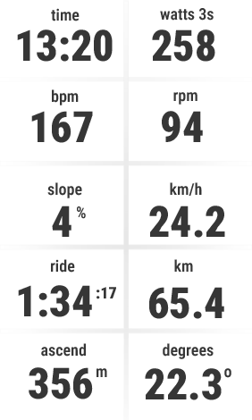 | 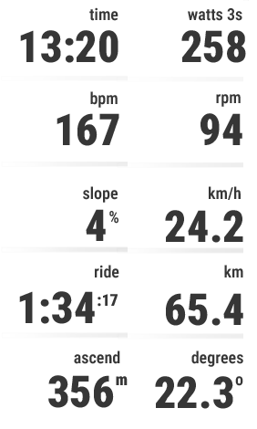 | 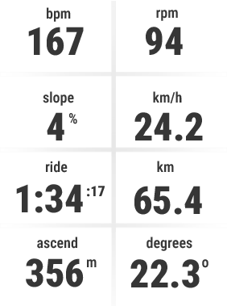 | 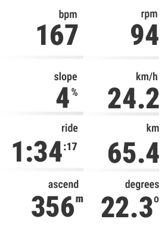 |

**One enlarged field at the top**

| Centered, 7 fields | Right-aligned, 7 fields | Centered, 5 fields | Right-aligned, 5 fields |
| --- | --- | --- | --- |
| 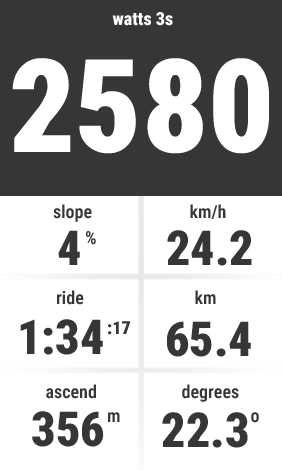 | 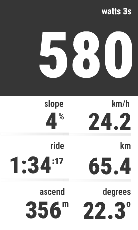 | 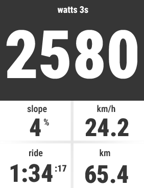 | 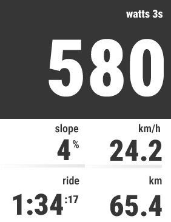 |

**Two enlarged fields at the top**

| Centered, 4 fields | Right-aligned, 4 fields | Centered, 2 fields | Right-aligned, 2 fields |
| --- | --- | --- | --- |
| 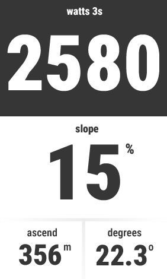 | 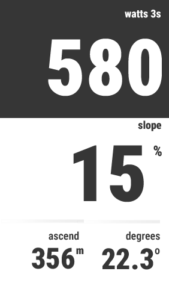 | 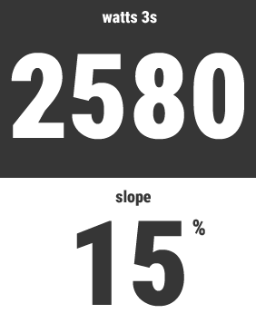 | 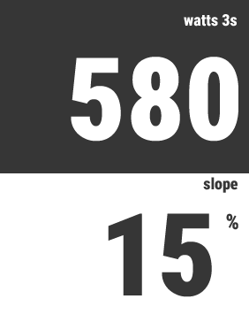 |

**Attachments**

- [centered ui with 5 fields](attachments/center-ui-5.png) | image/png | role: illustrates
- [centered ui with 7 fields](attachments/center-ui-7.png) | image/png | role: illustrates
- [centered ui with 10 fields](attachments/center-ui-10.png) | image/png | role: illustrates
- [centered ui with 8 fields](attachments/center-ui-8.png) | image/png | role: illustrates
- [right ui with 5 fields](attachments/right-ui-5.png) | image/png | role: illustrates
- [right ui with 7 fields](attachments/right-ui-7.png) | image/png | role: illustrates
- [right ui with 8 fields](attachments/right-ui-8.png) | image/png | role: illustrates
- [right ui with 10 fields](attachments/right-ui-10.png) | image/png | role: illustrates
- [centered ui 2](attachments/center-ui-2.png) | image/png | role: illustrates
- [centered ui 4](attachments/center-ui-4.png) | image/png | role: illustrates
- [right ui 2](attachments/right-ui-2.png) | image/png | role: illustrates
- [right ui 4](attachments/right-ui-4.png) | image/png | role: illustrates

**Relations**

- allocated_to: [APP-3](#app-3), [APP-4](#app-4)
- part_of: [APP-1](#app-1)
- uses: [APP-21](#app-21), [APP-22](#app-22), [APP-23](#app-23)

## APP-21 - Align field labels and values at center or right

Type: requirement | State: approved

Expose Center and Right alignment through [SPEC-155](#spec-155). Align headers and visible value-plus-secondary groups horizontally under [HFER-5](#hfer-5)/[HFER-6](#hfer-6) without changing cell geometry or assignments.

For a cell with top y and height h, reserve R=max(L,H), where L is the selected label-font line height and H is the cached shared label-band height under [DVS-6](#dvs-6). Vertically center the primary value's visible glyph bounds at `y + R + (h - R) / 2`, with at most one pixel of rounding error. Use the same R for every cell, including effects-off cells, both alignments, regular/enlarged cells and status markers. Header text, unit visibility, colors and toggle changes do not alter R. Recalculate value positioning when cell bounds change; regenerate R only when initializing a different catalogue/label font. Secondary positioning follows [DVS-3](#dvs-3) and collision checks follow [APP-34](#app-34).

**Attachments**

- [center values alignment](attachments/center-ui-8-2.png) | image/png | role: illustrates
- [right values alignment](attachments/right-ui-8-2.png) | image/png | role: illustrates

**Relations**

- allocated_to: [APP-4](#app-4)
- part_of: [APP-1](#app-1)

## APP-22 - Render separators according to field alignment

Type: requirement | State: approved

Provide a global Grid type selector, independent of Center/Right text alignment, with exactly these choices under [SPEC-155](#spec-155):

- 0 None: draw no separator lines.
- 1 Horizontal lines (default): use the pattern in [HFER-8](#hfer-8).
- 2 Full grid: use the pattern in [HFER-7](#hfer-7).

Both line patterns shall work with either alignment and the effective Day/Night palette. Do not cross enlarged cells. The compact fallback has no grid for every choice.

Apply changes under [APP-32](#app-32) on the next visible redraw. Change only separator commands; preserve cell geometry/capacity, alignment, font resources, text positions, backgrounds and acquisition state. Validate and retain the selection under [APP-31](#app-31). Replacing the Boolean option does not alter the two existing line patterns.

| Full grid | Horizontal lines |
| --- | --- |
|  |  |

**Attachments**

- [delimiters for center align](attachments/center-delimiters.png) | image/png | role: illustrates
- [delimiters for right align](attachments/right-delimiters.png) | image/png | role: illustrates

**Relations**

- allocated_to: [APP-4](#app-4)
- part_of: [APP-1](#app-1)
- uses: [APP-21](#app-21)

## APP-23 - Choose grid row capacity from the assigned drawing area

Type: requirement | State: approved

Choose row capacity from actual assigned bounds under [APP-7](#app-7)/[APP-34](#app-34). Try the profile's [APP-24](#app-24) full-screen row capacity first; for a five-row profile, retry four rows if five cannot fit. A four-row profile does not promote to five merely because a narrower font fits. Each attempt uses eligible fonts and the selected enlarged-field count; accept only a complete [APP-20](#app-20) combination. If no eligible grid fits, use [APP-34](#app-34)'s compact fallback.

**Relations**

- allocated_to: [APP-3](#app-3)
- part_of: [APP-1](#app-1)
- uses: [APP-24](#app-24), [APP-7](#app-7)

## APP-24 - Target Garmin Edge full-screen design profiles

Type: requirement | State: approved

Target Garmin Edge full-screen design profiles; each model is supported for release only after the qualification in [APP-38](#app-38) succeeds. Resolution and row count describe the full-screen design. The table specifies the three fixed font sizes for each profile:

| Model | Resolution | Screen Ratio | Rows | Enlarged Font Size | Regular Font Size | Label Font Size |
| --- | --- | --- | --- | --- | --- | --- |
| Edge 1050 | 480 x 800 | 1.66 | 5 | 200px | 95px | 35px |
| Edge 850 | 420 x 600 | 1.42 | 4 | 175px | 83px | 35px |
| Edge 550 | 420 x 600 | 1.42 | 4 | 175px | 83px | 35px |
| Edge 1040 | 282 x 470 | 1.66 | 5 | 116px | 55px | 21px |
| Edge 1030 | 282 x 470 | 1.66 | 5 | 116px | 55px | 21px |
| Edge 840 | 246 x 322 | 1.30 | 4 | 100px | 45px | 21px |
| Edge 830 | 246 x 322 | 1.30 | 4 | 100px | 45px | 21px |
| Edge 540 | 246 x 322 | 1.30 | 4 | 100px | 45px | 21px |
| Edge 530 | 246 x 322 | 1.30 | 4 | 100px | 45px | 21px |
   

The table defines font sizes without percentage scaling. Assigned drawing bounds determine whether a complete grid fits under [APP-34](#app-34).

At full-screen bounds, both numeric roles shall fit the complete primary text `00:00` and the timer group with primary `0:00` plus label-role `.00` secondary text and its two-pixel gap. Reserve the [APP-34](#app-34) four-pixel horizontal margins plus the largest applicable one-pixel halo; retain the header-height inset and vertical gap. Use these fixed sizes for all values in each role; this is a generation/verification constraint, not runtime font scaling. Other numeric values and complete headers retain their field-specific normal ranges under [APP-34](#app-34).

**Relations**

- part_of: [APP-1](#app-1)

## APP-25 - Use the three specified Roboto Condensed font roles

Type: requirement | State: approved

Bundle exactly three font roles per device profile: enlarged numeric values, regular numeric values, and labels/numeric secondary text. Use the fixed pixel sizes in [APP-24](#app-24); do not choose different sizes per value or bundle additional fitting ladders. Source faces are specified by [APP-27](#app-27), [APP-28](#app-28) and [APP-29](#app-29).

**Relations**

- allocated_to: [APP-4](#app-4)
- clarifies: [APP-27](#app-27), [APP-28](#app-28), [APP-29](#app-29)
- part_of: [APP-1](#app-1)
- uses: [APP-24](#app-24), [APP-34](#app-34)

## APP-26 - Prepare geometry and sensor values outside the drawing path

Type: requirement | State: approved

Prepare reusable state at the earliest point where its inputs are known, and retain bounded caches:

- At foreground initialization, cache the profile's three font-metric roles, shared label-band height and constant lookup tables. Resolve assigned field identifiers, formats and headers once per configuration/preference variant; do not rescan the catalogue or concatenate unchanged headers per sample.
- After assigned bounds are known under [APP-7](#app-7), cache cell geometry while bounds and capacity are unchanged. Prepare separator commands for the selected grid type, independently of text alignment; a grid-type change releases old-style separator commands and refreshes only the selected pattern under [APP-22](#app-22). Refit only visible cells whose displayed text, secondary text, header or effect clearance changes; reconsider preferred capacity when recovering from a fallback. Slots beyond the preferred layout capacity must not refit visible cells. While a smaller fallback is selected, changes in candidate fields within the preferred capacity must still trigger reconsideration so the preferred layout can recover.
- Before [APP-12](#app-12), prepare text coordinates, justification, foreground/background colors, contour offsets and any grade polygons. Reuse unchanged fitted runs, drawing packets and equal-angle grade polygons. A new value must not regenerate unrelated cells or separator gradients. Retain no unbounded history of strings, runs or configurations.
- Under [APP-8](#app-8), process current readings and stateful acquisition once per delivered sample, including rolling/lap continuity for temporarily unselected fields. Reuse unchanged formatting, but invalidate on reading, relevant unit/header/clock preference, format indicator or availability changes. Never freeze live readings, clock time, expiry, activity identity or required device preferences at startup.

Read the device clock only when a retained slot needs time of day; query battery only when a retained slot needs it under [DVS-35](#dvs-35). Skip foreground temperature-age clock queries while the temperature cache is empty; usable cached readings still undergo the original expiry/rollback checks. Settings, theme, background delivery and lifecycle events must invalidate only affected presentation state, preserving acquisition under [APP-32](#app-32). Recurring work and diagnostics follow [APP-37](#app-37).

Keep retained cache representation compact: use fixed-shape slot state and shared or packed separator data rather than one hash table or container per small cached element. Replacing or reassigning a slot must release its obsolete cache state and must not mutate any previously published snapshot. Preserve the reuse/invalidation rules above and verify allocation under [APP-48](#app-48).

**Relations**

- allocated_to: [APP-3](#app-3)
- part_of: [APP-1](#app-1)
- uses: [APP-12](#app-12), [APP-35](#app-35), [APP-5](#app-5), [APP-7](#app-7), [APP-8](#app-8)

## APP-27 - BIG_FONT: use Roboto Condensed Black for enlarged values

Type: requirement | State: approved

Use the bundled [Roboto Condensed Black source](attachments/Roboto_Condensed_Black.ttf) for enlarged primary numeric values at the profile's enlarged size in [APP-24](#app-24).

**Attachments**

- [Roboto_Condensed_Black.ttf](attachments/Roboto_Condensed_Black.ttf) | application/octet-stream | role: design_asset
- [Roboto_Condensed_SemiBold.ttf](attachments/Roboto_Condensed_SemiBold.ttf) | application/octet-stream | role: design_asset

**Relations**

- part_of: [APP-1](#app-1)

## APP-28 - REGULAR_FONT: use Roboto Condensed Black for regular values

Type: requirement | State: approved

Use the bundled [Roboto Condensed Black source](attachments/Roboto_Condensed_Black.ttf) for regular primary numeric values at the profile's regular size in [APP-24](#app-24). All regular cells use that same fixed size.

**Attachments**

- [Roboto_Condensed_Black.ttf](attachments/Roboto_Condensed_Black.ttf) | application/octet-stream | role: design_asset
- [Roboto_Condensed_SemiBold.ttf](attachments/Roboto_Condensed_SemiBold.ttf) | application/octet-stream | role: design_asset

**Relations**

- part_of: [APP-1](#app-1)

## APP-29 - LABELS_FONT: use Roboto Condensed SemiBold for labels

Type: requirement | State: approved

Use the bundled [Roboto Condensed SemiBold source](attachments/Roboto_Condensed_SemiBold.ttf) for headers and numeric secondary text at the profile's label size in [APP-24](#app-24).

**Attachments**

- [Roboto_Condensed_Black.ttf](attachments/Roboto_Condensed_Black.ttf) | application/octet-stream | role: design_asset
- [Roboto_Condensed_SemiBold.ttf](attachments/Roboto_Condensed_SemiBold.ttf) | application/octet-stream | role: design_asset

**Relations**

- part_of: [APP-1](#app-1)

## APP-3 - Drawing params provider

Type: component | State: draft

Drawing-parameter-provider component. Consume validated settings, actual assigned bounds and the latest complete normalized display snapshot. Prepare/cache layout, selected font resources/visible-glyph metrics, separators, effective cell palettes and applicable effect geometry under [APP-26](#app-26)/[APP-34](#app-34). Rebuild affected caches on bounds/settings changes; use the one-label-font-height value inset under [APP-21](#app-21), the three fixed per-profile font roles under [APP-24](#app-24)/[APP-28](#app-28), and unit/label rules under [DVS-50](#dvs-50)/[DVS-5](#dvs-5). Provide one consistent configuration to [APP-4](#app-4); preserve hidden-slot assignments and unrelated activity/sample state. Unsupported/invalid effects use their specified neutral/ordinary palette.

**Relations**

- part_of: [APP-1](#app-1)
- uses: [APP-2](#app-2), [SWINT-1](#swint-1)

## APP-30 - Configure visible count and value of each grid field

Type: requirement | State: approved

The rider shall choose a supported value for each ordered slot and zero, one, or two enlarged top fields through [APP-46](#app-46). The effective visible count shall be exactly the capacity of the measured four- or five-row grid and chosen enlarged-field count under [APP-20](#app-20): four rows permit 8/5/2 total fields for 0/1/2 enlarged fields; five rows permit 10/7/4. No independent count selector or partial-grid combination is permitted.

Only the first effective-count slots are drawn. Persist all ten assignments and their order through restart, including slots temporarily hidden by enlarged fields or a smaller measured row capacity. Restoring capacity shall reveal those assignments. Repeated use of a value in different slots is permitted. Existing legacy field_count values shall be ignored when calculating capacity and shall not suppress slots or overwrite unrelated saved values. If neither supported row capacity fits, use [APP-34](#app-34)'s compact fallback.

**Relations**

- allocated_to: [APP-3](#app-3)
- part_of: [APP-1](#app-1)
- refines: [APP-20](#app-20)
- uses: [APP-15](#app-15)

## APP-31 - Validate saved settings and use safe display defaults

Type: requirement | State: approved

Validate each saved property independently against the types, allowed values and defaults in [SPEC-155](#spec-155). Replace only missing or malformed values; retain valid saved settings through restart/upgrade, including hidden and duplicate-slot assignments.

A syntactically valid unknown field code/identifier shows unavailable with header `field`; it does not change to another metric. A malformed selection uses that slot's default. Invalid configuration must not prevent startup. Ignore retired properties without rewriting unrelated saved values. Apply later changes under [APP-32](#app-32).

**Relations**

- allocated_to: [APP-2](#app-2)
- derived_from: [APP-20](#app-20), [APP-21](#app-21)
- part_of: [APP-1](#app-1)
- uses: [APP-15](#app-15)

## APP-32 - Apply changed settings without restarting an activity

Type: requirement | State: approved

When [APP-6](#app-6) reports changed settings, the application shall re-read the validated configuration, invalidate affected geometry and presentation caches, and redraw the current data field. A field-value change shall not reset unrelated settings or recorded activity state. If a setting changes during an activity, the next visible update shall use one consistent configuration, not a mixture of old and new positions or styles.

With cached assigned bounds, apply presentation/cache invalidation and prepare the next complete drawing commands before requesting redraw. Reuse unchanged field/header/geometry caches; grid-type changes refresh only separator commands, without field refits, cell-geometry rebuilds or font loads. Refresh unit/clock/theme-dependent state when its inputs change, without resetting grade, rolling or lap accumulators.

**Relations**

- allocated_to: [APP-2](#app-2)
- part_of: [APP-1](#app-1)
- uses: [APP-12](#app-12), [APP-6](#app-6), [APP-7](#app-7)

## APP-33 - Initialize display state before asynchronous drawing

Type: requirement | State: approved

The application shall initialize a complete, safe display snapshot before the first [APP-12](#app-12) call. [APP-8](#app-8) shall update the snapshot from available activity data; drawing shall consume the latest complete snapshot and shall not assume compute has already run. Before the first valid sample, every configured field shall show its label and an unavailable-value placeholder rather than stale or uninitialized data.

**Relations**

- allocated_to: [APP-3](#app-3), [APP-4](#app-4)
- part_of: [APP-1](#app-1)
- uses: [APP-12](#app-12), [APP-5](#app-5), [APP-8](#app-8)

## APP-34 - Reflow the grid to the assigned data-field bounds

Type: requirement | State: approved

Measure the assigned drawing bounds and select a complete grid under [APP-23](#app-23). A grid fits only when every complete header and visible primary/secondary group fits its cell at the fixed fonts in [APP-24](#app-24). Never clip text into another cell.

Use cached visible glyph bounds. Leave four pixels at each horizontal cell edge and two pixels between header bottom and value-group top; include any halo in these margins. Position primary values under [APP-21](#app-21) and secondary text under [DVS-3](#dvs-3). A finite value that cannot fit uses the overflow marker from [APP-35](#app-35); omitted secondary text consumes no width.

If neither supported grid fits, display `full grid needs larger area`, centered in the assigned area with the base palette and no partial grid. Wrap the complete message at spaces if needed. If the fixed label font cannot display the complete message within those bounds, paint only the background; do not clip the message or substitute a value marker. Cache preparation and invalidation follow [APP-26](#app-26).

Each field specifies conservative normal ranges separately for [APP-24](#app-24) screen/font groups, regular/enlarged cells, header visibility and applicable unit/clock preferences. Bounds are inclusive after conversion and presentation rounding, in the selected displayed unit unless identified otherwise. Duration range notation describes elapsed hours/minutes/seconds, not its rendering pattern. A range guarantees the complete required header/value/secondary group without trimming, overflow marker or border crossing, in full-screen bounds with either alignment/theme and the largest applicable one-pixel halo. Optional heading cardinal text may be omitted under [DVS-36](#dvs-36).

`none` explicitly means no normal range is guaranteed in that context; it does not impose a sensor-validity limit. Outside declared intervals, preserve measured fitting and the existing overflow/compact behavior above. Do not shrink fonts, truncate text, or change precision to extend a guarantee. Regular cells are absent in four-row layouts with two enlarged fields. These conservative guarantees do not claim the maximal representable set or whole-grid usability when another assigned field has no guarantee. Reduced-area and unsupported-context assertions belong to the request-only Placement suite under [SPEC-157](#spec-157).

**Relations**

- allocated_to: [APP-3](#app-3)
- part_of: [APP-1](#app-1)
- refines: [APP-20](#app-20), [APP-23](#app-23)
- uses: [APP-7](#app-7)

## APP-35 - Show unavailable activity values without stale readings

Type: requirement | State: approved

Display `--` for missing, unsupported, invalid-type, out-of-range or non-finite readings, retaining the field's header. Display `!` for a finite value whose complete formatted text cannot fit. Never fabricate zero, clip a value, or reuse an invalid current reading.

Evaluate fields independently. Accumulated values, sampling windows and caches follow their acquisition contracts for retention/expiry. Before a valid initial reading, use `--`.

**Relations**

- allocated_to: [APP-3](#app-3)
- part_of: [APP-1](#app-1)
- uses: [APP-16](#app-16), [APP-8](#app-8)

## APP-36 - Keep text readable when effects and themes change

Type: requirement | State: approved

Use black text on white in ordinary Day regions and white text on black in ordinary Night regions, according to each cell's effective palette under [DVS-51](#dvs-51). For power-zone, heart-rate-zone, temperature and neutral-gray label bands, primary and secondary values keep this ordinary foreground and background; only the label band is colored under [DVS-6](#dvs-6).

On the colored label band, use black header text on yellow, cyan, white, green or light gray (#CCCCCC) and white header text on blue, orange, red, dark red, black or dark gray (#333333). For valid grade's two-region background, retain the ordinary effective-palette foreground for every text component over both regions. Transparent masks and applicable halos follow [DVS-6](#dvs-6). Fully erase and repaint affected regions on presentation changes so obsolete band colors or halos do not remain.

**Relations**

- allocated_to: [APP-4](#app-4)
- derived_from: [DVS-6](#dvs-6)
- part_of: [APP-1](#app-1)
- uses: [DVS-6](#dvs-6)

## APP-37 - Stay within device memory and refresh budgets

Type: requirement | State: approved

Process each delivered Activity.Info compute sample once and finish preparing its snapshot in less than 1,000 ms, before the next nominal one-second sample, without accumulated backlog. Stricter device execution limits still apply.

Each independently scheduled onUpdate renders the latest complete snapshot; do not assume callback ordering or a fixed screen-redraw frequency. Initialization follows [APP-33](#app-33), preparation follows [APP-26](#app-26), and memory acceptance follows [APP-47](#app-47)/[APP-48](#app-48).

Production must not perform continuous runtime-memory/deadline diagnostic sampling. Keep RuntimeMetrics disabled by default; an explicitly requested validation build may enable it. Avoid duplicate System.getSystemStats queries solely for diagnostics in normal compute. Core cache/drawing regressions run without memory sampling. This changes instrumentation policy, not the deadline above or the separately requested qualification gates; do not claim measured battery savings without device evidence.

**Relations**

- allocated_to: [APP-3](#app-3), [APP-4](#app-4)
- part_of: [APP-1](#app-1)
- refines: [APP-26](#app-26)
- uses: [APP-12](#app-12), [APP-8](#app-8)

## APP-38 - Qualify the declared Garmin device matrix

Type: requirement | State: approved

The packaged data field shall declare only devices and minimum Connect IQ API levels for which all required resources and APIs are available. Each target model listed by [APP-24](#app-24) shall be built and exercised in the Connect IQ simulator in its full-screen field layout and compact fallback, with zero, one and two enlarged fields, both alignments, missing sensor data and a settings change. Device-specific APIs shall be capability-checked or have a documented fallback; a failing profile shall not be advertised as supported. Qualify Auto/Day/Night behavior in [APP-45](#app-45), Garmin Connect enlargement-derived capacity and per-slot changes in [APP-46](#app-46), grade boundaries in [DVS-44](#dvs-44), and independent power/heart-rate backgrounds in [DVS-46](#dvs-46) and [DVS-48](#dvs-48) on every declared model.

Include all 32 selectable types, current-lap capture/coverage under [FUNC-9](#func-9)/[TFNC-21](#tfnc-21), exact effect/text pixels under [DVS-6](#dvs-6), and representative hardware qualification under [SPEC-159](#spec-159).

**Relations**

- allocated_to: [APP-2](#app-2)
- part_of: [APP-1](#app-1)
- refines: [APP-24](#app-24)
- uses: [APP-45](#app-45), [APP-46](#app-46), [SWINT-1](#swint-1)

## APP-39 - Toybox.System.getDeviceSettings().isNightModeEnabled

Type: data_item | State: approved

Read the current device night-color state through `System.getDeviceSettings().isNightModeEnabled` when this member is present. It is available on newer supported Edge devices but not every target in [APP-24](#app-24); use a capability check and the explicit theme fallback instead of assuming this property exists.

**Relations**

- part_of: [APP-1](#app-1)

## APP-4 - Data drawer

Type: component | State: approved

Data-drawer component. On [APP-12](#app-12), render the latest complete initialized snapshot using the settings, cell geometry, font metrics and palettes supplied by [APP-2](#app-2)/[APP-3](#app-3). Clip each cell; paint its applicable ordinary/effect background before its identifying header and complete primary/secondary value; apply horizontal alignment, label-height value inset, separators and contrast under [APP-21](#app-21)/[APP-22](#app-22)/[APP-34](#app-34)/[APP-36](#app-36). Render the compact fallback if no supported grid fits. Do not reload font resources/properties or acquire/convert sensor values in recurring drawing. Redraw old pixels on settings/palette changes and preserve unavailable/overflow semantics. Rendering is not evidence of real sensor or device qualification.

**Relations**

- part_of: [APP-1](#app-1)
- uses: [APP-2](#app-2), [APP-3](#app-3), [SWINT-1](#swint-1)

## APP-40 - Toybox.Application.AppBase.onNightModeChanged()

Type: data_item | State: approved

The AppBase callback for a device switch between day and night mode on supported devices. Re-read `System.getDeviceSettings().isNightModeEnabled`, update the active palette and request a redraw without altering the configured fields or numeric values.

**Relations**

- part_of: [APP-1](#app-1)

## APP-41 - Toybox.WatchUi.requestUpdate()

Type: data_item | State: approved

Request a redraw of the active data-field View after a Garmin Connect setting or supported night-mode change. The next [APP-12](#app-12) shall render one consistent settings and palette snapshot.

**Relations**

- part_of: [APP-1](#app-1)

## APP-42 - Toybox.UserProfile.getHeartRateZones(...)

Type: data_item | State: approved

Retrieve cycling heart-rate thresholds with `UserProfile.getHeartRateZones(UserProfile.HR_ZONE_SPORT_BIKING)` when available. The app needs UserProfile permission and shall validate the returned boundaries before assigning a zone; the API supplies thresholds, not display colors.

**Relations**

- part_of: [APP-1](#app-1)

## APP-43 - Toybox.UserProfile.getPowerZones(...)

Type: data_item | State: approved

Retrieve cycling power-zone thresholds with `UserProfile.getPowerZones(Activity.SPORT_CYCLING)` on devices supporting Connect IQ 5.2.2 and the method. This API is absent on some older [APP-24](#app-24) targets; use a neutral background per [DVS-42](#dvs-42) rather than inventing a personal zone. The API supplies thresholds, not display colors.

**Relations**

- part_of: [APP-1](#app-1)

## APP-44 - Toybox.Graphics.Dc.fillPolygon(...)

Type: data_item | State: approved

Inside [APP-12](#app-12), fill the ground region of the slope field with `Graphics.Dc.fillPolygon(...)` after clipping polygon points to the assigned field bounds. Use `Dc.setColor(...)` for foreground/background colors and `Dc.drawText(...)` to render the exact grade after background drawing; keep the polygon within the API's 64-point limit.

**Relations**

- part_of: [APP-1](#app-1)

## APP-45 - Support day and night themes on Garmin devices

Type: requirement | State: approved

Resolve theme_mode to one base Day/Night palette. Explicit Day and Night work on every profile. Auto uses the supported device night state and notification; when unavailable it selects Day.

Regular cells, separators and compact fallback use the base palette. Enlarged cells derive their effective palette under [DVS-51](#dvs-51). Theme changes update the next complete snapshot/redraw without altering data, layout or semantic effect colors. Text/background colors are defined in [APP-36](#app-36).

**Relations**

- allocated_to: [APP-4](#app-4)
- part_of: [APP-1](#app-1)
- refines: [APP-36](#app-36)
- uses: [APP-39](#app-39), [APP-40](#app-40), [APP-41](#app-41), [APP-46](#app-46)

## APP-46 - Configure visible fields in Garmin Connect

Type: requirement | State: approved

Expose the active typed properties in [SPEC-155](#spec-155) through Garmin Connect. No on-device editor is required. Provide all 32 stable field choices, including the lap mappings in [FUNC-11](#func-11), with their current display labels.

Retain assignments/effect toggles for all ten ordered slots, including hidden and duplicate slots. Validate saved choices under [APP-31](#app-31) and apply changes under [APP-32](#app-32).

**Relations**

- allocated_to: [APP-3](#app-3)
- part_of: [APP-1](#app-1)
- refines: [APP-30](#app-30)
- uses: [APP-15](#app-15), [APP-20](#app-20), [APP-31](#app-31), [APP-32](#app-32), [APP-41](#app-41), [APP-6](#app-6)

## APP-47 - Apply per-device Connect IQ Data Field memory ceilings

Type: requirement | State: approved

The application shall be built and qualified as a Connect IQ **Data Field** within the published per-application memory ceiling for every target in [APP-24](#app-24). This requirement refines [APP-37](#app-37).

| Supported device | SDK device ID | Data Field limit (bytes) | Limit (KiB) | Official source |
| --- | --- | ---: | ---: | --- |
| Edge 1050 | `edge1050` | 131,072 | 128 | [Garmin device reference](https://developer.garmin.com/connect-iq/device-reference/edge1050/) |
| Edge 850 | `edge850` | 131,072 | 128 | [Garmin device reference](https://developer.garmin.com/connect-iq/device-reference/edge850/) |
| Edge 550 | `edge550` | 131,072 | 128 | [Garmin device reference](https://developer.garmin.com/connect-iq/device-reference/edge550/) |
| Edge 1040 | `edge1040` | 131,072 | 128 | [Garmin device reference](https://developer.garmin.com/connect-iq/device-reference/edge1040/) |
| Edge 1030 | `edge1030` | 131,072 | 128 | [Garmin device reference](https://developer.garmin.com/connect-iq/device-reference/edge1030/) |
| Edge 840 | `edge840` | 131,072 | 128 | [Garmin device reference](https://developer.garmin.com/connect-iq/device-reference/edge840/) |
| Edge 830 | `edge830` | 131,072 | 128 | [Garmin device reference](https://developer.garmin.com/connect-iq/device-reference/edge830/) |
| Edge 540 | `edge540` | 131,072 | 128 | [Garmin device reference](https://developer.garmin.com/connect-iq/device-reference/edge540/) |
| Edge 530 | `edge530` | 131,072 | 128 | [Garmin device reference](https://developer.garmin.com/connect-iq/device-reference/edge530/) |

The table is the Data Field ceiling, not measured free heap. Qualification must satisfy both this ceiling and the runtime allocation measured under [APP-48](#app-48). Review vendor/device-package limit changes before changing supported profiles.

**Relations**

- part_of: [APP-1](#app-1)
- refines: [APP-37](#app-37)

## APP-48 - Measure runtime memory and verify bounded allocation

Type: requirement | State: approved

Sample System.getSystemStats().totalMemory, usedMemory and freeMemory after initialization/resource loading and throughout the maximum-grid/resource, theme/effect, rolling-buffer, sensor interruption and settings-rebuild scenarios. Record per-device SDK/firmware/build, configuration, provenance, sampling method, maximum observed used bytes and minimum observed free bytes. Label unmeasured values as unmeasured; sampling does not prove that no between-sample peak occurred.

Pass only within both the runtime allocation and [APP-47](#app-47) ceiling, without allocation failure, out-of-memory exception or sustained unreclaimed growth after returning to the same configuration. Bound/reuse retained resources, layouts and buffers. Physical qualification follows [APP-38](#app-38).

These samples belong only to explicitly requested Memory/runtime qualification. The validation entrypoint enables RuntimeMetrics; ordinary app startup leaves diagnostic sampling disabled under [APP-37](#app-37). Disabling production instrumentation does not waive qualification or permit inferred memory results.

Qualify each device independently even when its memory ceiling, screen geometry and font resources match another device. Account for the target API resource model: before API 4.0, loaded fonts share the application heap; API 4.0 and later provide a separate graphics pool. Record measured heap usage and resource hashes; identical fonts or ceilings do not establish identical available heap. Keep font sizes and maximum-grid coverage unchanged when verifying a cache-memory correction.

**Relations**

- part_of: [APP-1](#app-1)
- refines: [APP-37](#app-37)
- uses: [APP-47](#app-47)

## APP-49 - Enable or disable background effects independently per field slot

Type: requirement | State: approved

All ten per-slot background-effect toggles default to false (off), including hidden slots and every field type. Missing or malformed toggle values fall back to false under [APP-31](#app-31)/[SPEC-155](#spec-155). Retain each valid saved true or false value through restarts, upgrades and field reassignment; do not reset existing user choices to the new default. This does not change Day/Night palettes or enlarged-theme inversion.

A slot's background-effect toggle applies only to that ordered slot and persists when hidden or reassigned. Duplicate-value slots remain independent. For every known selectable field with its toggle enabled, the default is a label-only neutral band under [DVS-6](#dvs-6): light gray (#CCCCCC) in the effective Day palette or dark gray (#333333) in the effective Night palette, including [DVS-51](#dvs-51) enlarged inversion. Use this default when the field has no custom background logic or cannot select a valid custom effect because readings or required metadata are missing, invalid, unsupported, expired or unqualified. Retain any valid numeric reading.

A valid grade/zone/temperature effect takes precedence over the gray default and keeps its existing field-defined colors and geometry. Valid zero values are classified normally; they do not mean unavailable. Valid grade keeps ordinary sky and colored ground; unavailable grade has a gray label band with no horizon. Primary/secondary value areas otherwise remain ordinary. Disabled slots and unknown field identifiers retain the ordinary effective palette. Never infer readings, zones or a grade angle to obtain a custom color.

Changing a toggle updates the next redraw's background/required text contrast without resetting value acquisition, geometry or other slots. The property catalogue is [SPEC-155](#spec-155).

**Relations**

- part_of: [APP-1](#app-1)
- refines: [APP-46](#app-46)

## APP-5 - initialize()

Type: data_item | State: approved

Constructor/initialization entry. The application class initializes its Toybox.Application.AppBase superclass; the Data Field class initializes Toybox.WatchUi.DataField. Establish validated default configuration, bounded sample state and a complete unavailable-safe display snapshot before the system can call drawing under [APP-33](#app-33). A constructor has no assigned Graphics.Dc; select fitted cell geometry/resources after [APP-7](#app-7), not from an assumed full-screen size. Preserve the separation of constructor, AppBase.onStart and DataField.compute responsibilities.

**Relations**

- part_of: [APP-1](#app-1)

## APP-6 - onSettingsChanged()

Type: data_item | State: approved

Toybox.Application.AppBase.onSettingsChanged() is the running-application callback for delivered application setting changes, documented for Garmin Connect Mobile. Re-read each property through [APP-15](#app-15), validate independently under [APP-31](#app-31), apply one consistent configuration without clearing unrelated activity/rolling state under [APP-32](#app-32), invalidate affected presentation/layout caches and request [APP-41](#app-41). A later startup also loads saved properties; do not infer that every settings transport has an identical live-callback guarantee. Source: https://developer.garmin.com/connect-iq/api-docs/Toybox/Application/AppBase.html#onSettingsChanged-instance_function

**Relations**

- part_of: [APP-1](#app-1)

## APP-7 - onLayout(dc)

Type: data_item | State: approved

Toybox.WatchUi.View.onLayout(dc), inherited by DataField, receives the drawing context assigned to the field and precedes a redraw after its size changes. Measure dc.getWidth()/getHeight() and prepare the grid, fitted resources and cached geometry under [APP-23](#app-23)/[APP-26](#app-26)/[APP-34](#app-34). The device's physical resolution is a reference, not the assigned field dimensions. Recalculate the selected label-height top inset under [APP-21](#app-21) when bounds/font choice changes; no callback may assume a prior valid compute sample. Source: https://developer.garmin.com/connect-iq/api-docs/Toybox/WatchUi/View.html#onLayout-instance_function

**Relations**

- part_of: [APP-1](#app-1)

## APP-8 - compute(info)

Type: data_item | State: draft

Toybox.WatchUi.DataField.compute(info) receives Toybox.Activity.Info once per second. Process each delivered sample once, validate optional/null/non-finite members, convert producer units once, update bounded rolling samples and publish a complete display snapshot under [APP-26](#app-26)/[APP-35](#app-35)/[APP-37](#app-37). Activity transformations belong here; fitted layout/resource selection belongs to [APP-7](#app-7) and changes under [APP-34](#app-34), not exclusively to compute. Drawing and compute are independently scheduled, so initialize safe state before either and never assume callback ordering. Unresolved acquisition algorithms remain gated by [SPEC-161](#spec-161). Source: https://developer.garmin.com/connect-iq/api-docs/Toybox/WatchUi/DataField.html#compute-instance_function

Move invariant preparation to initialization or input-change events under [APP-26](#app-26). A delivered sample still advances grade, rolling, lap and lifecycle state exactly once even when no formatted value changes or the relevant field is hidden. Cache reuse must not skip validity, gap, identity or freshness checks.

**Relations**

- part_of: [APP-1](#app-1)

## APP-9 - getInitialView()

Type: data_item | State: approved

Toybox.Application.AppBase.getInitialView() returns the initial view array, containing this application's WatchUi.DataField instance. That view receives layout/update and activity-compute callbacks. An input delegate is optional when supported/needed; do not require an on-device settings editor under [APP-46](#app-46). Initialize a complete safe display state under [APP-33](#app-33) before returning the view. Source: https://developer.garmin.com/connect-iq/api-docs/Toybox/Application/AppBase.html#getInitialView-instance_function

**Relations**

- part_of: [APP-1](#app-1)

## DVS-1 - Display Values Specification

Type: document | State: draft

This document defines selectable fields and their Label text/Unit text. Shared formatting rules have one owner: decimal values [DVS-2](#dvs-2), integers [DVS-7](#dvs-7), clocks [DVS-5](#dvs-5), durations [DVS-13](#dvs-13), and physical-unit headers [DVS-50](#dvs-50). Grid/settings rules belong to [APP-1](#app-1).

Current-lap fields [FUNC-3](#func-3)..[FUNC-8](#func-8) use lifecycle [FUNC-9](#func-9) and averaging [FUNC-10](#func-10); selectable mappings are in [FUNC-11](#func-11). Dedicated acquisition contracts cover grade [FUNC-12](#func-12)..[FUNC-14](#func-14), onboard temperature [FUNC-15](#func-15)/[FUNC-16](#func-16), and completed laps [FUNC-17](#func-17).

Each selectable field states its precision and layout-specific normal display ranges. Shared guarantee scope and the meaning of an unsupported context belong to [APP-34](#app-34). The [APP-24](#app-24) table defines the fixed sizes.

**Relations**

- allocated_to: [APP-3](#app-3), [APP-4](#app-4)

## DVS-10 - Current Cadence

Type: requirement | State: approved

App shall display current cadence value as [DVS-7](#dvs-7).

Label text: `cadence`.

Unit text: `rpm`.

Header text with units: `cad | rpm`.

Precision: 0 decimal places.

Normal display ranges under [APP-34](#app-34):

| Cell / physical-unit header | 530/540/830/840 | 550/850 | 1030/1040 | 1050 |
| --- | --- | --- | --- | --- |
| regular, hidden | 0–250 | 0–250 | 0–250 | 0–250 |
| regular, shown | 0–250 | 0–250 | 0–250 | 0–250 |
| enlarged, hidden | 0–250 | 0–250 | 0–250 | 0–250 |
| enlarged, shown | 0–250 | 0–250 | 0–250 | 0–250 |

**Relations**

- part_of: [DVS-1](#dvs-1)
- uses: [DVS-7](#dvs-7)

## DVS-11 - Average Cadence

Type: requirement | State: approved

App shall display average cadence value as [DVS-7](#dvs-7).

Label text: `avg cadence`.

Unit text: `rpm`.

Header text with units: `avg cad | rpm`.

Precision: 0 decimal places.

Normal display ranges under [APP-34](#app-34):

| Cell / physical-unit header | 530/540/830/840 | 550/850 | 1030/1040 | 1050 |
| --- | --- | --- | --- | --- |
| regular, hidden | 0–250 | 0–250 | 0–250 | 0–250 |
| regular, shown | 0–250 | 0–250 | 0–250 | 0–250 |
| enlarged, hidden | 0–250 | 0–250 | 0–250 | 0–250 |
| enlarged, shown | 0–250 | 0–250 | 0–250 | 0–250 |

**Relations**

- part_of: [DVS-1](#dvs-1)
- uses: [DVS-7](#dvs-7)

## DVS-12 - App shall display field data label at the top of field

Type: requirement | State: approved

Draw each field's complete resolved header in the top label band using [APP-29](#app-29). Select Label text or Header text with units under [DVS-50](#dvs-50), then apply any field-specific non-physical format indicator. Align the complete header using the selected display alignment. Set the label font drawing origin three pixels below the cell top in both regular and enlarged fields; the catalogue-wide smallest safe padded height determines the shared colored-band height under [DVS-6](#dvs-6).

Reserve the shared header area under [APP-21](#app-21) for every cell, including cells with disabled effects. Keep the complete resolved header within its cell and separated from the value under [APP-34](#app-34). Prepare/cache headers outside drawing; invalidate them when the field assignment, Label text, Header text with units, selected unit, visibility setting or format indicator changes.

**Relations**

- allocated_to: [APP-4](#app-4)
- part_of: [DVS-1](#dvs-1)
- uses: [APP-29](#app-29), [DVS-5](#dvs-5), [DVS-50](#dvs-50)

## DVS-13 - Duration values display format

Type: requirement | State: approved

Truncate a valid nonnegative duration to whole seconds. Below one hour, display two-digit minutes MM; from one hour onward display H:MM with unpadded hours and two-digit minutes. Preserve every hour digit without wrapping at midnight.

For durations below 10 hours, append two-digit seconds as `.SS` in the smaller secondary role under [DVS-3](#dvs-3). At 10 hours or more, omit the seconds component and its dot completely. Physical-unit visibility settings do not alter these components.

| Duration | Primary | Secondary |
| --- | --- | --- |
| 0 seconds | 00 | .00 |
| 65 seconds | 01 | .05 |
| 1 hour | 1:00 | .00 |
| 9:59:59 | 9:59 | .59 |
| 10 hours | 10:00 | empty |
| 24 hours | 24:00 | empty |
| 100 hours | 100:00 | empty |

Measure the complete visible group under [APP-34](#app-34). Do not apply the floating-point character limit or drop required digits to fit. Invalid durations follow [APP-35](#app-35) and have no fabricated seconds.

**Relations**

- allocated_to: [APP-4](#app-4)
- part_of: [DVS-1](#dvs-1)
- uses: [DVS-3](#dvs-3)

## DVS-14 - Display percentages in their context-specific valid range

Type: requirement | State: approved

Display a battery percentage only for finite input in the inclusive range 0..100. Round it using [DVS-7](#dvs-7) without clamping invalid input into range. Physical-unit header visibility follows [DVS-50](#dvs-50).

**Relations**

- allocated_to: [APP-4](#app-4)
- part_of: [DVS-1](#dvs-1)
- uses: [DVS-15](#dvs-15), [DVS-2](#dvs-2)

## DVS-15 - Signed values display format

Type: requirement | State: approved

Display a minus sign only when the formatted numeric result is negative. Zero and positive results have no sign; a result rounded to zero has no negative sign. Use the field's specified numeric formatter.

**Relations**

- allocated_to: [APP-4](#app-4)
- part_of: [DVS-1](#dvs-1)
- uses: [DVS-2](#dvs-2)

## DVS-16 - Training zone values display format

Type: requirement | State: approved

A valid personal training zone shall be displayed as its integral 1-based zone number. When the zone value is used as a field background, the zone index shall map to [DVS-45](#dvs-45); missing or unsupported zone data uses [DVS-42](#dvs-42). The identifying zone header always follows [DVS-12](#dvs-12) and is fitted under [APP-34](#app-34); insufficient space uses the specified compact fallback rather than silently omitting the header.

**Relations**

- allocated_to: [APP-4](#app-4)
- part_of: [DVS-1](#dvs-1)

## DVS-17 - Compact text and status values display format

Type: requirement | State: approved

App shall display short textual, directional, or device-state values using a compact label that fits the field without truncating its distinguishing part. A recognized icon may accompany the text, but shall not replace essential meaning. The field name shall follow [DVS-12](#dvs-12).

**Relations**

- allocated_to: [APP-4](#app-4)
- part_of: [DVS-1](#dvs-1)
- uses: [DVS-12](#dvs-12)

## DVS-18 - Current heart rate

Type: requirement | State: approved

App shall display current heart rate using [DVS-7](#dvs-7). When this value is selected as a field, its background shall follow [DVS-48](#dvs-48) based on this field's own displayed value.

Label text: `heart rate`.

Unit text: `bpm`.

Header text with units: `hr | {unit}`.

Precision: 0 decimal places.

Normal display ranges under [APP-34](#app-34):

| Cell / physical-unit header | 530/540/830/840 | 550/850 | 1030/1040 | 1050 |
| --- | --- | --- | --- | --- |
| regular, hidden | 30–250 | 30–250 | 30–250 | 30–250 |
| regular, shown | 30–250 | 30–250 | 30–250 | 30–250 |
| enlarged, hidden | 30–250 | 30–250 | 30–250 | 30–250 |
| enlarged, shown | 30–250 | 30–250 | 30–250 | 30–250 |

**Relations**

- depends_on: [DVS-6](#dvs-6)
- part_of: [DVS-1](#dvs-1)
- uses: [DVS-48](#dvs-48), [DVS-7](#dvs-7)

## DVS-19 - Average heart rate

Type: requirement | State: approved

App shall display average heart rate for the current activity using [DVS-7](#dvs-7). When this value is selected as a field, its background shall follow [DVS-48](#dvs-48) based on this field's own displayed value.

Label text: `average hr`.

Unit text: `bpm`.

Header text with units: `avg hr | bpm`.

Precision: 0 decimal places.

Normal display ranges under [APP-34](#app-34):

| Cell / physical-unit header | 530/540/830/840 | 550/850 | 1030/1040 | 1050 |
| --- | --- | --- | --- | --- |
| regular, hidden | 30–250 | 30–250 | 30–250 | 30–250 |
| regular, shown | 30–250 | 30–250 | 30–250 | 30–250 |
| enlarged, hidden | 30–250 | 30–250 | 30–250 | 30–250 |
| enlarged, shown | 30–250 | 30–250 | 30–250 | 30–250 |

**Relations**

- depends_on: [DVS-6](#dvs-6)
- part_of: [DVS-1](#dvs-1)
- uses: [DVS-48](#dvs-48), [DVS-7](#dvs-7)

## DVS-2 - Format decimal values at the field-defined precision

Type: requirement | State: approved

Use the precision specified by the field. Round exact halves away from zero, retain the selected decimal places and suppress negative zero. Fixed precision shall not be reduced to make a value fit; measured fitting follows [APP-34](#app-34).

For a field declaring adaptive precision, try two, then one, then zero decimal places and select the first rounded numeric text of at most five characters, including sign and decimal point. Reformat at the next precision if rounding crosses the width limit; if none fits, display `!`. Examples: 9.99, 99.99, 999.9, 1000 and -9.99. Invalid input follows [APP-35](#app-35).

**Relations**

- allocated_to: [APP-4](#app-4)
- part_of: [DVS-1](#dvs-1)

## DVS-20 - Heart rate zone

Type: requirement | State: approved

App shall display the current heart-rate zone using [DVS-16](#dvs-16) when a valid cycling heart-rate zone profile is available. Supported heart-rate zones are 1 through 5. When zone thresholds are unavailable, it shall use the neutral unavailable-zone behavior in [DVS-42](#dvs-42) rather than infer a zone.

Label text: `hr zone`.

Unit text: `""` (empty; no unit text).

Precision: 0 decimal places.

Normal display ranges under [APP-34](#app-34):

| Cell / physical-unit header | 530/540/830/840 | 550/850 | 1030/1040 | 1050 |
| --- | --- | --- | --- | --- |
| regular, hidden | 1–5 | 1–5 | 1–5 | 1–5 |
| regular, shown | 1–5 | 1–5 | 1–5 | 1–5 |
| enlarged, hidden | 1–5 | 1–5 | 1–5 | 1–5 |
| enlarged, shown | 1–5 | 1–5 | 1–5 | 1–5 |

**Relations**

- clarifies: [DVS-42](#dvs-42)
- part_of: [DVS-1](#dvs-1)
- uses: [DVS-16](#dvs-16)

## DVS-21 - Current power

Type: requirement | State: approved

App shall display current cycling power using [DVS-7](#dvs-7). When this value is selected as a field, its background shall follow [DVS-46](#dvs-46) based on this field's own displayed value.

Label text: `watts`.

Unit text: `w`.

Header text with units: `watts`.

Precision: 0 decimal places.

Normal display ranges under [APP-34](#app-34):

| Cell / physical-unit header | 530/540/830/840 | 550/850 | 1030/1040 | 1050 |
| --- | --- | --- | --- | --- |
| regular, hidden | 0–3000 | 0–3000 | 0–3000 | 0–3000 |
| regular, shown | 0–3000 | 0–3000 | 0–3000 | 0–3000 |
| enlarged, hidden | 0–3000 | 0–3000 | 0–3000 | 0–3000 |
| enlarged, shown | 0–3000 | 0–3000 | 0–3000 | 0–3000 |

**Relations**

- depends_on: [DVS-6](#dvs-6)
- part_of: [DVS-1](#dvs-1)
- uses: [DVS-46](#dvs-46), [DVS-7](#dvs-7)

## DVS-22 - Three-second average power

Type: requirement | State: approved

App shall display the three-second moving average of cycling power using [DVS-7](#dvs-7). When this value is selected as a field, its background shall follow [DVS-46](#dvs-46) based on this field's own displayed value.

Label text: `3s watts`.

Unit text: `w`.

Header text with units: `3s watts`.

Precision: 0 decimal places.

Normal display ranges under [APP-34](#app-34):

| Cell / physical-unit header | 530/540/830/840 | 550/850 | 1030/1040 | 1050 |
| --- | --- | --- | --- | --- |
| regular, hidden | 0–3000 | 0–3000 | 0–3000 | 0–3000 |
| regular, shown | 0–3000 | 0–3000 | 0–3000 | 0–3000 |
| enlarged, hidden | 0–3000 | 0–3000 | 0–3000 | 0–3000 |
| enlarged, shown | 0–3000 | 0–3000 | 0–3000 | 0–3000 |

**Relations**

- depends_on: [DVS-6](#dvs-6)
- part_of: [DVS-1](#dvs-1)
- uses: [DVS-46](#dvs-46), [DVS-7](#dvs-7)

## DVS-23 - Average power

Type: requirement | State: approved

App shall display average cycling power for the current activity using [DVS-7](#dvs-7). When this value is selected as a field, its background shall follow [DVS-46](#dvs-46) based on this field's own displayed value.

Label text: `avg watts`.

Unit text: `w`.

Header text with units: `avg watts`.

Precision: 0 decimal places.

Normal display ranges under [APP-34](#app-34):

| Cell / physical-unit header | 530/540/830/840 | 550/850 | 1030/1040 | 1050 |
| --- | --- | --- | --- | --- |
| regular, hidden | 0–3000 | 0–3000 | 0–3000 | 0–3000 |
| regular, shown | 0–3000 | 0–3000 | 0–3000 | 0–3000 |
| enlarged, hidden | 0–3000 | 0–3000 | 0–3000 | 0–3000 |
| enlarged, shown | 0–3000 | 0–3000 | 0–3000 | 0–3000 |

**Relations**

- depends_on: [DVS-6](#dvs-6)
- part_of: [DVS-1](#dvs-1)
- uses: [DVS-46](#dvs-46), [DVS-7](#dvs-7)

## DVS-24 - Power zone

Type: requirement | State: approved

App shall display the current power zone using [DVS-16](#dvs-16) when the active Garmin cycling power-zone profile and API are available. The supported zone range follows that profile. When zone thresholds are unavailable, it shall use the neutral unavailable-zone behavior in [DVS-42](#dvs-42) rather than infer a zone.

Label text: `power zone`.

Unit text: `""` (empty; no unit text).

Precision: 0 decimal places.

Normal display ranges under [APP-34](#app-34):

| Cell / physical-unit header | 530/540/830/840 | 550/850 | 1030/1040 | 1050 |
| --- | --- | --- | --- | --- |
| regular, hidden | 1–7 | 1–7 | 1–7 | 1–7 |
| regular, shown | 1–7 | 1–7 | 1–7 | 1–7 |
| enlarged, hidden | 1–7 | 1–7 | 1–7 | 1–7 |
| enlarged, shown | 1–7 | 1–7 | 1–7 | 1–7 |

**Relations**

- clarifies: [DVS-42](#dvs-42)
- part_of: [DVS-1](#dvs-1)
- uses: [DVS-16](#dvs-16)

## DVS-25 - Distance

Type: requirement | State: approved

App shall display distance traveled for the current activity using [DVS-2](#dvs-2) and the user-selected distance unit from [DVS-4](#dvs-4).

Label text: `distance`.

Unit text: `km` (metric) or `mi` (imperial), selected under [DVS-4](#dvs-4).

Header text with units: `distance | {unit}`.

Precision: adaptive: 2, then 1, then 0 decimal places under [DVS-2](#dvs-2).

Normal display ranges under [APP-34](#app-34):

| Cell / physical-unit header | 530/540/830/840 | 550/850 | 1030/1040 | 1050 |
| --- | --- | --- | --- | --- |
| regular, hidden | 0–999.9 | 0–999.9 | 0–999.9 | 0–999.9 |
| regular, shown | 0–999.9 | 0–999.9 | 0–999.9 | 0–999.9 |
| enlarged, hidden | 0–999.9 | 0–999.9 | 0–999.9 | 0–999.9 |
| enlarged, shown | 0–999.9 | 0–999.9 | 0–999.9 | 0–999.9 |

**Relations**

- part_of: [DVS-1](#dvs-1)
- uses: [DVS-2](#dvs-2), [DVS-4](#dvs-4), [DVS-40](#dvs-40)

## DVS-26 - Elevation

Type: requirement | State: approved

App shall display current elevation using [DVS-7](#dvs-7) and the user-selected elevation unit from [DVS-4](#dvs-4).

Label text: `elevation`.

Unit text: `m` (metric) or `ft` (imperial), selected under [DVS-4](#dvs-4).

Header text with units: `elevation | {unit}`.

Precision: 0 decimal places.

Normal display ranges under [APP-34](#app-34):

| Cell / physical-unit header | 530/540/830/840 | 550/850 | 1030/1040 | 1050 |
| --- | --- | --- | --- | --- |
| regular, hidden | -1000–9999 | -999–9999 | -999–9999 | -999–9999 |
| regular, shown | -1000–9999 | -999–9999 | -999–9999 | -999–9999 |
| enlarged, hidden | -999–9999 | -999–9999 | -999–9999 | -999–9999 |
| enlarged, shown | -999–9999 | -999–9999 | -999–9999 | -999–9999 |

**Relations**

- depends_on: [DVS-7](#dvs-7)
- part_of: [DVS-1](#dvs-1)
- uses: [DVS-4](#dvs-4), [DVS-40](#dvs-40), [DVS-7](#dvs-7)

## DVS-27 - Total ascent

Type: requirement | State: approved

App shall display accumulated ascent for the current activity using [DVS-7](#dvs-7) and the user-selected elevation unit from [DVS-4](#dvs-4).

Label text: `ascent`.

Unit text: `m` (metric) or `ft` (imperial), selected under [DVS-4](#dvs-4).

Header text with units: `ascent | {unit}`.

Precision: 0 decimal places.

Normal display ranges under [APP-34](#app-34):

| Cell / physical-unit header | 530/540/830/840 | 550/850 | 1030/1040 | 1050 |
| --- | --- | --- | --- | --- |
| regular, hidden | 0–9999 | 0–9999 | 0–9999 | 0–9999 |
| regular, shown | 0–9999 | 0–9999 | 0–9999 | 0–9999 |
| enlarged, hidden | 0–9999 | 0–9999 | 0–9999 | 0–9999 |
| enlarged, shown | 0–9999 | 0–9999 | 0–9999 | 0–9999 |

**Relations**

- part_of: [DVS-1](#dvs-1)
- uses: [DVS-4](#dvs-4), [DVS-40](#dvs-40), [DVS-7](#dvs-7)

## DVS-28 - Total descent

Type: requirement | State: approved

App shall display accumulated descent for the current activity using [DVS-7](#dvs-7) and the user-selected elevation unit from [DVS-4](#dvs-4).

Label text: `descent`.

Unit text: `m` (metric) or `ft` (imperial), selected under [DVS-4](#dvs-4).

Header text with units: `descent | {unit}`.

Precision: 0 decimal places.

Normal display ranges under [APP-34](#app-34):

| Cell / physical-unit header | 530/540/830/840 | 550/850 | 1030/1040 | 1050 |
| --- | --- | --- | --- | --- |
| regular, hidden | 0–9999 | 0–9999 | 0–9999 | 0–9999 |
| regular, shown | 0–9999 | 0–9999 | 0–9999 | 0–9999 |
| enlarged, hidden | 0–9999 | 0–9999 | 0–9999 | 0–9999 |
| enlarged, shown | 0–9999 | 0–9999 | 0–9999 | 0–9999 |

**Relations**

- part_of: [DVS-1](#dvs-1)
- uses: [DVS-4](#dvs-4), [DVS-40](#dvs-40), [DVS-7](#dvs-7)

## DVS-29 - Grade

Type: requirement | State: approved

Display the current grade estimated under [FUNC-13](#func-13), formatted as a signed floating-point value under [DVS-2](#dvs-2). Effects use that same two-decimal grade estimate under [DVS-43](#dvs-43)/[DVS-44](#dvs-44). This is an app estimate of slope, not a native Garmin grade reading.

Label text: `slope`.

Unit text: `%`.

Header text with units: `slope | %`.

Precision: 1 decimal place.

Normal display ranges under [APP-34](#app-34):

| Cell / physical-unit header | 530/540/830/840 | 550/850 | 1030/1040 | 1050 |
| --- | --- | --- | --- | --- |
| regular, hidden | -99.9–99.9 | -99.9–99.9 | -99.9–99.9 | -99.9–99.9 |
| regular, shown | -99.9–99.9 | -99.9–99.9 | -99.9–99.9 | -99.9–99.9 |
| enlarged, hidden | -99.9–99.9 | -99.9–99.9 | -99.9–99.9 | -99.9–99.9 |
| enlarged, shown | -99.9–99.9 | -99.9–99.9 | -99.9–99.9 | -99.9–99.9 |

**Relations**

- depends_on: [DVS-6](#dvs-6)
- part_of: [DVS-1](#dvs-1)
- uses: [DVS-15](#dvs-15), [DVS-2](#dvs-2), [DVS-43](#dvs-43), [DVS-44](#dvs-44), [FUNC-13](#func-13)

## DVS-3 - Position numeric secondary text beside the primary value

Type: requirement | State: approved

Render visible numeric secondary text using [APP-29](#app-29), immediately after the primary value with a two-pixel gap. Align its visible glyph top with the primary value's visible top; align the complete group as one value under [APP-21](#app-21). Omitted secondary text reserves no width or gap.

Physical units belong in the header under [DVS-50](#dvs-50), not beside the primary value.

**Relations**

- allocated_to: [APP-4](#app-4)
- part_of: [DVS-1](#dvs-1)
- uses: [APP-29](#app-29)

## DVS-30 - Activity timer

Type: requirement | State: approved

Display active activity timer time using [DVS-13](#dvs-13).

Label text: `timer`.

Unit text: `""`.

Precision: 1 second below 10 hours; 1 minute at 10 hours and above under [DVS-13](#dvs-13).

Normal display ranges under [APP-34](#app-34):

| Cell / physical-unit header | 530/540/830/840 | 550/850 | 1030/1040 | 1050 |
| --- | --- | --- | --- | --- |
| regular, hidden | 0:00:00–99:59:59 elapsed h:mm:ss | 0:00:00–99:59:59 elapsed h:mm:ss | 0:00:00–99:59:59 elapsed h:mm:ss | 0:00:00–99:59:59 elapsed h:mm:ss |
| regular, shown | 0:00:00–99:59:59 elapsed h:mm:ss | 0:00:00–99:59:59 elapsed h:mm:ss | 0:00:00–99:59:59 elapsed h:mm:ss | 0:00:00–99:59:59 elapsed h:mm:ss |
| enlarged, hidden | 0:00:00–99:59:59 elapsed h:mm:ss | 0:00:00–99:59:59 elapsed h:mm:ss | 0:00:00–99:59:59 elapsed h:mm:ss | 0:00:00–99:59:59 elapsed h:mm:ss |
| enlarged, shown | 0:00:00–99:59:59 elapsed h:mm:ss | 0:00:00–99:59:59 elapsed h:mm:ss | 0:00:00–99:59:59 elapsed h:mm:ss | 0:00:00–99:59:59 elapsed h:mm:ss |

**Relations**

- part_of: [DVS-1](#dvs-1)
- uses: [DVS-13](#dvs-13), [DVS-40](#dvs-40)

## DVS-31 - Elapsed time

Type: requirement | State: approved

Display elapsed activity time, including paused time, using [DVS-13](#dvs-13).

Label text: `elapsed`.

Unit text: `""`.

Precision: 1 second below 10 hours; 1 minute at 10 hours and above under [DVS-13](#dvs-13).

Normal display ranges under [APP-34](#app-34):

| Cell / physical-unit header | 530/540/830/840 | 550/850 | 1030/1040 | 1050 |
| --- | --- | --- | --- | --- |
| regular, hidden | 0:00:00–99:59:59 elapsed h:mm:ss | 0:00:00–99:59:59 elapsed h:mm:ss | 0:00:00–99:59:59 elapsed h:mm:ss | 0:00:00–99:59:59 elapsed h:mm:ss |
| regular, shown | 0:00:00–99:59:59 elapsed h:mm:ss | 0:00:00–99:59:59 elapsed h:mm:ss | 0:00:00–99:59:59 elapsed h:mm:ss | 0:00:00–99:59:59 elapsed h:mm:ss |
| enlarged, hidden | 0:00:00–99:59:59 elapsed h:mm:ss | 0:00:00–99:59:59 elapsed h:mm:ss | 0:00:00–99:59:59 elapsed h:mm:ss | 0:00:00–99:59:59 elapsed h:mm:ss |
| enlarged, shown | 0:00:00–99:59:59 elapsed h:mm:ss | 0:00:00–99:59:59 elapsed h:mm:ss | 0:00:00–99:59:59 elapsed h:mm:ss | 0:00:00–99:59:59 elapsed h:mm:ss |

**Relations**

- part_of: [DVS-1](#dvs-1)
- uses: [DVS-13](#dvs-13), [DVS-40](#dvs-40)

## DVS-32 - Time of day

Type: requirement | State: approved

Display local time of day using [DVS-5](#dvs-5).

Label text: `time`.

Unit text: `""`.

Precision: 1 minute under [DVS-5](#dvs-5).

Normal display ranges under [APP-34](#app-34):

| Cell / physical-unit header | 530/540/830/840 | 550/850 | 1030/1040 | 1050 |
| --- | --- | --- | --- | --- |
| regular, hidden | 24h: 00:00–23:59; 12h: 00:00–23:59 | 24h: 00:00–23:59; 12h: 00:00–23:59 | 24h: 00:00–23:59; 12h: 00:00–23:59 | 24h: 00:00–23:59; 12h: 00:00–23:59 |
| regular, shown | 24h: 00:00–23:59; 12h: 00:00–23:59 | 24h: 00:00–23:59; 12h: 00:00–23:59 | 24h: 00:00–23:59; 12h: 00:00–23:59 | 24h: 00:00–23:59; 12h: 00:00–23:59 |
| enlarged, hidden | 24h: 00:00–23:59; 12h: 00:00–23:59 | 24h: 00:00–23:59; 12h: 00:00–23:59 | 24h: 00:00–23:59; 12h: 00:00–23:59 | 24h: 00:00–23:59; 12h: 00:00–23:59 |
| enlarged, shown | 24h: 00:00–23:59; 12h: 00:00–23:59 | 24h: 00:00–23:59; 12h: 00:00–23:59 | 24h: 00:00–23:59; 12h: 00:00–23:59 | 24h: 00:00–23:59; 12h: 00:00–23:59 |

The intervals identify local time using 24-hour notation; the selected display format remains [DVS-5](#dvs-5).

**Relations**

- part_of: [DVS-1](#dvs-1)
- uses: [DVS-5](#dvs-5)

## DVS-33 - Calories

Type: requirement | State: approved

App shall display total calories burned using [DVS-7](#dvs-7).

Label text: `calories`.

Unit text: `kcal`.

Header text with units: `kcal`.

Precision: 0 decimal places.

Normal display ranges under [APP-34](#app-34):

| Cell / physical-unit header | 530/540/830/840 | 550/850 | 1030/1040 | 1050 |
| --- | --- | --- | --- | --- |
| regular, hidden | 0–9999 | 0–9999 | 0–9999 | 0–9999 |
| regular, shown | 0–9999 | 0–9999 | 0–9999 | 0–9999 |
| enlarged, hidden | 0–9999 | 0–9999 | 0–9999 | 0–9999 |
| enlarged, shown | 0–9999 | 0–9999 | 0–9999 | 0–9999 |

**Relations**

- part_of: [DVS-1](#dvs-1)
- uses: [DVS-7](#dvs-7)

## DVS-34 - Temperature

Type: requirement | State: approved

Display qualified onboard device temperature from [FUNC-16](#func-16), convert it under [DVS-4](#dvs-4), and format it under [DVS-2](#dvs-2). A valid zero Celsius reading is available. Effects use its unrounded Celsius value under [DVS-49](#dvs-49). This measures the device sensor, not guaranteed ambient-air temperature.

Label text: `temperature`.

Unit text: `°c` (Celsius) or `°f` (Fahrenheit).

Header text with units: `temp | {unit}`.

Precision: adaptive: 2, then 1, then 0 decimal places under [DVS-2](#dvs-2).

Normal display ranges under [APP-34](#app-34):

| Cell / physical-unit header | 530/540/830/840 | 550/850 | 1030/1040 | 1050 |
| --- | --- | --- | --- | --- |
| regular, hidden | °c: -40–60; °f: -40–140 | °c: -40–60; °f: -40–140 | °c: -40–60; °f: -40–140 | °c: -40–60; °f: -40–140 |
| regular, shown | °c: -40–60; °f: -40–140 | °c: -40–60; °f: -40–140 | °c: -40–60; °f: -40–140 | °c: -40–60; °f: -40–140 |
| enlarged, hidden | °c: -40–60; °f: -40–140 | °c: -40–60; °f: -40–140 | °c: -40–60; °f: -40–140 | °c: -40–60; °f: -40–140 |
| enlarged, shown | °c: -40–60; °f: -40–140 | °c: -40–60; °f: -40–140 | °c: -40–60; °f: -40–140 | °c: -40–60; °f: -40–140 |

**Relations**

- depends_on: [DVS-6](#dvs-6)
- part_of: [DVS-1](#dvs-1)
- uses: [DVS-2](#dvs-2), [DVS-4](#dvs-4), [DVS-40](#dvs-40), [FUNC-16](#func-16)

## DVS-35 - Device battery level

Type: requirement | State: approved

App shall display the remaining Garmin device battery level using [DVS-14](#dvs-14).

Acquire the current system battery reading on each delivered compute callback only when battery is assigned to at least one of the ten retained slots, including hidden slots. When unassigned, avoid a battery-only system-stats query; reassignment resumes acquisition without inventing a cached reading. Presentation caches follow [APP-26](#app-26).

Label text: `battery`.

Unit text: `%`.

Header text with units: `battery | {unit}`.

Precision: 0 decimal places.

Normal display ranges under [APP-34](#app-34):

| Cell / physical-unit header | 530/540/830/840 | 550/850 | 1030/1040 | 1050 |
| --- | --- | --- | --- | --- |
| regular, hidden | 0–100 | 0–100 | 0–100 | 0–100 |
| regular, shown | 0–100 | 0–100 | 0–100 | 0–100 |
| enlarged, hidden | 0–100 | 0–100 | 0–100 | 0–100 |
| enlarged, shown | 0–100 | 0–100 | 0–100 | 0–100 |

**Relations**

- part_of: [DVS-1](#dvs-1)
- uses: [APP-17](#app-17), [DVS-14](#dvs-14)

## DVS-36 - Heading

Type: requirement | State: approved

Display the current true-north-referenced device heading from `Activity.Info.currentHeading`, converting its radian value to degrees under [DVS-40](#dvs-40). Normalize to [0,360) degrees. Display whole degrees under [DVS-7](#dvs-7), mapping rounded 360 to 0. If the complete group fits, append one of N/NE/E/SE/S/SW/W/NW selected by floor((degrees+22.5)/45) modulo 8; otherwise omit the cardinal text and retain degrees. The physical degree symbol follows [DVS-50](#dvs-50); cardinal direction is value information, not a removable physical unit. When the device does not support heading or the value is unavailable, follow [APP-35](#app-35). Do not label compass orientation as GPS course of travel.

Label text: `heading` (placement under [DVS-12](#dvs-12)).

Unit text: `°`.

Header text with units: `heading | {unit}`.

Precision: 0 decimal places.

Normal display ranges under [APP-34](#app-34):

| Cell / physical-unit header | 530/540/830/840 | 550/850 | 1030/1040 | 1050 |
| --- | --- | --- | --- | --- |
| regular, hidden | 0–359 | 0–359 | 0–359 | 0–359 |
| regular, shown | 0–359 | 0–359 | 0–359 | 0–359 |
| enlarged, hidden | 0–359 | 0–359 | 0–359 | 0–359 |
| enlarged, shown | 0–359 | 0–359 | 0–359 | 0–359 |

**Relations**

- part_of: [DVS-1](#dvs-1)
- uses: [DVS-17](#dvs-17), [DVS-40](#dvs-40)

## DVS-37 - Distance to next waypoint

Type: requirement | State: approved

App shall display the remaining distance to the next waypoint while navigating using [DVS-2](#dvs-2) and the user-selected distance unit from [DVS-4](#dvs-4).

Label text: `next waypoint`.

Unit text: `km` (metric) or `mi` (imperial), selected under [DVS-4](#dvs-4).

Header text with units: `next | {unit}`.

Precision: adaptive: 2, then 1, then 0 decimal places under [DVS-2](#dvs-2).

Normal display ranges under [APP-34](#app-34):

| Cell / physical-unit header | 530/540/830/840 | 550/850 | 1030/1040 | 1050 |
| --- | --- | --- | --- | --- |
| regular, hidden | 0–999.9 | 0–999.9 | 0–999.9 | 0–999.9 |
| regular, shown | 0–999.9 | 0–999.9 | 0–999.9 | 0–999.9 |
| enlarged, hidden | 0–999.9 | 0–999.9 | 0–999.9 | 0–999.9 |
| enlarged, shown | 0–999.9 | 0–999.9 | 0–999.9 | 0–999.9 |

**Relations**

- part_of: [DVS-1](#dvs-1)
- uses: [DVS-2](#dvs-2), [DVS-4](#dvs-4), [DVS-40](#dvs-40)

## DVS-39 - Completed laps

Type: requirement | State: approved

Display the exact observed completed-lap total from [FUNC-17](#func-17) using [DVS-7](#dvs-7). The current unfinished lap is excluded; an unproven total is unavailable.

Label text: `laps`.

Unit text: `""`.

Precision: 0 decimal places.

Normal display ranges under [APP-34](#app-34):

| Cell / physical-unit header | 530/540/830/840 | 550/850 | 1030/1040 | 1050 |
| --- | --- | --- | --- | --- |
| regular, hidden | 0–999 | 0–999 | 0–999 | 0–999 |
| regular, shown | 0–999 | 0–999 | 0–999 | 0–999 |
| enlarged, hidden | 0–999 | 0–999 | 0–999 | 0–999 |
| enlarged, shown | 0–999 | 0–999 | 0–999 | 0–999 |

**Relations**

- part_of: [DVS-1](#dvs-1)
- uses: [DVS-7](#dvs-7), [FUNC-17](#func-17)

## DVS-4 - App shall support metric and imperial values

Type: requirement | State: approved

Read distanceUnits, elevationUnits and temperatureUnits from System.getDeviceSettings when available. Use metric as the fallback independently for each missing preference.

Select the field's declared Unit text for that preference: km/h and km or mph and mi; m or ft; °c or °f. Convert the value once under [DVS-40](#dvs-40). Header placement and visibility follow [DVS-50](#dvs-50).

**Relations**

- allocated_to: [APP-3](#app-3)
- part_of: [DVS-1](#dvs-1)

## DVS-40 - Convert SDK units before displaying values

Type: requirement | State: approved

Raw [SWINT-1](#swint-1) activity values shall be normalized once before applying the field-specific formats in this document. Speed values expressed in meters per second shall be converted to km/h or mph according to [DVS-4](#dvs-4); distances and elevations shall be converted consistently to metric or imperial units; millisecond durations shall become display time; angular values shall be converted from radians before degree display where applicable. A change of units shall update number and unit together; conversions shall never be applied twice.

**Relations**

- allocated_to: [APP-3](#app-3)
- part_of: [DVS-1](#dvs-1)
- refines: [DVS-4](#dvs-4)
- uses: [APP-8](#app-8), [SWINT-1](#swint-1)

## DVS-41 - Compute three-second power from consecutive valid samples

Type: requirement | State: approved

For [DVS-22](#dvs-22), use the arithmetic mean of the latest three valid power samples in consecutive activity elapsed-time seconds, each keyed by floor(elapsedTime/1000). Accept finite nonnegative watts, including measured zero. Before three samples exist, show unavailable. A duplicate second adds no sample; missing/invalid input, a skipped or decreasing second, pause/stop/resume/reset or changed activity identity clears the window. A valid sample following a gap seeds a new window. Process once per compute, independently of slots/drawing, and use [DVS-7](#dvs-7) rounding only for display. Effects use that same displayed value under [DVS-46](#dvs-46).

**Relations**

- allocated_to: [APP-3](#app-3)
- part_of: [DVS-1](#dvs-1)
- refines: [DVS-22](#dvs-22)
- uses: [APP-11](#app-11), [APP-8](#app-8)

## DVS-42 - Handle unsupported training-zone data honestly

Type: requirement | State: approved

Retrieve cycling personal thresholds through [APP-42](#app-42)/[APP-43](#app-43), with UserProfile permission and runtime capability checks. Never infer FTP/default thresholds. Unsupported power-zone APIs, including older candidate devices, produce unavailable zone values and neutral effects while retaining valid watts.

Normalize qualified SDK metadata to bounds b[0..n]: b0 is zone 1's minimum; b1..bn are successive zone maxima. Require finite nonnegative, strictly increasing bounds; heart rate requires exactly five zones. The HR API's six-element min/max representation is documented. For power, record and verify the adapter's array interpretation against the pinned SDK/device metadata before enabling it; an ambiguous shape remains unavailable.

Use the displayed whole-number heart-rate/power value under [DVS-7](#dvs-7), independently for current, three-second and activity-average readings. Zone 1 contains b0 <= v <= b1; zone i>1 contains b[i-1] < v <= b[i]. Values outside b0..bn have no supported zone. Exact upper-bound equality belongs to the lower zone. Numeric zone fields and effect backgrounds use this same classifier.

Missing/invalid metadata or readings produce `--` for a zone field and the neutral-gray label default under [APP-49](#app-49) for an enabled effect (ordinary effective background when disabled), without suppressing a separately valid numeric reading. Verify lower/upper/equal/outside boundaries, rounding across a boundary, malformed metadata and unsupported APIs under [SPEC-169](#spec-169).

API evidence: https://developer.garmin.com/connect-iq/api-docs/Toybox/UserProfile.html

**Relations**

- allocated_to: [APP-3](#app-3)
- part_of: [DVS-1](#dvs-1)
- uses: [DVS-6](#dvs-6), [SWINT-1](#swint-1)

## DVS-43 - Render an angled horizon for current grade

Type: requirement | State: approved

For valid grade g from [FUNC-13](#func-13) with this slot's effect enabled, draw a straight horizon through the cell center at clamp(2*g, -45, 45) degrees. Positive g rises left to right; negative g falls. Only the drawing angle is doubled/capped.

Paint the whole cell with its effective ordinary background, then fill the clipped polygon below the horizon using [DVS-44](#dvs-44). The upper region retains that background. Text alignment remains independent of the horizon under [APP-21](#app-21).

When enabled grade has no valid estimate, use the neutral label-only default under [APP-49](#app-49), without a horizon or ground polygon.

**Relations**

- allocated_to: [APP-4](#app-4)
- part_of: [DVS-1](#dvs-1)
- refines: [DVS-6](#dvs-6)
- uses: [APP-12](#app-12), [APP-44](#app-44), [APP-45](#app-45), [APP-49](#app-49), [APP-8](#app-8), [FUNC-13](#func-13)

## DVS-44 - Color slope ground using exact grade bands

Type: requirement | State: approved

Color the grade horizon's ground region from the two-decimal estimate g supplied by [FUNC-13](#func-13):

| Grade (%) | Color |
| --- | --- |
| g <= 0 | green |
| 0 < g <= 2 | blue |
| 2 < g <= 5 | yellow |
| 5 < g <= 8 | orange |
| 8 < g <= 15 | red |
| 15 < g <= 20 | dark red |
| g > 20 | black |

Use the palette in [DVS-45](#dvs-45). No valid grade means no semantic grade-ground color.

**Relations**

- allocated_to: [APP-4](#app-4)
- part_of: [DVS-1](#dvs-1)
- refines: [DVS-6](#dvs-6)
- uses: [APP-45](#app-45), [APP-49](#app-49), [DVS-43](#dvs-43), [DVS-45](#dvs-45), [FUNC-13](#func-13)

## DVS-45 - Map personal training zones to display colors

Type: requirement | State: approved

Use this shared semantic grade/zone/temperature effect palette, matching the existing Garmin color constants (cyan is explicit), unchanged by Day/Night or enlarged inversion:

| Color | RGB hexadecimal | Zone |
| --- | --- | --- |
| blue | #00AAFF | 1 |
| green | #00FF00 | 2 |
| yellow | #FFAA00 | 3 |
| orange | #FF5500 | 4 |
| red | #FF0000 | 5 |
| dark red | #AA0000 | 6 |
| black | #000000 | 7 and higher |
| cyan | #00FFFF | temperature only |
| white | #FFFFFF | temperature only |

Garmin zone APIs supply thresholds, not these colors. Classify valid personal zones under [DVS-42](#dvs-42) and select the corresponding color; invalid zones select the neutral-gray label default under [APP-49](#app-49) when that slot is enabled. Grade and temperature select colors under [DVS-44](#dvs-44)/[DVS-49](#dvs-49). Foreground and halo contrast follows [APP-36](#app-36)/[DVS-6](#dvs-6).

Neutral-gray default label bands for any enabled field without a valid custom effect follow [APP-49](#app-49), including their effective-theme-dependent shades.

**Relations**

- allocated_to: [APP-4](#app-4)
- part_of: [DVS-1](#dvs-1)
- refines: [DVS-6](#dvs-6)

## DVS-46 - Fill current, three-second and average power fields by personal power zone

Type: requirement | State: approved

When this slot's effects are enabled under [APP-49](#app-49), color only the label band of each of the power fields [DVS-21](#dvs-21), [DVS-22](#dvs-22) and [DVS-23](#dvs-23) under [DVS-6](#dvs-6) with the color of its own displayed whole-number value's personal cycling zone. Retrieve thresholds through [APP-43](#app-43), classify under [DVS-42](#dvs-42), and color under [DVS-45](#dvs-45). Do not reuse the current reading's zone for an averaged field.

Missing, invalid, unsupported or unqualified zone metadata/readings select the neutral-gray label default under [APP-49](#app-49), retaining any valid numeric reading. Disabled effects use the ordinary effective palette under [APP-45](#app-45)/[DVS-51](#dvs-51). Valid personal-zone colors resume as soon as the complete snapshot supports them. Paint before text and use [DVS-6](#dvs-6)'s glyph masks/halos. Recompute from each complete snapshot. Lap fields are outside this effect scope.

**Relations**

- allocated_to: [APP-3](#app-3), [APP-4](#app-4)
- part_of: [DVS-1](#dvs-1)
- refines: [DVS-6](#dvs-6)
- uses: [APP-12](#app-12), [APP-43](#app-43), [APP-49](#app-49), [APP-8](#app-8), [DVS-42](#dvs-42), [DVS-45](#dvs-45)

## DVS-47 - Display three-second average heart rate

Type: requirement | State: approved

Display the arithmetic mean of the latest three valid heart-rate samples in consecutive activity elapsed-time seconds. Apply [DVS-41](#dvs-41)'s bounded window, timestamps, duplicate/gap and lifecycle rules, but accept only finite heart rate >0. Use [DVS-7](#dvs-7) whole-number rounding and [DVS-48](#dvs-48) for the displayed mean's effect; text follows [DVS-6](#dvs-6).

Label text: `3s heart rate`.

Unit text: `bpm`.

Header text with units: `3s hr | {unit}`.

Precision: 0 decimal places.

Normal display ranges under [APP-34](#app-34):

| Cell / physical-unit header | 530/540/830/840 | 550/850 | 1030/1040 | 1050 |
| --- | --- | --- | --- | --- |
| regular, hidden | 30–250 | 30–250 | 30–250 | 30–250 |
| regular, shown | 30–250 | 30–250 | 30–250 | 30–250 |
| enlarged, hidden | 30–250 | 30–250 | 30–250 | 30–250 |
| enlarged, shown | 30–250 | 30–250 | 30–250 | 30–250 |

**Relations**

- allocated_to: [APP-3](#app-3)
- depends_on: [DVS-6](#dvs-6)
- part_of: [DVS-1](#dvs-1)
- uses: [APP-11](#app-11), [APP-8](#app-8), [DVS-41](#dvs-41), [DVS-48](#dvs-48), [DVS-7](#dvs-7)

## DVS-48 - Fill current, three-second and average heart-rate fields by personal heart-rate zone

Type: requirement | State: approved

When this slot's effects are enabled under [APP-49](#app-49), color only the label band of each of the heart-rate fields [DVS-18](#dvs-18), [DVS-47](#dvs-47) and [DVS-19](#dvs-19) under [DVS-6](#dvs-6) with the color of its own displayed whole-number value's personal cycling zone. Retrieve thresholds through [APP-42](#app-42), classify under [DVS-42](#dvs-42), and color under [DVS-45](#dvs-45). Do not reuse the current reading's zone for an averaged field.

Missing, invalid, unsupported or unqualified zone metadata/readings select the neutral-gray label default under [APP-49](#app-49), retaining any valid numeric reading. Disabled effects use the ordinary effective palette under [APP-45](#app-45)/[DVS-51](#dvs-51). Valid personal-zone colors resume as soon as the complete snapshot supports them. Paint before text and use [DVS-6](#dvs-6)'s glyph masks/halos. Recompute from each complete snapshot. Lap fields are outside this effect scope.

**Relations**

- allocated_to: [APP-3](#app-3), [APP-4](#app-4)
- part_of: [DVS-1](#dvs-1)
- refines: [DVS-6](#dvs-6)
- uses: [APP-12](#app-12), [APP-42](#app-42), [APP-49](#app-49), [APP-8](#app-8), [DVS-42](#dvs-42), [DVS-45](#dvs-45)

## DVS-49 - Color temperature field backgrounds using Celsius bands

Type: requirement | State: approved

With this slot's effects enabled, color only the temperature field's label band under [DVS-6](#dvs-6) using the valid unrounded Celsius reading from [DVS-34](#dvs-34):

| Celsius t | Color |
| --- | --- |
| t <= -10 | blue |
| -10 < t <= 0 | cyan |
| 0 < t <= 10 | white |
| 10 < t <= 20 | green |
| 20 < t <= 30 | yellow |
| t > 30 | red |

Use [DVS-45](#dvs-45)'s exact RGB values in both themes, including white in Night. Select the band before display rounding or Fahrenheit conversion; add no hysteresis. Use [DVS-6](#dvs-6) text masks/halos and [APP-36](#app-36) contrast. Physical-unit header decoration follows [DVS-50](#dvs-50).

Invalid, expired or unqualified readings show unavailable and select the neutral-gray label default under [APP-49](#app-49) when effects are enabled; disabled effects retain a valid value over the ordinary effective palette.

**Relations**

- part_of: [DVS-1](#dvs-1)
- refines: [DVS-34](#dvs-34)
- uses: [APP-36](#app-36), [APP-49](#app-49), [DVS-45](#dvs-45)

## DVS-5 - Format local time and its 12-hour header indicator

Type: requirement | State: approved

Format valid local time of day using System.getDeviceSettings().is24Hour. True selects HH:MM with hours 00..23; false selects h:MM with hours 1..12 and an unpadded hour. Minutes always have two digits. A missing preference selects 24-hour mode.

In 12-hour mode, append ` | am` before noon or ` | pm` from noon onward to the field's header, using lowercase text. Midnight is 12:00 with `time | am`; noon is 12:00 with `time | pm`. In 24-hour mode the header has no indicator. This indicator is not a physical unit and is unaffected by hide_value_units. Invalid local time has no guessed indicator and follows [APP-35](#app-35).

**Relations**

- allocated_to: [APP-4](#app-4)
- part_of: [DVS-1](#dvs-1)

## DVS-50 - Show or hide physical units in field headers

Type: requirement | State: approved

Use a vertical bar with one space on each side (` | `) between a label and physical unit. Preserve slashes within unit symbols such as `km/h`; exact literal overrides without a separator remain unchanged.

The global Boolean hide_value_units selects the physical-unit header for each field:

- When true, or when the selected Unit text is empty, use Label text alone, with no separator or reserved unit spacing.
- When false and the selected Unit text is nonempty, use the field's Header text with units if it is defined and nonempty; otherwise use `Label text + " | " + Unit text`.

A display-field requirement may define Header text with units as a literal lowercase string or a string containing one optional `{unit}` placeholder. Render literal text exactly, including any spaces and vertical bars. Replace `{unit}`, when present, with that field's declared Unit text selected under [DVS-4](#dvs-4). Do not append another unit or separator to an explicit override. An override may use an abbreviated label, a unit name already expressed as a word, or a unit-only header such as `kcal`, exactly as specified by the field. The placeholder itself is never displayed. This requirement parameter is not an additional user setting.

Resolve the same header for an unavailable reading whose field and unit are known. Unknown fields receive no guessed unit or override. When no override is defined, retain the default Label text plus spaced separator and selected unit above. Physical unit text is never drawn beside the numeric value. Field-specific non-physical format indicators retain their own rules.

This option changes presentation only. Its type/default are defined in [SPEC-155](#spec-155); header caching and placement follow [DVS-12](#dvs-12).

**Relations**

- part_of: [DVS-1](#dvs-1)

## DVS-51 - Inverse theme for enlarged fields option

Type: requirement | State: approved

When inverse_enlarged_theme is true, use the palette opposite the base Day/Night choice for each enlarged cell. When false, use the base palette. Regular cells, separators and compact fallback always retain the base. With no enlarged fields, keep the saved option without a visible effect.

The effective palette controls ordinary/neutral fills, ordinary text, the value area beneath a colored label band, and grade sky. Label-band effects under [DVS-6](#dvs-6) apply equally to enlarged and regular cells; semantic grade/zone/temperature RGB colors remain unchanged by inversion. Neutral label bands, including defaults for unavailable custom effects, switch between the two grays under [APP-49](#app-49) according to the effective cell palette. Repaint on theme/enlargement/option changes without resetting acquisition or altering other settings. Property type/default are in [SPEC-155](#spec-155).

**Relations**

- part_of: [DVS-1](#dvs-1)

## DVS-6 - Render transparent text with contrast halos on effect backgrounds

Type: requirement | State: approved

For an enabled, valid power-zone, heart-rate-zone or temperature effect, or an enabled neutral background under [APP-49](#app-49), first paint the cell with its effective ordinary background. Apply the effect color only to a full-width top band with one shared pixel height H for the device's fixed label font. Compute H once at application/renderer initialization, outside drawing. For each supported complete header, let p be the label origin inset from [DVS-12](#dvs-12) and [a,b) its cached visible glyph bounds relative to the font origin. Let M=min(2*p+a+b) over those headers and S=max(p+b+1), including the one-pixel lower halo. Use H=max(M,S): align every band to the smallest padded height, increasing it only enough to keep every supported glyph and outline inside the band. Cache the result; field assignment, units, clock format, header visibility, theme, alignment, value changes and enlargement must not resize the band. Include every selectable field and hidden assignment, label-only and label/unit text, metric/statute alternatives and 12-hour am/pm indicators. A future catalogue/font revision requires a fresh initialization calculation. Every enabled neutral or semantic label band ends at cell_y+H in regular and enlarged cells. Do not enlarge the common band to preserve equal per-label top/bottom padding; padding may differ between labels while the band edge remains fixed. Keep glyphs and one-pixel halos complete inside the shared band, and keep all primary/secondary glyphs below it under [APP-21](#app-21)/[APP-34](#app-34). Do not shrink fonts, clip glyphs or draw band color beneath values to force a fit. The remaining value area, including primary and secondary values, retains the effective ordinary palette under [APP-36](#app-36)/[DVS-51](#dvs-51). Apply the same rule to regular and enlarged fields, including enlarged-theme inversion, without changing cell geometry or the value inset under [APP-21](#app-21). Disabled slots and unknown fields leave the whole cell ordinary. Enabled known fields without a valid custom effect use the neutral-gray label default under [APP-49](#app-49), including unavailable readings and missing or unsupported metadata. Slot independence follows [APP-49](#app-49).

Valid grade/slope is exempt from the label-band restriction: its sky and colored ground follow [DVS-43](#dvs-43)/[DVS-44](#dvs-44). Unavailable grade uses only the neutral label band under [APP-49](#app-49), without a horizon or ground fill.

Paint backgrounds before text. Composite text through transparent glyph masks; character gaps, font padding and pixels outside glyphs/halos retain the underlying background. On the colored label band, draw the opposite-black/white one-pixel halo as the union of the glyph mask shifted to its eight neighbors minus the original mask. Clip this label halo to the label band; do not apply an effect halo to primary or secondary values over the ordinary value area. Grade retains halos for its text components over the two-region background. Rectangular text panels are forbidden. Use [APP-36](#app-36) foreground contrast, include halos in [APP-34](#app-34) bounds/gap checks, and prepare outside drawing under [APP-26](#app-26).

**Relations**

- allocated_to: [APP-4](#app-4)
- part_of: [DVS-1](#dvs-1)

## DVS-7 - Display valid integral values within field bounds

Type: requirement | State: approved

Round finite numeric input to the nearest whole number, with exact halves away from zero. Display no fractional digits or negative zero. Integer text has no five-character limit; measured fitting follows [APP-34](#app-34). Invalid input follows [APP-35](#app-35).

**Relations**

- allocated_to: [APP-4](#app-4)
- part_of: [DVS-1](#dvs-1)

## DVS-8 - Current speed

Type: requirement | State: approved

App shall display current speed value as [DVS-2](#dvs-2) using user selected [DVS-4](#dvs-4).

Label text: `speed`.

Unit text: `km/h` (metric) or `mph` (imperial), selected under [DVS-4](#dvs-4).

Header text with units: `speed | {unit}`.

Precision: 1 decimal place.

Normal display ranges under [APP-34](#app-34):

| Cell / physical-unit header | 530/540/830/840 | 550/850 | 1030/1040 | 1050 |
| --- | --- | --- | --- | --- |
| regular, hidden | 0.0–199.9 | 0.0–199.9 | 0.0–199.9 | 0.0–199.9 |
| regular, shown | 0.0–199.9 | 0.0–199.9 | 0.0–199.9 | 0.0–199.9 |
| enlarged, hidden | 0.0–199.9 | 0.0–199.9 | 0.0–199.9 | 0.0–199.9 |
| enlarged, shown | 0.0–199.9 | 0.0–199.9 | 0.0–199.9 | 0.0–199.9 |

**Relations**

- part_of: [DVS-1](#dvs-1)
- uses: [DVS-2](#dvs-2), [DVS-4](#dvs-4), [DVS-40](#dvs-40)

## DVS-9 - Average speed

Type: requirement | State: approved

App shall display average speed value as [DVS-2](#dvs-2) using user selected [DVS-4](#dvs-4).

Label text: `average speed`.

Unit text: `km/h` (metric) or `mph` (imperial), selected under [DVS-4](#dvs-4).

Header text with units: `avg | {unit}`.

Precision: 1 decimal place.

Normal display ranges under [APP-34](#app-34):

| Cell / physical-unit header | 530/540/830/840 | 550/850 | 1030/1040 | 1050 |
| --- | --- | --- | --- | --- |
| regular, hidden | none | none | 0.0–199.9 | 0.0–199.9 |
| regular, shown | 0.0–199.9 | 0.0–199.9 | 0.0–199.9 | 0.0–199.9 |
| enlarged, hidden | 0.0–199.9 | 0.0–199.9 | 0.0–199.9 | 0.0–199.9 |
| enlarged, shown | 0.0–199.9 | 0.0–199.9 | 0.0–199.9 | 0.0–199.9 |

**Relations**

- part_of: [DVS-1](#dvs-1)
- uses: [DVS-2](#dvs-2), [DVS-4](#dvs-4), [DVS-40](#dvs-40)

## FUNC-10 - Calculate bounded time-weighted lap sensor averages

Type: requirement | State: approved

For [FUNC-6](#func-6)/[FUNC-7](#func-7)/[FUNC-8](#func-8), process each delivered sample once in compute. Keep constant-size per-channel sum, covered active milliseconds and previous endpoint, scoped to [FUNC-9](#func-9)'s activity/lap epoch.

An eligible pair a,b must be in the same epoch with recording ON at both endpoints, finite stamps, 0 < elapsed_b-elapsed_a <= 2000 ms, and 0 < dt_active = timer_b-timer_a <= elapsed_b-elapsed_a. Both channel values must be valid. Accumulate:

`sum += ((value_a + value_b) / 2) * dt_active`

`covered_ms += dt_active; mean = sum / covered_ms`

Heart rate requires values >0; power/cadence accept >=0 and include measured zeros. Invalid input breaks only that channel's endpoint continuity and adds neither time nor fabricated zero. Preserve previously accumulated sums during channel loss; the displayed mean describes covered valid intervals. With no covered time, show unavailable. Retain raw units/precision until [DVS-7](#dvs-7) display rounding.

A valid boundary capture may seed the first endpoint; otherwise the first active compute sample only seeds. Never bridge a lap boundary, pause/resume or gap over 2000 ms. Duplicate timestamps add no weight; out-of-order samples never pair with a newer endpoint. Counter regression invalidates state under [FUNC-9](#func-9); after an ordinary gap, a valid current sample seeds the next pair. Non-finite/overflow sums or denominators invalidate that channel until a new lap. Settings and visibility do not clear sums.

Do not derive these means from activity-wide or three-second averages. A missing whole-lap baseline remains unavailable even if post-load samples exist.

**Relations**

- depends_on: [FUNC-9](#func-9)
- part_of: [DVS-1](#dvs-1)
- uses: [APP-8](#app-8)

## FUNC-11 - Expose six lap fields without changing existing settings mappings

Type: requirement | State: approved

Retain original field choice codes 0..25 and these appended lap choices:

| Code | Stable identifier | Field definition |
| --- | --- | --- |
| 26 | lap_distance | [FUNC-3](#func-3) |
| 27 | lap_time | [FUNC-4](#func-4) |
| 28 | lap_speed | [FUNC-5](#func-5) |
| 29 | lap_heart_rate | [FUNC-6](#func-6) |
| 30 | lap_power | [FUNC-7](#func-7) |
| 31 | lap_cadence | [FUNC-8](#func-8) |

Labels and units come solely from the field definitions, independently of these identifiers. All six describe the current observed lap, may occupy any regular/enlarged/hidden/duplicate slot, and share [FUNC-9](#func-9) state. They have no colored effect. Extend the selectable catalogue without adding properties or overwriting valid saved selections.

**Relations**

- depends_on: [APP-46](#app-46)
- part_of: [DVS-1](#dvs-1)
- uses: [SPEC-155](#spec-155), [SPEC-176](#spec-176), [SPEC-177](#spec-177)

## FUNC-12 - Acquire bounded activity samples for grade

Type: requirement | State: approved

Read finite Activity.Info.altitude and nonnegative elapsedDistance in metres, finite nonnegative elapsedTime in milliseconds, timerState and available startTime.value(). Altitude may be zero or negative. Unknown timer state is not running.

While running, accept at most one altitude/distance pair per one-second update with a distinct elapsedTime. Repeated distance is valid. Duplicate elapsedTime adds no sample and does not refresh inactivity timing. Maintain one shared bounded sampler independently of slots, settings and drawing. Lifecycle resets follow [FUNC-14](#func-14); estimation follows [FUNC-13](#func-13). Do not poll sensors/GPS or invent a currentGrade member.

**Relations**

- depends_on: [FUNC-14](#func-14)
- part_of: [DVS-1](#dvs-1)
- uses: [APP-8](#app-8)

## FUNC-13 - Estimate grade with five-sample least-squares regression

Type: requirement | State: approved

Retain the latest five accepted samples from [FUNC-12](#func-12) in FIFO order, discarding the oldest on a sixth sample. For n >= 3, with accumulated distance x and altitude y in metres, calculate D = n*sum(x*x) - sum(x)*sum(x), N = n*sum(x*y) - sum(x)*sum(y), and g = 100*N/D.

For a valid running update with fewer than three samples or abs(D) < 1e-9 square metres, publish zero without division. Otherwise require finite sums, positive D and a finite result; numerical failure is unavailable. Round g to two decimal places with exact halves away from zero and suppress negative zero. Positive means ascent. Do not clamp it to 0..100, double the numeric reading, or add another smoothing/travel-span/interpolation rule.

The rounded estimate supplies both numeric presentation and grade effects. Display formatting follows [DVS-2](#dvs-2); only the horizon's drawing angle is doubled/capped.

**Relations**

- depends_on: [FUNC-12](#func-12)
- part_of: [DVS-1](#dvs-1)

## FUNC-14 - Reset the grade window on discontinuity or inactivity

Type: requirement | State: approved

Clear grade samples/value on invalid or missing input, negative/decreasing distance, decreasing time, inter-sample gaps over 2,000 ms, timer stop/pause/resume/reset, changed activity identity or an explicitly reported calibration/source change. A valid running reset/gap sample may seed a new window; apply [FUNC-13](#func-13) warm-up rules.

After three seconds of elapsed activity time without distance progress, clear the window and remain unavailable until valid progress resumes; the progressing sample may seed a new window. Duplicate timestamps must not postpone this reset. Settings, units, header/visibility changes do not clear a valid window. An unreported altitude change cannot be detected through an invented calibration API.

**Relations**

- part_of: [DVS-1](#dvs-1)

## FUNC-15 - Acquire qualified onboard temperature through a background worker

Type: requirement | State: approved

Use Sensor.getInfo().temperature only in a qualified background System.ServiceDelegate.onTemporalEvent, with required background annotations and Background/Sensor permissions. Foreground compute/draw must not call Sensor.getInfo or enable/change sensors. No weather, phone estimate, external sensor or unsupported history adapter is a substitute.

Schedule at the earliest legal time with at least 300 seconds between temporal events, including across restarts. Read once, return a small versioned packet through Background.exit and terminate. The packet carries nullable Celsius, UTC read time and path/qualification version; onBackgroundData delivers it to the foreground cache and requests a redraw.

Enable a model/firmware path only after onboard-origin qualification, including external-sensor pairing scenarios. A successful simulator call or path tag is insufficient; ambiguous, unsupported or external-substituting paths remain unavailable.

**Relations**

- part_of: [DVS-1](#dvs-1)

## FUNC-16 - Validate and expire background temperature readings

Type: requirement | State: approved

Validate the packet envelope, protocol, timestamp and qualified model/firmware path from [FUNC-15](#func-15) before processing its temperature. Include delivery delay in age: a finite Celsius read is usable through 360 seconds inclusive and expired thereafter. Reject future, older/out-of-order, duplicate or incompatible packets without replacing a newer valid value or refreshing its timestamp.

A newer qualified read with invalid temperature clears the value. A missing result retains an existing value only through its original expiry. Invalidate on detected wall-clock rollback; a monotonic receipt-age guard must prevent extended lifetime. Startup/queued packets require the same checks; do not restore an unvalidated saved reading.

Pause/resume, settings, conversion and visibility changes do not refresh acquisition time and retain only a still-valid cache. No accepted/usable sample means unavailable. Cache age is read age, not a guaranteed physical sensor-update timestamp.

**Relations**

- depends_on: [FUNC-15](#func-15)
- part_of: [DVS-1](#dvs-1)

## FUNC-17 - Count completed laps from a continuously observed zero baseline

Type: requirement | State: approved

Keep one completed-lap counter per application/activity, shared by every slot. Count each confirmed onTimerLap notification once after its lap record is written; unfinished laps, ordinary updates and stop/pause/button events are not increments. Do not invent a native total-lap API or infer missing history.

Use UNKNOWN, FRESH_READY and TRACKING states. Establish zero only after an observed completed reset followed by a new activity start, or after a complete pre-activity snapshot with startTime=null, timerState=OFF and present timerTime=elapsedTime=elapsedDistance=0 followed by start. Missing values are not zeros; startup onTimerStart on an existing activity proves no fresh baseline. Bind available startTime.value(), not object identity.

TRACKING increments on confirmed lap events. Pause/stop/resume retain baseline/count; reset ends the old activity and marks the next FRESH_READY, ignoring old end-session events. Changed activity identity, regressing counters without reset, lost callback continuity or counter overflow invalidates the exact total. UNKNOWN after late loading stays unknown for that activity even after later laps; only a later proven fresh session can recover zero. Do not restore unproven persisted totals.

Settings/page visibility do not reset a continuously observed counter. Use the legacy onTimerLap adapter across profiles. A qualified modern onTimerLap2 adapter handles once and returns true to avoid legacy double delivery; trigger metadata is not a unique lap/history ID. Qualify save/discard/reset ordering and off-screen event continuity per model.

**Relations**

- part_of: [DVS-1](#dvs-1)
- uses: [APP-8](#app-8)

## FUNC-2 - Field label and unit name option

Type: requirement | State: obsolete

Expose the global Boolean `use_units_as_labels`, default true, through [APP-46](#app-46)/[SPEC-155](#spec-155). It affects exactly these five field types: current speed [DVS-8](#dvs-8), current cadence [DVS-10](#dvs-10), current heart rate [DVS-18](#dvs-18), distance [DVS-25](#dvs-25) and calories [DVS-33](#dvs-33). The field-to-[FUNC-2](#func-2) depends_on relations shall identify this same set.

When true for an affected field with nonempty Unit text, use that exact lowercase abbreviated unit as its header and suppress the adjacent physical unit. Resolve unit variants under [DVS-4](#dvs-4). Otherwise retain Label text. This also applies when the known field's reading is unavailable; unknown identifiers acquire no guessed unit. All other fields, including power, grade, temperature and the six lap fields, keep Label text.

Header placement follows [DVS-12](#dvs-12), the interaction table and group measurement follow [DVS-50](#dvs-50), and settings validation/persistence/update behavior follows [APP-31](#app-31)/[APP-32](#app-32). Changing this presentation option shall preserve acquisition state. Verify the five affected fields, exclusions, empty units, unit-system changes and hidden/duplicate slots under [TFNC-8](#tfnc-8).

## FUNC-3 - Lap distance

Type: requirement | State: approved

Display the host-recorded distance accumulated since the known lap-start distance baseline, in meters before a single metric/statute conversion under [DVS-4](#dvs-4)/[DVS-40](#dvs-40). Calculate D_lap = Activity.Info.elapsedDistance - D_start; never use whole-activity distance as a lap value. Require finite nonnegative totals and a known baseline; a regression invalidates the affected distance/speed until a new known lap boundary. A known newly started lap may show zero. Use [DVS-2](#dvs-2) floating formatting. The host activity distance counter determines whether movement during a stopped/paused timer is recorded; do not invent additional distance.

Label text: `lap distance`.

Unit text: `km` (metric), `mi` (statute).

Header text with units: `lap dist | {unit}`.

Precision: adaptive: 2, then 1, then 0 decimal places under [DVS-2](#dvs-2).

Normal display ranges under [APP-34](#app-34):

| Cell / physical-unit header | 530/540/830/840 | 550/850 | 1030/1040 | 1050 |
| --- | --- | --- | --- | --- |
| regular, hidden | 0–999.9 | 0–999.9 | 0–999.9 | 0–999.9 |
| regular, shown | 0–999.9 | 0–999.9 | 0–999.9 | 0–999.9 |
| enlarged, hidden | 0–999.9 | 0–999.9 | 0–999.9 | 0–999.9 |
| enlarged, shown | 0–999.9 | 0–999.9 | 0–999.9 | 0–999.9 |

**Relations**

- depends_on: [FUNC-11](#func-11), [FUNC-9](#func-9)
- part_of: [DVS-1](#dvs-1)

## FUNC-4 - Lap time

Type: requirement | State: approved

Display nonnegative active timerTime minus the current-lap timer baseline from [FUNC-9](#func-9), using [DVS-13](#dvs-13). Pause does not add active time; a missing baseline or invalid/regressing counter is unavailable.

Label text: `lap time`.

Unit text: `""`.

Precision: 1 second below 10 hours; 1 minute at 10 hours and above under [DVS-13](#dvs-13).

Normal display ranges under [APP-34](#app-34):

| Cell / physical-unit header | 530/540/830/840 | 550/850 | 1030/1040 | 1050 |
| --- | --- | --- | --- | --- |
| regular, hidden | 0:00:00–99:59:59 elapsed h:mm:ss | 0:00:00–99:59:59 elapsed h:mm:ss | 0:00:00–99:59:59 elapsed h:mm:ss | 0:00:00–99:59:59 elapsed h:mm:ss |
| regular, shown | 0:00:00–99:59:59 elapsed h:mm:ss | 0:00:00–99:59:59 elapsed h:mm:ss | 0:00:00–99:59:59 elapsed h:mm:ss | 0:00:00–99:59:59 elapsed h:mm:ss |
| enlarged, hidden | 0:00:00–99:59:59 elapsed h:mm:ss | 0:00:00–99:59:59 elapsed h:mm:ss | 0:00:00–99:59:59 elapsed h:mm:ss | 0:00:00–99:59:59 elapsed h:mm:ss |
| enlarged, shown | 0:00:00–99:59:59 elapsed h:mm:ss | 0:00:00–99:59:59 elapsed h:mm:ss | 0:00:00–99:59:59 elapsed h:mm:ss | 0:00:00–99:59:59 elapsed h:mm:ss |

**Relations**

- depends_on: [FUNC-11](#func-11), [FUNC-9](#func-9)
- part_of: [DVS-1](#dvs-1)

## FUNC-5 - Lap speed

Type: requirement | State: approved

Display average speed over the current lap as v_lap_mps = D_lap_m / (T_lap_ms / 1000), using the same lap distance and active lap time baselines as [FUNC-3](#func-3) and [FUNC-4](#func-4). Convert meters/second once under [DVS-4](#dvs-4)/[DVS-40](#dvs-40) and apply [DVS-2](#dvs-2). Require valid distance and T_lap_ms > 0; at zero duration show unavailable rather than divide by zero. Valid zero distance with positive duration gives zero speed. Do not substitute currentSpeed, whole-activity averageSpeed, moving-time speed or an unweighted mean of speed samples. Stopped time is excluded by timerTime; recorded distance follows the host activity counter.

Label text: `lap speed`.

Unit text: `km/h` (metric), `mph` (statute).

Header text with units: `lap | {unit}`.

Precision: 1 decimal place.

Normal display ranges under [APP-34](#app-34):

| Cell / physical-unit header | 530/540/830/840 | 550/850 | 1030/1040 | 1050 |
| --- | --- | --- | --- | --- |
| regular, hidden | 0.0–199.9 | 0.0–199.9 | 0.0–199.9 | 0.0–199.9 |
| regular, shown | 0.0–199.9 | 0.0–199.9 | 0.0–199.9 | 0.0–199.9 |
| enlarged, hidden | 0.0–199.9 | 0.0–199.9 | 0.0–199.9 | 0.0–199.9 |
| enlarged, shown | 0.0–199.9 | 0.0–199.9 | 0.0–199.9 | 0.0–199.9 |

**Relations**

- depends_on: [FUNC-11](#func-11), [FUNC-3](#func-3), [FUNC-4](#func-4), [FUNC-9](#func-9)
- part_of: [DVS-1](#dvs-1)

## FUNC-6 - Lap heart rate

Type: requirement | State: approved

Display the time-weighted mean of valid Activity.Info.currentHeartRate readings within the current observed lap under [FUNC-10](#func-10). A valid heart-rate sample is finite and strictly positive; zero, null, missing, negative or non-finite readings are unavailable samples. Do not use averageHeartRate, which is an activity-wide value. Round the final positive mean to the nearest whole bpm only for display under [DVS-7](#dvs-7); retain unrounded accumulation. Until positive covered time exists, show unavailable, not zero.

Label text: `lap heart rate`.

Unit text: `bpm`.

Header text with units: `lap hr | bpm`.

Precision: 0 decimal places.

Normal display ranges under [APP-34](#app-34):

| Cell / physical-unit header | 530/540/830/840 | 550/850 | 1030/1040 | 1050 |
| --- | --- | --- | --- | --- |
| regular, hidden | 30–250 | 30–250 | 30–250 | 30–250 |
| regular, shown | 30–250 | 30–250 | 30–250 | 30–250 |
| enlarged, hidden | 30–250 | 30–250 | 30–250 | 30–250 |
| enlarged, shown | 30–250 | 30–250 | 30–250 | 30–250 |

**Relations**

- depends_on: [FUNC-10](#func-10), [FUNC-11](#func-11), [FUNC-9](#func-9)
- part_of: [DVS-1](#dvs-1)

## FUNC-7 - Lap power

Type: requirement | State: approved

Display the current-lap mean of finite nonnegative Activity.Info.currentPower readings, calculated under [FUNC-10](#func-10) and formatted under [DVS-7](#dvs-7). Measured zero watts contribute valid covered time; missing readings do not. With no covered active time, show unavailable.

Label text: `lap watts`.

Unit text: `w`.

Header text with units: `lap watts`.

Precision: 0 decimal places.

Normal display ranges under [APP-34](#app-34):

| Cell / physical-unit header | 530/540/830/840 | 550/850 | 1030/1040 | 1050 |
| --- | --- | --- | --- | --- |
| regular, hidden | 0–3000 | 0–3000 | 0–3000 | 0–3000 |
| regular, shown | 0–3000 | 0–3000 | 0–3000 | 0–3000 |
| enlarged, hidden | 0–3000 | 0–3000 | 0–3000 | 0–3000 |
| enlarged, shown | 0–3000 | 0–3000 | 0–3000 | 0–3000 |

**Relations**

- depends_on: [FUNC-10](#func-10), [FUNC-11](#func-11), [FUNC-9](#func-9)
- part_of: [DVS-1](#dvs-1)

## FUNC-8 - Lap cadence

Type: requirement | State: approved

Display the time-weighted mean of finite nonnegative Activity.Info.currentCadence readings within the current observed lap under [FUNC-10](#func-10). Valid zero cadence, including coasting, contributes zero with its covered active time; missing readings do not contribute fabricated zeros. Do not use averageCadence, which is an activity-wide value. Round only the final displayed mean to the nearest whole rpm under [DVS-7](#dvs-7). Until covered active time exists, show unavailable. This explicitly includes measured zeros independently of the device native zero-averaging preference.

Label text: `lap cadence`.

Unit text: `rpm`.

Header text with units: `lap cad | rpm`.

Precision: 0 decimal places.

Normal display ranges under [APP-34](#app-34):

| Cell / physical-unit header | 530/540/830/840 | 550/850 | 1030/1040 | 1050 |
| --- | --- | --- | --- | --- |
| regular, hidden | 0–250 | 0–250 | 0–250 | 0–250 |
| regular, shown | 0–250 | 0–250 | 0–250 | 0–250 |
| enlarged, hidden | 0–250 | 0–250 | 0–250 | 0–250 |
| enlarged, shown | 0–250 | 0–250 | 0–250 | 0–250 |

**Relations**

- depends_on: [FUNC-10](#func-10), [FUNC-11](#func-11), [FUNC-9](#func-9)
- part_of: [DVS-1](#dvs-1)

## FUNC-9 - Establish and retain the current observed lap baseline

Type: requirement | State: approved

Maintain one current-lap state per continuously observed application/activity, shared by all slots. [DVS-39](#dvs-39)'s completed-lap total is independent.

1. Establish the first lap only from the proven fresh-session sequence in [FUNC-17](#func-17), with zero timer/distance baselines. Startup onTimerStart alone proves nothing. After late attachment/reload, lap fields remain unavailable until a confirmed subsequent lap boundary supplies their required baselines; the historical completed-lap total may remain unknown.
2. Use onTimerLap as the common adapter for all nine profiles. At each confirmed event, advance a lap epoch, clear accumulators and capture Activity.getActivityInfo() timerTime, elapsedDistance, elapsedTime, available startTime.value() and optional channel seeds. Capture only bounded metadata here; integrate samples in compute. Do not replace missing boundary counters with zero or an older compute snapshot. A missing distance baseline blocks distance/speed; missing timer baseline blocks time/speed/averages. Later samples cannot reconstruct a missed baseline.
3. An optional supported onTimerLap2 adapter shall handle once and return true; false calls the legacy handler. Trigger metadata is neither a historical total nor a unique boundary timestamp. Workout-step-only events do not reset laps. Qualify actual manual/Auto Lap/workout and hidden-page callback delivery per model.
4. Pause/Auto Pause/stop preserve lap baselines and sums but clear interpolation endpoints; resume seeds a new active pair without bridging stopped time. Settings, selection, layout and redraws do not reset state. Reset/save/discard ends the old state; ignore old end-session callbacks until a new proven baseline.
5. Changed activity identity, decreasing counters, lost callback/instance continuity or arithmetic overflow invalidate affected lap values until a new proven boundary. Bind identity when first available; temporary missing identity alone is not proof of a new activity. Never wrap counters or restore unproven persisted totals. Use host-recorded distance and active timer without invented pause-distance corrections.

These are app-observed estimates: the callback follows FIT lap writing and exposes no exact native boundary timestamp or lap totals. Record observed boundary error/capture freshness under [TFNC-21](#tfnc-21) before claiming native equivalence. Unsupported capture/delivery stays unavailable.

API evidence: https://developer.garmin.com/connect-iq/api-docs/Toybox/WatchUi/DataField.html#onTimerLap-instance_function

**Relations**

- part_of: [DVS-1](#dvs-1)
- uses: [APP-16](#app-16), [APP-8](#app-8), [DVS-39](#dvs-39), [FUNC-17](#func-17)

## HFER-2 - Render equal-size fields in a two-column grid

Type: requirement | State: approved

The data field shall arrange regular fields in two columns, filling each row from left to right and then top to bottom. Every field in this mode occupies one standard cell; the field label appears above its formatted value.

With five logical rows and no enlarged fields, the grid shall display exactly ten fields. With four logical rows and no enlarged fields, it shall display exactly eight fields. Partially filled regular grids are not permitted; visible count is derived from the selected [APP-20](#app-20) layout. The screen-dependent row choice is specified by [APP-23](#app-23). Field content alignment and separators are specified by [APP-21](#app-21) and [APP-22](#app-22).

Examples: [five-row centered grid](attachments/center-ui-10.png), [five-row right-aligned grid](attachments/right-ui-10.png), [four-row centered grid](attachments/center-ui-8.png), and [four-row right-aligned grid](attachments/right-ui-8.png).

**Relations**

- part_of: [APP-1](#app-1)
- refines: [APP-20](#app-20)
- uses: [APP-21](#app-21), [APP-22](#app-22), [APP-23](#app-23)

## HFER-3 - Render one enlarged top field above the regular grid

Type: requirement | State: approved

When one enlarged field is selected, the first field shall occupy both columns and the height of two standard rows. It shall show its label and value at the larger scale using the effective enlarged-cell Day/Night palette under [APP-45](#app-45)/[DVS-51](#dvs-51), or the applicable value-specific background enabled under [APP-49](#app-49) and defined by [DVS-6](#dvs-6). Remaining fields shall occupy one cell each in the two-column grid below it.

With a five-row capacity, the display shall contain one enlarged field plus six regular fields, for seven fields total. With a four-row capacity, it shall contain one enlarged field plus four regular fields, for five fields total. The selected content alignment shall apply to the enlarged and regular fields.

Examples: [seven centered fields](attachments/center-ui-7.png), [seven right-aligned fields](attachments/right-ui-7.png), [five centered fields](attachments/center-ui-5.png), and [five right-aligned fields](attachments/right-ui-5.png).

**Relations**

- part_of: [APP-1](#app-1)
- refines: [APP-20](#app-20)
- uses: [APP-23](#app-23)

## HFER-4 - Render two stacked enlarged fields above regular fields

Type: requirement | State: approved

When two enlarged fields are selected, they shall occupy the top of the display in order. Each shall span both columns and the height of two standard rows, with its label and value at the larger scale using the effective enlarged-cell Day/Night palette under [APP-45](#app-45)/[DVS-51](#dvs-51), or the applicable value-specific background enabled under [APP-49](#app-49) and defined by [DVS-6](#dvs-6).

With a five-row capacity, one standard row remains below them for two regular fields, giving four fields total. With a four-row capacity, the two enlarged fields use the entire grid and no regular field remains. The selected content alignment shall apply to both enlarged fields and any regular fields.

Examples: [four centered fields](attachments/center-ui-4.png), [four right-aligned fields](attachments/right-ui-4.png), [two centered fields](attachments/center-ui-2.png), and [two right-aligned fields](attachments/right-ui-2.png).

**Relations**

- part_of: [APP-1](#app-1)
- refines: [APP-20](#app-20)
- uses: [APP-23](#app-23)

## HFER-5 - Center field labels and values within their cells

Type: requirement | State: approved

For Center alignment, center the complete header and the complete visible value-plus-secondary group independently within each field's width. Do not change field order or size. Vertical placement follows [APP-21](#app-21).

[Layout example](attachments/center-ui-8-2.png).

**Relations**

- part_of: [APP-1](#app-1)
- refines: [APP-21](#app-21)

## HFER-6 - Right-align field labels and values within their cells

Type: requirement | State: approved

For Right alignment, align the complete header and complete visible value-plus-secondary group to the field's usable right edge. Do not change field order or size. Vertical placement follows [APP-21](#app-21).

[Layout example](attachments/right-ui-8-2.png).

**Relations**

- part_of: [APP-1](#app-1)
- refines: [APP-21](#app-21)

## HFER-7 - Draw centered-layout row and column separators

Type: requirement | State: approved

Apply this pattern only when Grid type is Full grid under [APP-22](#app-22), independently of text alignment.

Draw one-pixel horizontal separators between regular rows and a vertical separator between regular columns. Do not cross enlarged cells or add an outer border. Split each cell-length line into 16 equal integer-bounded segments; omit empty segments.

For horizontal segments, use their global horizontal midpoint p and display width W: intensity q = floor(96 * clamp(1 - abs(p-W/2)/(W/2), 0, 1)). For vertical segments, use the global vertical midpoint and display height in the same formula. Night uses RGB(q,q,q); Day uses RGB(255-q,255-q,255-q). Use the base palette even beside enlarged inverted cells.

Place horizontal lines at each regular row's bottom pixel except the last display row, and the vertical line at the right column's left pixel. Fit and clip to assigned bounds under [APP-34](#app-34). Reference: [full grid pattern](attachments/center-delimiters.png).

**Relations**

- part_of: [APP-1](#app-1)
- refines: [APP-22](#app-22)

## HFER-8 - Draw right-layout separators below individual fields

Type: requirement | State: approved

Apply this pattern only when Grid type is Horizontal lines under [APP-22](#app-22), independently of text alignment.

Draw no vertical separator. Draw a one-pixel horizontal line at the bottom pixel of each regular cell, including the last row, with no line across enlarged cells. Split each cell width into 16 equal integer-bounded segments from left to right; omit empty segments.

For segment index i=0..15, q = floor(96*(i+1)/16). Night uses RGB(q,q,q); Day uses RGB(255-q,255-q,255-q), giving increasing contrast toward the right. Use the base palette, preserve cell boundaries and clip under [APP-34](#app-34). Reference: [horizontal line pattern](attachments/right-delimiters.png).

**Relations**

- part_of: [APP-1](#app-1)
- refines: [APP-22](#app-22)

## SPEC-150 - Struktur Development Environment and Readiness Specification

Type: document | State: draft

This document defines Struktur development/readiness requirements [SPEC-151](#spec-151)..[SPEC-162](#spec-162) and their verification definitions [SPEC-163](#spec-163)..[SPEC-174](#spec-174). It covers the toolchain, profile capabilities, builds, font generation, settings catalogue, acquisition mapping, executable tests, simulator/hardware qualification and evidence gates.

Product behavior belongs to [APP-1](#app-1) and [DVS-1](#dvs-1). Qualification evidence and exact revision binding follow [SPEC-162](#spec-162); development decisions follow [SPEC-161](#spec-161).

## SPEC-151 - Record and verify a reproducible Connect IQ development toolchain

Type: requirement | State: approved

The project shall document one validated primary developer host and CI host, initially a Windows developer workflow consistent with the current working environment. Record exact host OS, Connect IQ SDK/compiler/simulator, device-package revisions or hashes, Java distribution/version, and any font-generation tools in a versioned toolchain manifest. SDK version and minimum application API level are separate values. Select the SDK by successfully compiling all nine [APP-24](#app-24) products, rather than requiring every device to support that SDK's newest APIs. Do not use an unrecorded floating latest SDK or device library for baseline builds. Obtain SDK/device packages using Garmin-supported distribution and account setup; document their availability to a fresh developer and CI runner. An environment check shall report resolved tool paths, versions, required device packages and actionable missing-prerequisite errors. CLI builds are authoritative; optional VS Code plus Garmin Monkey C extension settings shall invoke the same SDK. The development guide shall give copyable setup, environment-check, single-device build, all-device build and test commands with expected outputs. Selecting and recording compatible exact versions is the first implementation deliverable, not a claim that an SDK has already been installed or validated.

Reference: https://developer.garmin.com/connect-iq/connect-iq-basics/getting-started/

**Relations**

- part_of: [SPEC-150](#spec-150)

## SPEC-152 - Version the Data Field project and per-device API capability matrix

Type: requirement | State: approved

The implementation repository shall contain Monkey C sources, manifest.xml, monkey.jungle, resource XML, settings/properties XML, tests, fixtures and build scripts. Use repository-relative paths for project inputs and configurable external paths for tool installations and signing keys; generated binaries/caches are excluded from source control. The manifest shall identify a Data Field application, stable application identifier and entry point. The qualification candidate matrix shall contain edge530, edge540, edge550, edge830, edge840, edge850, edge1030, edge1040 and edge1050 from [APP-24](#app-24)/[APP-47](#app-47). Record per-product minimum firmware/API compatibility, supported APIs and fallback behavior for properties, heart-rate/power zones, night mode, background temperature and graphics. Manifest minimum API choices and build configuration shall preserve older targets with approved fallbacks; requiring API 5.2.2 globally just to use optional power-zone support is not acceptable. Requested permissions shall be enumerated and justified by the selected acquisition paths, including UserProfile and any approved background/sensor path. Product build success is separate from release-qualified support under [APP-38](#app-38). A failing candidate is reported explicitly and cannot be silently omitted from qualification or advertised as supported.

**Relations**

- part_of: [SPEC-150](#spec-150)

## SPEC-153 - Provide repeatable CLI build, simulator-test and package commands

Type: requirement | State: approved

Provide documented scripts accepting product ID, build mode, SDK location and external developer-key path. Supply clean/build/test/package operations with deterministic target selection, nonzero failure exit status and logs containing compiler invocation, selected product, source revision, resource hashes and toolchain manifest. Builds shall not depend on a particular IDE workspace or a developer's absolute checkout path. Ordinary debug, test-enabled and release builds shall be distinguishable; unit-test code and diagnostic fixtures shall not be packaged into the release artifact. Invoke Garmin's compiler/test tools for the pinned SDK; validate command options rather than assuming all SDK versions share them. Test orchestration shall start or connect to the documented simulator, detect a successful test-results summary, and fail on timeout, crash, assertion failure or zero discovered tests. Emit per-product PRG/debug artifacts and a release IQ package when supported by the selected SDK. Compilation/package success shall never be reported as simulator or physical-device qualification. Developer signing keys and account tokens shall be injected from local configuration or CI secret storage and excluded from commits, artifacts and log content; preserve the release signing identity across updates.

References: https://developer.garmin.com/connect-iq/connect-iq-basics/getting-started/ and https://developer.garmin.com/connect-iq/core-topics/unit-testing/

**Relations**

- part_of: [SPEC-150](#spec-150)

## SPEC-154 - Reproduce Garmin-compatible Roboto Condensed resources within the memory budget

Type: requirement | State: approved

Generate the three profile fonts in [APP-25](#app-25) from the specified versioned source fonts at the exact sizes in [APP-24](#app-24). Record source/license hashes, generator/dependency versions, input requirement revisions, atlas encoding, glyph ink/advance metrics and deterministic output hashes.

Apply [SPEC-176](#spec-176)/[SPEC-177](#spec-177) for glyph coverage and verification. Provide a reproducible regeneration command and matching outputs. Compiler/resource-loading checks cover every profile; runtime memory qualification follows [APP-48](#app-48).

**Relations**

- part_of: [SPEC-150](#spec-150)

## SPEC-155 - Publish one typed settings catalogue shared by XML, runtime and tests

Type: requirement | State: approved

Maintain one versioned catalogue shared by settings XML, runtime validation and tests. It defines these 26 active properties:

| Property | Type / allowed values | Default |
| --- | --- | --- |
| enlarged_field_count | number: 0, 1, 2 | 0 |
| alignment | number: 0 Center, 1 Right | 1 |
| theme_mode | number: 0 Auto, 1 Day, 2 Night | 0 |
| slot_1_value through slot_10_value | number: stable choice codes 0..31 | ordered choices below |
| slot_1_background_effects through slot_10_background_effects | Boolean | false |
| hide_value_units | Boolean | true |
| inverse_enlarged_theme | Boolean | true |
| grid_type | number: 0 None, 1 Horizontal lines, 2 Full grid | 1 |

Default slot identifiers, in order: current_speed, distance, activity_timer, time_of_day, current_heart_rate, power_3s, elevation, grade, total_ascent, temperature. Resolve their stable numeric codes from the catalogue. Preserve original choice codes 0..25 and the lap codes in [FUNC-11](#func-11), independently of display labels; retain valid legacy identifier strings.

Grid codes map to the canonical identifiers none, horizontal and full; those exact identifier strings are also valid runtime selections. Missing/null/malformed values use Horizontal lines.

Retired show_grid, use_units_as_labels and field_count must not be exposed or affect presentation/capacity. Ignore saved values of those keys without changing other properties. Visible count follows [APP-20](#app-20), and live update follows [APP-32](#app-32). XML defaults and runtime fallbacks must agree with this catalogue.

**Relations**

- part_of: [SPEC-150](#spec-150)

## SPEC-156 - Specify each displayed value acquisition path and deterministic sensor fixtures

Type: requirement | State: approved

Maintain one acquisition table for all 32 selectable identifiers. Each row identifies its field requirement, precise SDK member or derived algorithm, supported context, raw type/unit, validity, update/time authority, conversion/formatting and reset behavior. Use the dedicated grade, temperature, completed-lap and current-lap contracts rather than duplicating their algorithms.

Provide synthetic/anonymized timestamped fixtures covering missing/non-finite readings, valid zero, interruptions, unit changes, pause/resume and boundaries. State source qualification separately from fixture results. Acquisition requirements define the expected behavior; this table maps them to the adapter.

**Relations**

- part_of: [SPEC-150](#spec-150)

## SPEC-157 - Run deterministic Monkey C tests for formatting, settings and sample processing

Type: requirement | State: approved

Provide executable Monkey C tests using Toybox.Test/Run No Evil against the production acquisition, formatting, layout, settings and effect routines. Cover normal/zero/negative/invalid input, numeric width and rounding boundaries, units, both clock preferences, duration boundaries including the 10-hour seconds cutoff, all supported layouts/alignments, settings transitions, sequence gaps/resets and effect thresholds.

Measure headers/visible glyph groups against the current display contracts and fixed [APP-24](#app-24) fonts; drawing must load no new resources. Verify the active/retired property catalogue under [SPEC-155](#spec-155), header visibility under [DVS-50](#dvs-50), and derived acquisition contracts through fixtures. Acceptance evidence and failure reporting follow [SPEC-162](#spec-162)/[SPEC-160](#spec-160); the tests do not redefine product formatting rules.

Separate executable tests into Core, Memory and Placement. Core is the default after app changes and for CI; it covers production calculations, settings, formatting and UI correctness. For every declared normal interval, check minimum, interior, maximum and numeric-width transitions using exact text and real glyph/halo bounds, both alignments, unit/header preferences and native layout roles. An overflow marker or compact fallback fails a guaranteed case. Report contexts explicitly documented as having no guarantee; these are not silently skipped required assertions or proof of unrestricted field support.

Memory contains isolated font resource probes and normal Data Field runtime allocation checks. Placement contains deliberate insufficient-area, unsupported-context, overflow and compact-message assertions. Run Memory or Placement only on an explicit user request. Compile separate test inventories and record the selected suite, current source fingerprint and actual named results, including failures. Core must not trigger either other suite. Full qualification still requires the separately requested suites and applicable hardware evidence.

Core also verifies [APP-26](#app-26) cache invalidation and [APP-12](#app-12) draw purity: unchanged readings cause no formatting/header rebuild or visible refit; one changed normal value refits only its cell; equal grade angles reuse polygons; live units/12-24-hour periods, effect kind, theme and configuration changes refresh the correct state. Exercise optional battery/clock selection and disabled production diagnostics without invoking memory probes. Preserve complete snapshots and existing acquisition/lifecycle cases.

**Relations**

- part_of: [SPEC-150](#spec-150)

## SPEC-158 - Exercise and record the complete nine-device simulator scenario matrix

Type: requirement | State: approved

For every candidate in [APP-24](#app-24), build and run the scenarios in [APP-38](#app-38) on that specific simulator product. Version scenario IDs, settings and fixture inputs; cover full-screen and compact placement, 0/1/2 enlarged fields, both alignments, maximum field count, missing data, initialization redraw before compute, sample gaps and pause/resume, settings changes and layout rebuilds. Cover Auto/Day/Night with supported and unavailable callbacks, each independently enabled effect, duplicate-value slots, grade/zone/temperature boundaries and neutral states. Record assigned drawing bounds and images alongside expected cell/text/unused-area rules; visual pass/fail requires explicit reviewed expectations, not an image's existence. Record compile errors, simulator exceptions and missing products individually, with no aggregate green result hiding them. Capture the snapshot/sample ordering checks from [APP-33](#app-33)/[APP-37](#app-37) and memory diagnostics from [APP-48](#app-48). This matrix establishes simulator evidence only; hardware qualification remains separate.

**Relations**

- part_of: [SPEC-150](#spec-150)

## SPEC-159 - Provide physical-device and memory-performance qualification procedures

Type: requirement | State: approved

Provide a hardware validation plan extending [APP-38](#app-38) with selected representative older and newer Edge models and the rationale for coverage of remaining product/API/graphics families. Use actual-device runs for recurring compute/draw behavior, Garmin Connect settings delivery and restart persistence, day/night changes where supported, sensor loss/recovery and the maximal-resource configuration. Measure [APP-37](#app-37) compute deadlines and [APP-48](#app-48) runtime total/used/free memory with an identified sampling method, instrumentation overhead and configured test duration/repetition count; published limits are not measured free heap. The approved specifications currently do not give a soak duration or representative-device selection: record these as reviewed plan values before a pass is accepted. Temperature availability requires per-model/firmware onboard-source provenance under [DVS-34](#dvs-34), including external-sensor pairing, plus the reviewed reading-age limit; representative sampling cannot substitute for this explicit per-model obligation. Separate simulator and hardware results and foreground/background memory scopes. Release evidence shall contain firmware/SDK/build IDs, settings, input source, observed maximum used/minimum free bytes, timing, errors and result; unavailable hardware or an unresolved source is an unverified capability, not a successful run.

**Relations**

- part_of: [SPEC-150](#spec-150)

## SPEC-160 - Gate changes on repeatable compilation and explicit test evidence

Type: requirement | State: approved

CI shall provision the recorded SDK/Java/device dependencies on a documented runner, then check project/settings/resource consistency and compile all nine candidate products. It shall run the deterministic test suite and declared automated simulator scenarios where the runner provides a validated display/session and simulator setup. Do not assume the Garmin simulator is a display-free unit-test runtime or replace Monkey C execution with a host-language approximation. Use a dedicated GUI-capable runner or explicitly report unavailable simulator stages; missing prerequisites, timed-out stages, zero tests, required skips and compiler/test failures cannot yield a passed required gate. Logs/results/artifacts shall be tied to the source revision and toolchain/device/fixture hashes; caches are invalidated when these inputs change. Define required checks and permitted warning dispositions before accepting a baseline. Physical-device/visual-review results remain named evidence gates and cannot be inferred from CI compile success. CI shall not publish to the store or alter the product support list automatically.

**Relations**

- part_of: [SPEC-150](#spec-150)

## SPEC-161 - Record unresolved product decisions before closing dependent development tasks

Type: requirement | State: approved

Maintain a versioned decision register identifying each unresolved decision, owner, affected requirements, selected rule/rationale and review state. An unresolved decision blocks only its dependent acceptance. Record specification approval, implementation and qualification separately; do not claim source provenance or measured results from guesses.

**Relations**

- part_of: [SPEC-150](#spec-150)

## SPEC-162 - Define development milestones and traceable release evidence

Type: requirement | State: approved

Plan three separately assessable milestones: reproducible environment plus a Data Field skeleton on all nine candidates; core grid/settings/formatting and ordinary sensors with deterministic tests; then effects, unresolved acquisitions and full simulator/hardware qualification. Create verification cases for existing product requirements, linking tests to their actual targets; the development-environment cases in this document do not constitute complete product-test coverage. Maintain a requirement-to-code/test/evidence map with source revision, requirement version, scenario/product and pass/fail/unrun result. Every approved product requirement shall have a verification method before the full-scope release gate, including those without automation. Record font/resource constraints and timing/source-provenance risks early, before committing to the entire device matrix. A compiled skeleton is a prototype milestone; added draft requirements are plans, not working software or completed verification. Release readiness requires reviewed decisions, implemented requirements, compatible resources/settings, passing required tests and simulator plus declared hardware evidence. Full-scope completion remains unproven when any mandatory product behavior lacks evidence.

For every test execution, record execution time, exact baseline Test/target revisions, product/toolchain/environment, source revision, binary and raw-log hashes, expected/observed results and actual outcome. A Monkey C case requires its named Executing test block with PASS plus the successful suite summary; suite duration is not per-case duration. Definition approval never creates a passing execution. Retain historical executions at their captured revisions and mark changed, unexecuted scope unrun or blocked.

**Relations**

- part_of: [SPEC-150](#spec-150)

## SPEC-163 - Verify: record and verify a reproducible Connect IQ development toolchain

Type: test | State: approved

On a clean checkout on the documented host, follow only the guide, verify tool versions and resolve all nine product packages. Exercise missing Java, mismatched SDK and missing device-package cases; each must fail with a useful diagnostic. Compare optional IDE and CLI resolved SDK paths. Record versions and command output; this case is planned, not executed. This is a planned verification case; no passing execution is asserted.

**Relations**

- part_of: [SPEC-150](#spec-150)
- verifies: [SPEC-151](#spec-151)

## SPEC-164 - Verify: version the Data Field project and per-device API capability matrix

Type: test | State: approved

Inspect the manifest and build inputs; compile all nine candidates as Data Fields and compare product coverage with the matrix. Exercise unavailable newer APIs on an older candidate and verify the approved neutral/theme fallback. Fail on unsupported product/API references, unexplained permissions or an unreported missing candidate. This is a planned verification case; no passing execution is asserted.

**Relations**

- part_of: [SPEC-150](#spec-150)
- verifies: [SPEC-152](#spec-152)

## SPEC-165 - Verify: provide repeatable CLI build, simulator-test and package commands

Type: test | State: approved

Build from two different checkout paths, including one with spaces, using the same toolchain and declared inputs. Record equivalent product/resource selection; bit-for-bit signed output is not required unless established. Verify debug/test/release separation, missing-key and invalid-product failure, simulator timeout/crash/zero-test failure, and absence of secrets in tracked files/logs. Verify release-key identity metadata without exposing key material. This is a planned verification case; no passing execution is asserted.

**Relations**

- part_of: [SPEC-150](#spec-150)
- verifies: [SPEC-153](#spec-153)

## SPEC-166 - Verify: reproduce Garmin-compatible Roboto Condensed resources within the memory budget

Type: test | State: draft

Regenerate or verify each checked-in resource from declared inputs; compile it on all candidate profiles. Render required glyphs, five-character numeric boundaries and largest regular/enlarged fields. Verify no missing glyph, clipping or unintended substitute typeface, and record resource/loaded-memory costs against existing ceilings. Capture actual generator configuration and asset hashes. This is a planned verification case; no passing execution is asserted.

Check the three font roles under [APP-25](#app-25)/[APP-27](#app-27)/[APP-28](#app-28)/[APP-29](#app-29) against [APP-24](#app-24) references and [SPEC-154](#spec-154) fixed role sizes, including complete current-lap labels after implementation.

Run resource/loaded-memory measurements only when Memory is explicitly requested. Verify unsupported/reduced-area behavior only when Placement is explicitly requested. Core normal-value guarantees follow each field's [APP-34](#app-34) table; fixed font sizes do not guarantee every format in every role.

**Relations**

- part_of: [SPEC-150](#spec-150)
- verifies: [APP-25](#app-25), [APP-27](#app-27), [APP-29](#app-29), [SPEC-154](#spec-154)

## SPEC-167 - Verify: publish one typed settings catalogue shared by XML, runtime and tests

Type: test | State: draft

Compare the versioned catalogue, settings/property XML, runtime validation and fixture identifiers/defaults for exact agreement under [SPEC-155](#spec-155). Require all 25 active properties and 32 selectable fields (the 26 existing choices plus six lap choices under [FUNC-11](#func-11)). First installation uses zero enlarged fields and maximum measured capacity: eight regular fields for four rows or ten for five rows under [APP-20](#app-20). Verify all ten default assignments under [APP-31](#app-31), including temporarily hidden slots; Right alignment default (code 1), valid saved Center (code 0) preservation, Auto theme default and independently enabled defaults for all slot effects and the two global presentation Booleans. There are no active field_count or use_units_as_labels properties; legacy values are ignored without rewriting valid assignments/effects.

Exercise every property with missing, malformed and valid saved values, numeric list mappings and supported legacy identifiers. Unknown field identifiers render unavailable; an invalid property resets only that property's default. Verify all six layouts, independently configured duplicate slots, hidden-slot restoration, restart persistence and settings-change callbacks without clearing activity/rolling state. Record expected/observed values, product and input/source/requirement revisions. Evidence follows [SPEC-162](#spec-162); definition approval is separate from execution.

**Relations**

- part_of: [SPEC-150](#spec-150)
- verifies: [APP-46](#app-46), [SPEC-155](#spec-155)

## SPEC-168 - Verify: specify each displayed value acquisition path and deterministic sensor fixtures

Type: test | State: draft

Verify every one of the 32 selectable identifiers has one explicit acquisition/normalization contract under [SPEC-156](#spec-156). Cover current/activity-average speed, cadence, heart rate and power; distance, elevation, ascent/descent, grade, timers, local time, calories, battery, heading, waypoint distance, zones, completed laps and the six current-lap fields. Check each Label text, Unit text, producer API/units, validity/ranges and conversion/rounding against the production adapter; do not substitute whole-activity values for lap values.

Replay zero, negative where valid, null/non-finite, absent members, sensor interruption/recovery, unit changes, activity reset and clock/timer boundaries. Verify current readings become unavailable while explicitly accumulated/cache values obey their own retention rules. Inspect all complete exact headers and the distinct unavailable/overflow markers. Unavailable navigation or zone metadata must not become fabricated zeros. Use [TFNC-21](#tfnc-21) for lap lifecycle/weighted fixtures and [TFNC-10](#tfnc-10)..[TFNC-19](#tfnc-19) for existing derived acquisitions. Physical source/callback evidence remains separate under [SPEC-171](#spec-171). Record actual results under [SPEC-162](#spec-162).

Core fixtures requestedFieldPrecision and normalRangeFormatting verify one decimal for current/average/lap speed and slope, integer elevation, independent unit conversion and the other explicit field precision rules. normalRangeCellBounds covers the declared per-layout intervals under [APP-34](#app-34); formatting correctness outside them does not imply fit. Preserve canonical two-decimal grade/effect calculations and existing acquisition validity/lifecycle rules.

**Relations**

- part_of: [SPEC-150](#spec-150)
- verifies: [DVS-10](#dvs-10), [DVS-11](#dvs-11), [DVS-16](#dvs-16), [DVS-17](#dvs-17), [DVS-18](#dvs-18), [DVS-19](#dvs-19), [DVS-20](#dvs-20), [DVS-21](#dvs-21), [DVS-22](#dvs-22), [DVS-23](#dvs-23), [DVS-24](#dvs-24), [DVS-25](#dvs-25), [DVS-26](#dvs-26), [DVS-27](#dvs-27), [DVS-28](#dvs-28), [DVS-33](#dvs-33), [DVS-35](#dvs-35), [DVS-37](#dvs-37), [DVS-40](#dvs-40), [DVS-8](#dvs-8), [DVS-9](#dvs-9), [SPEC-156](#spec-156)

## SPEC-169 - Verify: run deterministic Monkey C tests for formatting, settings and sample processing

Type: test | State: draft

Purpose: Production-policy mutation and test-driver guards.

Requirement references: [SPEC-157](#spec-157), [APP-24](#app-24), [APP-25](#app-25), [APP-21](#app-21), [DVS-50](#dvs-50), [SPEC-155](#spec-155), [DVS-42](#dvs-42), [DVS-45](#dvs-45).

Procedure and expected results: Run recorded fixtures against production routines. An intentionally incorrect conversion/band boundary must fail; restore it afterward. Zero tests, exceptions and skipped required cases must prevent passing. Cover fixed three-role fonts at the current profile table, vertical inset, Right default with saved Center preserved, the typed property catalogue under [SPEC-155](#spec-155) and header rules. Retain zone normalization/upper-inclusive rounded classification and exact RGB palette checks. Record summary/raw output only after updating fixtures to the current contracts.

Executable source to update/verify: Monkey C production test suite and its driver.

Evidence follows [SPEC-162](#spec-162). This definition asserts no execution; historical results retain their captured scope.

Verify the Core default and disjoint Core/Memory/Placement compiler inventories. Every declared guaranteed case is required; explicitly unsupported contexts are reported and assigned to request-only Placement, not hidden as skipped Core requirements. A Core run must contain no memory probe or deliberate compact-message scenario.

**Relations**

- part_of: [SPEC-150](#spec-150)
- verifies: [DVS-15](#dvs-15), [DVS-42](#dvs-42), [DVS-45](#dvs-45), [SPEC-157](#spec-157)

## SPEC-170 - Verify: exercise and record the complete nine-device simulator scenario matrix

Type: test | State: approved

Execute the recorded matrix for all nine products and check coverage against scenario IDs. Verify compact fallback has no overlap, all cells stay within assigned bounds, settings leave no obsolete effect pixels and every supported effect has explicit assertions. Inspect product-specific images/logs and record simulator provenance; report unrun scenarios separately. This is a planned verification case; no passing execution is asserted.

Explicitly verify [APP-23](#app-23) capacity selection, [APP-26](#app-26) cached drawing, [DVS-12](#dvs-12) headers, [HFER-5](#hfer-5)/[HFER-6](#hfer-6) alignment and [HFER-7](#hfer-7)/[HFER-8](#hfer-8) exact separator geometry/grayscale; cover [DVS-46](#dvs-46)/[DVS-48](#dvs-48) independently averaged zone effects and [APP-37](#app-37) callback ordering/deadlines.

**Relations**

- part_of: [SPEC-150](#spec-150)
- verifies: [APP-23](#app-23), [APP-26](#app-26), [APP-37](#app-37), [DVS-12](#dvs-12), [DVS-46](#dvs-46), [DVS-48](#dvs-48), [HFER-5](#hfer-5), [HFER-6](#hfer-6), [HFER-7](#hfer-7), [HFER-8](#hfer-8), [SPEC-158](#spec-158)

## SPEC-171 - Verify: provide physical-device and memory-performance qualification procedures

Type: test | State: draft

Review the selected hardware/firmware coverage and executable procedure, then run it with declared durations/repetitions. Compare measured allocation/timing with [APP-37](#app-37), [APP-47](#app-47) and [APP-48](#app-48) criteria and distinguish simulator observations. Inspect per-model temperature provenance and age tests; insufficient or absent evidence prevents the affected support claim. This is a planned verification case; no passing execution is asserted.

Explicitly evaluate the [APP-47](#app-47) published ceiling and [APP-48](#app-48) runtime allocation separately for each measured device; retain missing device records as blocked, never extrapolate a pass.

Simulator-only runtime Memory procedure is specified separately in [TPRF-9](#tprf-9). Preserve its failed attempts and fixture corrections; missing physical evidence remains blocked.

**Relations**

- part_of: [SPEC-150](#spec-150)
- verifies: [APP-47](#app-47), [APP-48](#app-48), [SPEC-159](#spec-159)

## SPEC-172 - Verify: gate changes on repeatable compilation and explicit test evidence

Type: test | State: approved

Run a clean CI job and a cached job with declared inputs; change the SDK/device/resource inputs and verify cache invalidation. Inject a compiler error, failing test and unavailable simulator and verify honest failures or unrun classifications. Check per-product artifacts, raw logs and separate hardware/visual-review gates. This is a planned verification case; no passing execution is asserted.

**Relations**

- part_of: [SPEC-150](#spec-150)
- verifies: [SPEC-160](#spec-160)

## SPEC-173 - Verify: record unresolved product decisions before closing dependent development tasks

Type: test | State: approved

Inspect all listed decisions and their affected requirements/tasks. Verify open entries prevent only dependent acceptance, and independently implemented features remain assessable. For resolved entries, confirm reviewer/decision provenance and matching contract/fixture updates; no fabricated temperature source, grade method or arbitrary visual goldens may close an unresolved entry. This is a planned verification case; no passing execution is asserted.

**Relations**

- part_of: [SPEC-150](#spec-150)
- verifies: [SPEC-161](#spec-161)

## SPEC-174 - Verify: define development milestones and traceable release evidence

Type: test | State: approved

Review the milestone exit criteria and the traceability map. Verify every original approved requirement has a named verification method before release; missing implementation or evidence is explicit. Confirm new linked environment tests are not counted as covering all product behavior and that build-only or draft-only states cannot satisfy the release gate. This is a planned verification case; no passing execution is asserted.

**Relations**

- part_of: [SPEC-150](#spec-150)
- verifies: [SPEC-162](#spec-162)

## SPEC-175 - Struktur Used-Glyph-Only Font Requirements

Type: document | State: draft

This document defines exact bundled glyph inventories under [SPEC-176](#spec-176), generation/validation under [SPEC-177](#spec-177), and verification definitions [SPEC-178](#spec-178)/[SPEC-179](#spec-179). Font roles and sizes follow [APP-25](#app-25)/[APP-24](#app-24); reproducible conversion follows [SPEC-154](#spec-154).

Source fonts may remain generation inputs. Runtime memory and device qualification follow [APP-48](#app-48)/[APP-38](#app-38) independently of glyph validation.

**Relations**

- derived_from: [SPEC-150](#spec-150)

## SPEC-176 - Bundle exactly the glyphs that each application font role can render

Type: requirement | State: approved

For each font role and supported language, RequiredGlyphs is the union of code points reachable in that role across every supported field, valid setting, unit variant and formatting/status state. Initial language is English. Include only characters actually rendered by that role; header indicators follow the exact casing in their format definition. Include spaces only where that role renders them.

Each generated font's identifiers must equal its RequiredGlyphs: neither missing nor surplus glyphs are permitted. Atlas pixels outside the declared glyph rectangles and padding must be transparent. Desktop source TTF inventories and nonrendered format metadata are not bundled rendering inventories. Current-screen filtering must not remove characters reachable in another configuration.

**Relations**

- part_of: [SPEC-175](#spec-175)

## SPEC-177 - Reject missing or surplus font glyphs during generation and verification

Type: requirement | State: approved

Trace each role's RequiredGlyphs to supported text, units, formatting, fallback states and language. Record input revisions/hashes, expected/generated code points, role/size, atlas encoding and output hashes in a reproducible manifest.

Fail generation/build verification for missing or surplus identifiers, undeclared opaque pixels, duplicate identifiers, out-of-bounds/overlapping rectangles, glyph masks or metrics differing from the specified source font, or nonreproducible output. Diagnostics identify the role/size and offending code points. Negative fixtures must reject a missing f from ft, an unused numeric-font letter and opaque padding.

Changes to reachable text require inventory regeneration before acceptance. Compile/load every profile's resources; memory qualification is a separate [APP-48](#app-48) check.

**Relations**

- depends_on: [SPEC-176](#spec-176)
- part_of: [SPEC-175](#spec-175)

## SPEC-178 - Verify exact glyph inventories across font roles and supported UI states

Type: test | State: draft

Construct an independently reviewed role inventory covering all configurable values, ordinary and fallback labels, both unit systems including ft and degree units, 12/24-hour output, and supported unavailable/overflow/status presentations. For every one of the three profile roles compare the font character IDs with the role inventory; require both set differences to be empty. Verify that hidden but configurable values are covered, that whitespace appears only in a role that renders it, and that lowercase am/pm letters occur in the header/label role under [DVS-5](#dvs-5). Decode every atlas and verify all opaque pixels belong to declared glyph rectangles, with transparent padding and no additional glyph images. Record the language scope, approved/provisional decision status, input/inventory/output hashes and per-role result. Do not assert fixed counts such as 15/46 as permanent product behavior; these are implementation inventories that evolve with supported text.

**Relations**

- part_of: [SPEC-175](#spec-175)
- verifies: [SPEC-176](#spec-176)

## SPEC-179 - Verify font subset rejection, regeneration and nine-profile compatibility

Type: test | State: approved

Run the normal font validator on valid generated assets. In isolated fixture copies remove the f glyph while retaining the ft unit, add an unused numeric-role letter with a font record/image, and add opaque pixels outside all glyph rectangles. Each must be rejected for the intended defect, not fail merely because a cached hash differs. Also reject duplicate IDs, bad bounds/overlap and altered retained glyph metrics/masks. Regenerate twice from the same recorded source fonts and presentation inventory and compare all output hashes. Make a controlled presentation-text change in a fixture and verify its traced inventory changes and affected fonts require regeneration. Compile and load regenerated resources on edge530, edge540, edge550, edge830, edge840, edge850, edge1030, edge1040 and edge1050. Save exact SDK/tool versions, revisions, fixture definitions and per-product outcomes. Source/atlas byte counts, SDK unit-runtime font-load samples and actual Data Field/physical-device memory results must be labelled separately; missing visual/hardware evidence is unrun, not a pass.

**Relations**

- part_of: [SPEC-175](#spec-175)
- verifies: [SPEC-177](#spec-177)

## SWINT-1 - Garmin SDK

Type: interface | State: approved

Garmin devices SDK library to use device function APIs.

**Attributes**

- interface_kind: software_interface - Software interface

**Relations**

- contains: [APP-10](#app-10), [APP-11](#app-11), [APP-12](#app-12), [APP-13](#app-13), [APP-14](#app-14), [APP-15](#app-15), [APP-16](#app-16), [APP-17](#app-17), [APP-18](#app-18), [APP-19](#app-19), [APP-39](#app-39), [APP-40](#app-40), [APP-41](#app-41), [APP-42](#app-42), [APP-43](#app-43), [APP-44](#app-44), [APP-5](#app-5), [APP-6](#app-6), [APP-7](#app-7), [APP-8](#app-8), [APP-9](#app-9)
- part_of: [APP-1](#app-1)

## TCOM-1 - Exact glyph inventories and reproducible font resources

Type: test | State: approved

Purpose: Exact glyph inventories and reproducible font resources.

Requirement references: [SPEC-176](#spec-176), [SPEC-177](#spec-177).

Procedure and expected results: Run the complete font validator and two isolated deterministic regenerations. For every current manifest variant require exact derived numeric/label character sets, transparent padding, valid rectangles, original glyph masks/metrics, verified source fonts and identical generated resource hashes. A pass covers atlas/role correctness and regeneration; it does not measure loaded memory or certify physical readability.

Executable source: `tools/validate_fonts.py`.

Evidence follows [SPEC-162](#spec-162); this focused definition is not a full product qualification. Historical executions retain their original scope.

**Relations**

- verifies: [SPEC-176](#spec-176), [SPEC-177](#spec-177)

## TFNC-1 - Floating-point display boundaries

Type: test | State: approved

Purpose: Floating-point display boundaries.

Requirement references: [DVS-2](#dvs-2), [DVS-4](#dvs-4), [DVS-5](#dvs-5), [DVS-7](#dvs-7).

Procedure and expected results: Check specified floating/integer boundary conversions, unavailable input and overflow markers against the literal expected values in floatingBoundaries.

Executable source: `tests/CoreTests.mc`; fixture `floatingBoundaries`.

Evidence follows [SPEC-162](#spec-162); this focused definition is not a full product qualification. Historical executions retain their original scope.

**Relations**

- verifies: [DVS-2](#dvs-2), [DVS-4](#dvs-4), [DVS-5](#dvs-5), [DVS-7](#dvs-7)

## TFNC-10 - Grade distance window and boundary interpolation

Type: test | State: draft

Purpose: Five-sample grade regression.

Requirement references: [DVS-29](#dvs-29), [FUNC-12](#func-12), [FUNC-13](#func-13), [DVS-2](#dvs-2), [DVS-36](#dvs-36).

Procedure and expected results: Check valid zero warm-up with one/two samples, five-point FIFO eviction, zero/positive/negative slopes, repeated distance, near-zero and negative denominators, non-finite sums and two-decimal rounding. With x=0,10,20 and y=100,101,102, require 10.00%; verify finite grade above 100 is not clamped. Require the same rounded estimate for value and effects; exercise formatting separately. There is no 30m window or interpolated anchor.

Executable source to update/verify: `tests/AcquisitionTests.mc`; replace the obsolete `gradeDistanceWindow` fixture with a regression fixture.

Evidence follows [SPEC-162](#spec-162). This definition asserts no execution; historical results retain their captured scope.

**Relations**

- verifies: [DVS-2](#dvs-2), [DVS-29](#dvs-29), [DVS-36](#dvs-36), [FUNC-12](#func-12), [FUNC-13](#func-13)

## TFNC-11 - Grade continuity and bounded sample history

Type: test | State: draft

Purpose: Grade discontinuity and bounded history.

Requirement references: [DVS-29](#dvs-29), [FUNC-12](#func-12), [FUNC-14](#func-14).

Procedure and expected results: Check ignored duplicate timestamps, three-second no-progress invalidation and recovery on progress. Exactly 2000ms gaps are permitted; 2001ms, counter regression, identity change and non-running/invalid input reset as specified. Across 150 inputs retain at most five samples, independently of duplicate slots/settings/drawing. This is not a heap measurement.

Executable source to update/verify: `tests/AcquisitionTests.mc`, `gradeResetAndBounds`.

Evidence follows [SPEC-162](#spec-162). This definition asserts no execution; historical results retain their captured scope.

**Relations**

- verifies: [DVS-29](#dvs-29), [FUNC-12](#func-12), [FUNC-14](#func-14)

## TFNC-12 - Known-zero lap baseline and pause/reset lifecycle

Type: test | State: draft

Purpose: Known-zero lap baseline and pause/reset lifecycle.

Requirement references: [DVS-39](#dvs-39); [FUNC-17](#func-17)

Procedure and expected results: Late attachment remains unknown despite start/lap callbacks. A proven fresh snapshot/reset sequence establishes zero; confirmed notifications increment once. Pause/stop/start preserve the count; old/end-session notifications cannot leak into a new session.

Executable source: `tests/AcquisitionTests.mc`; fixture `lapBaselineLifecycle`.

Evidence follows [SPEC-162](#spec-162); this focused definition is not a full product qualification. Historical executions retain their original scope.

**Relations**

- verifies: [DVS-39](#dvs-39)

## TFNC-13 - Lap identity, regression and overflow invalidation

Type: test | State: draft

Purpose: Lap identity, regression and overflow invalidation.

Requirement references: [DVS-39](#dvs-39); [FUNC-17](#func-17)

Procedure and expected results: Reject incomplete or ambiguous zero-baseline snapshots. Invalidate on changed identity, each timer/elapsed/distance regression, confirmed continuity loss and counter overflow; never wrap or fabricate a total.

Executable source: `tests/AcquisitionTests.mc`; fixture `lapIdentityAndOverflow`.

Evidence follows [SPEC-162](#spec-162); this focused definition is not a full product qualification. Historical executions retain their original scope.

**Relations**

- verifies: [DVS-39](#dvs-39), [FUNC-17](#func-17)

## TFNC-14 - Temperature packet and cache-age boundaries

Type: test | State: draft

Purpose: Temperature packet and cache-age boundaries.

Requirement references: [DVS-34](#dvs-34); [FUNC-15](#func-15), [FUNC-16](#func-16)

Procedure and expected results: Exercise protocol-1 four-element onboard-v1 packets with synthetic qualification. Valid 0C survives age 360s but expires at 361s. Reject old/duplicate/future timestamps, wrong protocol/path/type; newer invalid reads clear the cache. Synthetic qualification does not certify onboard provenance.

Executable source: `tests/AcquisitionTests.mc`; fixture `temperatureProtocolAndAge`.

Evidence follows [SPEC-162](#spec-162); this focused definition is not a full product qualification. Historical executions retain their original scope.

**Relations**

- verifies: [DVS-34](#dvs-34), [FUNC-15](#func-15), [FUNC-16](#func-16)

## TFNC-15 - Temperature delivery delay and clock guards

Type: test | State: draft

Purpose: Temperature delivery delay and clock guards.

Requirement references: [DVS-34](#dvs-34); [FUNC-16](#func-16)

Procedure and expected results: Include delivery delay in cache age. Check 359s/360s read-age boundaries, monotonic advancement, UTC rollback/forward jumps, monotonic wrap/rollback and loss of source qualification. Invalidated values remain unavailable.

Executable source: `tests/AcquisitionTests.mc`; fixture `temperatureClockAndDelivery`.

Evidence follows [SPEC-162](#spec-162); this focused definition is not a full product qualification. Historical executions retain their original scope.

**Relations**

- verifies: [DVS-34](#dvs-34), [FUNC-16](#func-16)

## TFNC-16 - Legal temperature scheduling and closed source gate

Type: test | State: draft

Purpose: Legal temperature scheduling and closed source gate.

Requirement references: [DVS-34](#dvs-34), [APP-38](#app-38); [FUNC-15](#func-15)

Procedure and expected results: Assert earliest legal temporal times with no prior event, a prior event and 300s spacing. An unqualified model/firmware or self-created source tag must not enable acquisition/cache. This tests scheduling calculations and fail-closed qualification, not actual background-event delivery.

Executable source: `tests/AcquisitionTests.mc`; fixture `temporalAndSourceQualification`.

Evidence follows [SPEC-162](#spec-162); this focused definition is not a full product qualification. Historical executions retain their original scope.

**Relations**

- verifies: [APP-38](#app-38), [DVS-34](#dvs-34), [FUNC-15](#func-15)

## TFNC-17 - Shared acquisition integration and duplicate slots

Type: test | State: draft

Purpose: Shared acquisition integration and duplicate slots.

Requirement references: [DVS-29](#dvs-29), [DVS-34](#dvs-34), [DVS-39](#dvs-39), [DVS-36](#dvs-36); [FUNC-13](#func-13), [FUNC-16](#func-16), [FUNC-17](#func-17)

Procedure and expected results: Replay fresh-session activity -> 10% grade -> confirmed lap; duplicate grade/lap/temperature slots share one value. Check metric/statute temperature formatting with effects based on raw Celsius, cache expiry, paused grade with preserved laps, and cardinal suffix only when measured width fits.

Executable source: `tests/AcquisitionTests.mc`; fixture `acquisitionToSnapshot`.

Evidence follows [SPEC-162](#spec-162); this focused definition is not a full product qualification. Historical executions retain their original scope.

**Relations**

- verifies: [DVS-29](#dvs-29), [DVS-34](#dvs-34), [DVS-36](#dvs-36), [DVS-39](#dvs-39), [FUNC-13](#func-13), [FUNC-16](#func-16), [FUNC-17](#func-17)

## TFNC-18 - Data Field callbacks preserve lap continuity

Type: test | State: draft

Purpose: Data Field callbacks preserve lap continuity.

Requirement references: [APP-32](#app-32), [DVS-39](#dvs-39); [FUNC-17](#func-17)

Procedure and expected results: Invoke production callbacks around a known two-lap session. Pause/stop/resume/start, hide/show and settings reload preserve the count. Reset and old callbacks do not leak; a newly attached field stays unknown. Direct callbacks are fixtures, not physical FIT delivery evidence.

Executable source: `tests/AcquisitionTests.mc`; fixture `datafieldCallbackIsolation`.

Evidence follows [SPEC-162](#spec-162); this focused definition is not a full product qualification. Historical executions retain their original scope.

**Relations**

- verifies: [APP-32](#app-32), [DVS-39](#dvs-39), [FUNC-17](#func-17)

## TFNC-19 - Invalid acquisition input and safe background startup

Type: test | State: draft

Purpose: Invalid acquisition input and safe background startup.

Requirement references: [APP-33](#app-33), [DVS-29](#dvs-29), [DVS-34](#dvs-34); [FUNC-12](#func-12), [FUNC-14](#func-14), [FUNC-16](#func-16)

Procedure and expected results: Check production onStart creates no foreground view/cache. Reject null, strings, Booleans, non-finite values, negative time/distance, missing running state and incorrectly typed protocol/timestamps. Grade/cache failures independently become unavailable.

Executable source: `tests/AcquisitionTests.mc`; fixture `acquisitionInvalidInputs`.

Evidence follows [SPEC-162](#spec-162); this focused definition is not a full product qualification. Historical executions retain their original scope.

**Relations**

- verifies: [APP-33](#app-33), [DVS-29](#dvs-29), [DVS-34](#dvs-34), [FUNC-12](#func-12), [FUNC-14](#func-14), [FUNC-16](#func-16)

## TFNC-2 - All six full-capacity logical grids

Type: test | State: approved

Purpose: All six full-capacity logical grids.

Requirement references: [APP-20](#app-20), [HFER-2](#hfer-2), [HFER-3](#hfer-3), [HFER-4](#hfer-4).

Procedure and expected results: For four/five rows and zero/one/two enlarged fields, assert capacities 8/5/2 and 10/7/4, cell bounds and non-overlap. Check a zero-cell plan for invalid row count and bounded horizon polygons at the literal angle fixtures.

Executable source: `tests/CoreTests.mc`; fixture `logicalGridCases`.

Evidence follows [SPEC-162](#spec-162); this focused definition is not a full product qualification. Historical executions retain their original scope.

**Relations**

- verifies: [APP-20](#app-20), [HFER-2](#hfer-2), [HFER-3](#hfer-3), [HFER-4](#hfer-4)

## TFNC-20 - Reject semantic font defects with refreshed cached hashes

Type: test | State: approved

Purpose: Reject semantic font defects with refreshed cached hashes.

Requirement references: [SPEC-177](#spec-177).

Procedure and expected results: Run all isolated negative fixtures in test_font_validation.py. Require the intended semantic diagnostic for missing f, unused numeric letter, undeclared opaque pixels, duplicate/missing IDs, bounds/overlap and changed masks/metrics even when cached hashes are refreshed. Check controlled presentation-text inventory changes and unstable/stale regeneration. No simulator font-loading or memory probe.

Executable source: `tools/test_font_validation.py`.

Evidence follows [SPEC-162](#spec-162); this focused definition is not a full product qualification. Historical executions retain their original scope.

**Relations**

- verifies: [SPEC-177](#spec-177)

## TFNC-21 - Verify current-lap fields, averages and boundary lifecycle

Type: test | State: draft

Planned acceptance definition; no execution or implementation is asserted. Verify all six lap fields and the exact labels from their field definitions, codes 26..31, units and full/regular/enlarged/duplicate/hidden layouts. Prove existing 0..25 mappings, saved assignments, ten-slot defaults and 25 active properties are exposed and the retired use_units_as_labels key is ignored. A full lap of 1000 m over 120000 active ms gives 1.00 km / 02.00 / 30.00 km/h; verify statute conversion, .SS preservation, zero distance and zero-duration unavailability. Use irregular-spacing/zero/missing-channel fixtures against [FUNC-10](#func-10). Verify all channel and time values at confirmed boundaries, including unavailable means until positive covered time.

Exercise fresh activity, late loading while running/paused, recovery at the next confirmed boundary independently of an unknown completed-lap total, manual/Auto Lap, optional lap2 once-only fallback, workout-step-only notifications, pause/stop/resume, save/discard/reset, old events, identity/counter regressions and lost callback continuity under [FUNC-9](#func-9). Verify per-channel availability/coverage, first-sample seeding, gaps, duplicate/out-of-order samples, overflow and long-duration bounded memory. A missing boundary baseline remains unavailable rather than using a cached counter or activity-wide average. Changing settings/layout/visibility does not reset acquisition; drawing adds no samples.

On all nine profiles, separately record compiler capability, callback order/capture freshness, sensor/zero behavior, FIT comparison and observed boundary error with product, SDK, firmware, source revision and captured requirement baseline. Simulator fixtures are not physical evidence. Hardware portions remain blocked until devices/evidence exist. Record unexecuted portions as unrun and missing hardware evidence as blocked. Link this test to its current-lap acquisition and field definitions; approval of the test definition is not a passing result.

**Relations**

- part_of: [DVS-1](#dvs-1)
- verifies: [FUNC-10](#func-10), [FUNC-11](#func-11), [FUNC-3](#func-3), [FUNC-4](#func-4), [FUNC-5](#func-5), [FUNC-6](#func-6), [FUNC-7](#func-7), [FUNC-8](#func-8), [FUNC-9](#func-9)

## TFNC-22 - Explicit speed, slope and elevation precision

Type: test | State: draft

Purpose: Explicit speed, slope and elevation precision.

Suite: Core. Default fast regression after app changes; no Memory or Placement work.

Requirement references: [DVS-8](#dvs-8), [DVS-9](#dvs-9), [DVS-26](#dvs-26), [DVS-29](#dvs-29), [FUNC-5](#func-5).

Procedure and expected results: Require one fractional digit for speed/slope, integer elevation, explicit rounding and unavailable/overflow behavior without trimming requested precision.

Executable source: `tests/CoreTests.mc`; named test `requestedFieldPrecision`.

Evidence follows [SPEC-162](#spec-162): record actual selected suite, baseline/source/toolchain/product and named results. This is a definition, not a new execution or a qualification claim. Historical evidence retains its captured scope.

**Relations**

- verifies: [DVS-26](#dvs-26), [DVS-29](#dvs-29), [DVS-8](#dvs-8), [DVS-9](#dvs-9), [FUNC-5](#func-5)

## TFNC-23 - Rolling samples use activity time and valid values

Type: test | State: draft

Purpose: Rolling samples use activity time and valid values.

Suite: Core. Default fast regression after app changes; no Memory or Placement work.

Requirement references: [DVS-41](#dvs-41), [DVS-47](#dvs-47), [APP-35](#app-35).

Procedure and expected results: Exercise elapsed-activity second identity, sampling state, duplicates, gaps, measured zero and invalid/negative values. Reject stale bridges without confusing wall time or resetting unrelated channels.

Executable source: `tests/AcquisitionTests.mc`; named test `rollingActivityClockAndValidity`.

Evidence follows [SPEC-162](#spec-162): record actual selected suite, baseline/source/toolchain/product and named results. This is a definition, not a new execution or a qualification claim. Historical evidence retains its captured scope.

**Relations**

- verifies: [APP-35](#app-35), [DVS-41](#dvs-41), [DVS-47](#dvs-47)

## TFNC-24 - Validated zone metadata and snapshot classification

Type: test | State: draft

Purpose: Validated zone metadata and snapshot classification.

Suite: Core. Default fast regression after app changes; no Memory or Placement work.

Requirement references: [DVS-42](#dvs-42), [DVS-45](#dvs-45), [DVS-46](#dvs-46), [DVS-48](#dvs-48).

Procedure and expected results: Exercise qualified synthetic min/max zone bounds, displayed whole-number upper-inclusive thresholds, missing/invalid metadata and safe unqualified power behavior; fixture bounds do not qualify production APIs.

Executable source: `tests/AcquisitionTests.mc`; named test `approvedZoneSnapshot`.

Evidence follows [SPEC-162](#spec-162): record actual selected suite, baseline/source/toolchain/product and named results. This is a definition, not a new execution or a qualification claim. Historical evidence retains its captured scope.

**Relations**

- verifies: [DVS-42](#dvs-42), [DVS-45](#dvs-45), [DVS-46](#dvs-46), [DVS-48](#dvs-48)

## TFNC-25 - Current-lap distance time and weighted averages

Type: test | State: draft

Purpose: Current-lap distance time and weighted averages.

Suite: Core. Default fast regression after app changes; no Memory or Placement work.

Requirement references: [FUNC-3](#func-3), [FUNC-4](#func-4), [FUNC-5](#func-5), [FUNC-6](#func-6), [FUNC-7](#func-7), [FUNC-8](#func-8), [FUNC-9](#func-9), [FUNC-10](#func-10).

Procedure and expected results: Use known boundaries/counters to verify lap distance, active duration, distance/time speed and time-weighted HR/power/cadence. Include measured zero, valid endpoints and pause behavior.

Executable source: `tests/AcquisitionTests.mc`; named test `currentLapAcquisition`.

Evidence follows [SPEC-162](#spec-162): record actual selected suite, baseline/source/toolchain/product and named results. This is a definition, not a new execution or a qualification claim. Historical evidence retains its captured scope.

**Relations**

- verifies: [FUNC-10](#func-10), [FUNC-3](#func-3), [FUNC-4](#func-4), [FUNC-5](#func-5), [FUNC-6](#func-6), [FUNC-7](#func-7), [FUNC-8](#func-8), [FUNC-9](#func-9)

## TFNC-26 - Late loading and gaps do not invent lap history

Type: test | State: draft

Purpose: Late loading and gaps do not invent lap history.

Suite: Core. Default fast regression after app changes; no Memory or Placement work.

Requirement references: [FUNC-9](#func-9), [FUNC-10](#func-10), [FUNC-17](#func-17).

Procedure and expected results: After late attachment wait for a confirmed boundary; reject unknown/regressing baselines. Missing intervals and stopped periods must not contribute to averages or recover an unobserved boundary.

Executable source: `tests/AcquisitionTests.mc`; named test `currentLapLateAttachAndGaps`.

Evidence follows [SPEC-162](#spec-162): record actual selected suite, baseline/source/toolchain/product and named results. This is a definition, not a new execution or a qualification claim. Historical evidence retains its captured scope.

**Relations**

- verifies: [FUNC-10](#func-10), [FUNC-17](#func-17), [FUNC-9](#func-9)

## TFNC-3 - Three-second rolling-window continuity

Type: test | State: approved

Purpose: Three-second rolling-window continuity.

Requirement references: [DVS-41](#dvs-41), [DVS-47](#dvs-47).

Procedure and expected results: Deliver three consecutive sample seconds with known values and require their arithmetic mean. Check duplicates, missing input, sequence gaps, valid zeros and explicit reset discard stale averages.

Executable source: `tests/CoreTests.mc`; fixture `threeConsecutiveSamples`.

Evidence follows [SPEC-162](#spec-162); this focused definition is not a full product qualification. Historical executions retain their original scope.

**Relations**

- verifies: [DVS-41](#dvs-41), [DVS-47](#dvs-47)

## TFNC-4 - Grade and temperature effect boundaries

Type: test | State: approved

Purpose: Grade and temperature effect boundaries.

Requirement references: [DVS-43](#dvs-43), [DVS-44](#dvs-44), [DVS-49](#dvs-49).

Procedure and expected results: Assert the literal grade/temperature boundary arrays and expected band names in exactEffectBands, including fractional boundaries, negative values and null. Check horizon clamping to +/-45 degrees. Verify [DVS-42](#dvs-42) upper-inclusive boundaries using displayed whole-number values, invalid/outside metadata, and [DVS-45](#dvs-45) exact RGB mapping. Update the production-policy fixtures before execution; historical helper-only runs do not cover this addition.

Executable source: `tests/CoreTests.mc`; fixture `exactEffectBands`.

Evidence follows [SPEC-162](#spec-162); this focused definition is not a full product qualification. Historical executions retain their original scope.

**Relations**

- verifies: [DVS-43](#dvs-43), [DVS-44](#dvs-44), [DVS-49](#dvs-49)

## TFNC-5 - Typed settings defaults and hidden-slot preservation

Type: test | State: draft

Purpose: Typed settings defaults and hidden-slot preservation.

Requirement references: [APP-20](#app-20), [APP-30](#app-30), [APP-31](#app-31), [APP-49](#app-49), [SPEC-155](#spec-155).

Procedure and expected results: Check Right first-install default and saved Center, all ten ordered default assignments (current_speed, distance, activity_timer, time_of_day, current_heart_rate, power_3s, elevation, grade, total_ascent, temperature) and false/off effect defaults for every slot, including constructor initialization and missing/null/malformed properties. Check valid saved true and false choices across restart, hidden slots, duplicate assignments and field reassignment; neither choice may be overwritten by the new default. Keep hide_value_units and inverse_enlarged_theme defaults unchanged. Require neutral effect backgrounds with fresh settings, and verify that explicitly enabling individual slots still activates the appropriate effect. Exercise malformed, numeric and legacy settings, unknown identifiers, independent fallback and hidden slot 10. Legacy field_count values must not create partial grids.

Executable source: `tests/CoreTests.mc`; fixture `typedSettingsAndHiddenSlots`.

Evidence follows [SPEC-162](#spec-162); this focused definition is not a full product qualification. Historical executions retain their original scope.

**Relations**

- verifies: [APP-20](#app-20), [APP-30](#app-30), [APP-31](#app-31), [APP-49](#app-49), [SPEC-155](#spec-155)

## TFNC-6 - Unit conversion and complete duration formatting

Type: test | State: draft

Purpose: Unit conversion and clock/duration formats.

Requirement references: [DVS-13](#dvs-13), [DVS-30](#dvs-30), [DVS-31](#dvs-31), [DVS-5](#dvs-5), [DVS-32](#dvs-32), [SPEC-157](#spec-157).

Procedure and expected results: Check 10m/s -> 36km/h, 1609.344m -> 1mi and 0C -> 32F. Use the exact boundary cases in [DVS-13](#dvs-13) through 100h, including omission of seconds at 10h. Verify separate timer/elapsed paths, invalid times and both clock modes with the [DVS-5](#dvs-5) header indicator. Retain [DVS-42](#dvs-42) zone classification checks.

Executable source to update/verify: `tests/CoreTests.mc`, `unitsAndExplicitFormatPolicy`.

Evidence follows [SPEC-162](#spec-162). This definition asserts no execution; historical results retain their captured scope.

**Relations**

- verifies: [DVS-13](#dvs-13), [DVS-30](#dvs-30), [DVS-31](#dvs-31), [DVS-32](#dvs-32), [SPEC-157](#spec-157)

## TFNC-7 - Measured caption and duration fitting

Type: test | State: draft

Purpose: Fixed-font caption fitting.

Requirement references: [APP-21](#app-21), [APP-24](#app-24), [APP-28](#app-28), [APP-34](#app-34), [DVS-3](#dvs-3), [DVS-13](#dvs-13).

Procedure and expected results: Measure complete headers and primary/secondary ink bounds in both alignments. Use exactly the three fixed profile fonts; required content must fit or use the defined overflow/fallback state. Long durations do not select another font size or drop required hour digits. Check label-height vertical inset and omitted-secondary width.

Suite: Placement. Explicit user request only.

Executable source: `tests/PlacementTests.mc`; named test `proportionalCaptionFit`.

Evidence follows [SPEC-162](#spec-162). This definition asserts no execution; historical results retain their captured scope.

**Relations**

- verifies: [APP-21](#app-21), [APP-24](#app-24), [APP-28](#app-28), [DVS-13](#dvs-13), [DVS-3](#dvs-3)

## TFNC-8 - All field unit headers and secondary-unit switches

Type: test | State: draft

Purpose: Physical-unit header selection and retired settings.

Requirement references: [DVS-50](#dvs-50), [DVS-5](#dvs-5), [DVS-13](#dvs-13), [SPEC-155](#spec-155), [APP-31](#app-31), [APP-35](#app-35).

Procedure and expected results: For all 32 fields, both physical-unit systems and hide_value_units false/true, compare the exact header with the field requirement. Hidden units and empty Unit text use the full Label text without a separator. Shown nonempty units render the exact literal Header text with units, replacing its optional single {unit} placeholder when present without appending redundant unit text; an absent or empty template falls back to Label text + " | " + Unit text. Check independent distance/elevation/temperature preferences, lowercase text, preserved separator spaces, unavailable known readings and unknown fields. In particular, temperature uses temp | °c or temp | °f, and heart rate uses hr | bpm, while hidden-unit labels remain temperature and heart rate. Verify every specified physical-unit header against the actual profile font and available regular/enlarged cell widths, including applicable halos. A passing width audit does not establish whole-grid usability of other assigned fields or numeric values. No physical unit appears beside a value. The retired use_units_as_labels key has no effect. Clock meridian indicators and duration components follow their own contracts independently.

Executable sources to update/verify: tests/PresentationTests.mc, presentationSettingsAndUnits, literalAndTemplateHeaderSelection and composedHeaderWidthAudit; tools/check_header_fit.py. Record a current pass only against matching source and requirement revisions.

Evidence follows [SPEC-162](#spec-162). Historical executions retain their captured scope.

**Relations**

- verifies: [APP-31](#app-31), [APP-35](#app-35), [DVS-13](#dvs-13), [DVS-5](#dvs-5), [DVS-50](#dvs-50), [SPEC-155](#spec-155)

## TFNC-9 - Independent theme inversion and sample preservation

Type: test | State: approved

Purpose: Independent theme inversion and sample preservation.

Requirement references: [DVS-51](#dvs-51), [APP-32](#app-32), [APP-45](#app-45).

Procedure and expected results: Check explicit Day/Night and Auto capability fallback, every base-theme/enlarged/inversion combination, and preservation of the known rolling average through presentation-setting changes.

Executable source: `tests/PresentationTests.mc`; fixture `presentationThemeAndActivity`.

Evidence follows [SPEC-162](#spec-162); this focused definition is not a full product qualification. Historical executions retain their original scope.

**Relations**

- verifies: [APP-32](#app-32), [APP-45](#app-45), [DVS-51](#dvs-51)

## TINT-1 - Compile the production Data Field for each declared profile

Type: test | State: approved

Purpose: Compile the production Data Field for each declared profile.

Requirement references: [SPEC-152](#spec-152), [SPEC-153](#spec-153).

Procedure and expected results: Run build.ps1 -Mode all with the declared toolchain and external signing key. For each of the nine profiles require compiler exit 0, a nonempty PRG, a recorded SHA256 matching the file and matching current source-input hashes. Normal application compilation only; no tests or memory measurements are invoked by this case.

Executable source: `scripts/build.ps1`.

Evidence follows [SPEC-162](#spec-162); this focused definition is not a full product qualification. Historical executions retain their original scope.

**Relations**

- verifies: [SPEC-152](#spec-152), [SPEC-153](#spec-153)

## TPER-1 - Memory

Type: test_suite | State: draft

Explicit user request only. Run the two isolated profile font probes and the separate normal Data Field runtime validation stage under [APP-47](#app-47)/[APP-48](#app-48). Source: tests/FontTests.mc, memory-tests.jungle and validation/memory/MemoryValidation.mc. A font probe alone cannot qualify peak runtime memory. Record per-product requested scenarios, source/binary/toolchain and actual used/free/total observations. Hardware evidence and unrun cases remain separate. A build or Core run never authorizes this suite.

**Relations**

- includes_test: [TPRF-7](#tprf-7), [TPRF-8](#tprf-8), [TPRF-9](#tprf-9)

## TPRF-4 - Bounded snapshot caches and live-input invalidation

Type: test | State: draft

Purpose: Bounded snapshot caches and live-input invalidation.

Suite: Core. Default fast regression after app changes; no Memory or Placement work.

Requirement references: [APP-26](#app-26), [DVS-4](#dvs-4), [DVS-50](#dvs-50), [DVS-32](#dvs-32).

Procedure and expected results: Require ten bounded assignment caches, no descriptor/header/format rebuild for unchanged input, selective changed-reading/unit/header/clock invalidation and unchanged previously published value text. Unknown assignments and unavailable clock state remain safe.

Executable source: `tests/PerformanceTests.mc`; named test `snapshotCacheInvalidation`.

Evidence follows [SPEC-162](#spec-162): record actual selected suite, baseline/source/toolchain/product and named results. This is a definition, not a new execution or a qualification claim. Historical evidence retains its captured scope.

Regression: In snapshotCacheInvalidation, retain a published metric snapshot containing duplicate speed slots. Reassign only one slot, change the reading and distance units, and verify independent new distance/speed values while both old published speed values remain unchanged. Cycle the first assignment through all catalogue fields twice and require the retained descriptor count to remain ten. Keep the existing selective formatting/header/clock invalidation checks. This Core regression performs no runtime-memory sampling; native allocation acceptance remains [TPRF-9](#tprf-9).

**Relations**

- verifies: [APP-26](#app-26), [DVS-32](#dvs-32), [DVS-4](#dvs-4), [DVS-50](#dvs-50)

## TPRF-5 - Changed-cell fitting and prepared-only rendering

Type: test | State: draft

Purpose: Changed-cell fitting and prepared-only rendering.

Suite: Core. Default fast regression after app changes; no Memory or Placement work.

Requirement references: [APP-26](#app-26), [APP-12](#app-12), [APP-32](#app-32), [DVS-43](#dvs-43).

Procedure and expected results: Unchanged frames perform zero refits/geometry/packet rebuilds. One changed normal value refits exactly one cell; equal-angle polygons are reused. Theme/effect-kind/configuration changes invalidate correctly; hidden slots beyond capacity do no refitting. Lock metric/color/preparation methods during draw and require actual production drawing to succeed.

Executable source: `tests/PerformanceTests.mc`; named test `rendererCacheAndDrawPurity`.

Evidence follows [SPEC-162](#spec-162): record actual selected suite, baseline/source/toolchain/product and named results. This is a definition, not a new execution or a qualification claim. Historical evidence retains its captured scope.

**Relations**

- verifies: [APP-12](#app-12), [APP-26](#app-26), [APP-32](#app-32), [DVS-43](#dvs-43)

## TPRF-6 - Optional battery clock and diagnostic work

Type: test | State: draft

Purpose: Optional battery clock and diagnostic work.

Suite: Core. Default fast regression after app changes; no Memory or Placement work.

Requirement references: [APP-26](#app-26), [APP-37](#app-37), [DVS-35](#dvs-35).

Procedure and expected results: Require battery/clock selection flags to include hidden assignments, no battery reading on the disabled adapter path, and disabled production RuntimeMetrics counters through real activity callbacks. Core does not collect runtime memory samples.

Executable source: `tests/PerformanceTests.mc`; named test `optionalRuntimeQueries`.

Evidence follows [SPEC-162](#spec-162): record actual selected suite, baseline/source/toolchain/product and named results. This is a definition, not a new execution or a qualification claim. Historical evidence retains its captured scope.

**Relations**

- verifies: [APP-26](#app-26), [APP-37](#app-37), [DVS-35](#dvs-35)

## TPRF-7 - Isolated three-font resource allocation probe

Type: test | State: draft

Purpose: Isolated three-font resource allocation probe.

Suite: Memory. Explicit user request only; never launched by Core or a build.

Requirement references: [APP-47](#app-47), [APP-48](#app-48), [SPEC-177](#spec-177).

Procedure and expected results: Load the enlarged/regular/label resources on the selected product, record baseline/loaded used/free/total memory and require loaded usage within both available allocation and the profile limit. An isolated probe does not qualify full Data Field peak usage.

Executable source: `tests/FontTests.mc`; named test `profileFontLoad`.

Evidence follows [SPEC-162](#spec-162): record actual selected suite, baseline/source/toolchain/product and named results. This is a definition, not a new execution or a qualification claim. Historical evidence retains its captured scope.

**Relations**

- verifies: [APP-47](#app-47), [APP-48](#app-48), [SPEC-177](#spec-177)

## TPRF-8 - All three profile font resources can load

Type: test | State: draft

Purpose: All three profile font resources can load.

Suite: Memory. Explicit user request only; never launched by Core or a build.

Requirement references: [APP-25](#app-25), [APP-28](#app-28), [SPEC-177](#spec-177).

Procedure and expected results: Require exactly three referenced font resources and successful loading with positive font heights on the selected profile. This isolated resource check is not full runtime memory or physical readability qualification.

Executable source: `tests/FontTests.mc`; named test `allFontVariantsLoad`.

Evidence follows [SPEC-162](#spec-162): record actual selected suite, baseline/source/toolchain/product and named results. This is a definition, not a new execution or a qualification claim. Historical evidence retains its captured scope.

**Relations**

- verifies: [APP-25](#app-25), [APP-28](#app-28), [SPEC-177](#spec-177)

## TPRF-9 - Normal Data Field runtime memory validation

Type: test | State: draft

Purpose: Normal Data Field runtime memory validation.

Suite: Memory. Explicit user request only.

Requirement references: [APP-47](#app-47), [APP-48](#app-48), [APP-37](#app-37), [APP-38](#app-38).

Procedure and expected results: After isolated font probes, run scripts/validate-memory.ps1 for each requested product using validation/memory/MemoryValidation.mc. Exercise the maximum grid/resources, effects/themes/inversion, settings rebuilds and bounded rolling/lap/grade history. Require normal Data Field execution, no out-of-memory/allocation failure, usage within runtime allocation and the 131072-byte ceiling, and no sustained unreclaimed growth after return to the same configuration. Record per-product configuration, current source/binary/toolchain and observed used/free/total values; simulator success does not qualify physical devices or between-sample peaks. Missing hardware evidence stays unrun/blocked, never inferred.

This is the separate runtime validation stage, not a Toybox.Test function. Creating this definition or linking it to the suite records no execution. Evidence follows [SPEC-162](#spec-162).

Native fixture contract: Three cycles of 216 cases, at least 54 complete preferred grids and three maximum cached font roles, with observed native compute/draw callbacks. Cache regular-header eligibility at the actual width, substitute a compatible short field only in unsupported regular-header contexts, and require all 32 field types to be drawn in fitting roles. Log substitution counts; verify unsupported placements separately in Placement. Split fixture helpers to bound local-variable stack overhead, and prepare changed settings/snapshots through production entrypoints before drawing. Keep instrumentation inside measured allocation and fail on allocation or stack exceptions. Preserve failed attempts; do not weaken memory ceilings or silently omit field coverage.

**Relations**

- verifies: [APP-37](#app-37), [APP-38](#app-38), [APP-47](#app-47), [APP-48](#app-48)

## TRGR-1 - Core

Type: test_suite | State: draft

Default fast UI correctness, values/calculations, formatting, settings, acquisition/lifecycle and cache/draw regressions under [SPEC-157](#spec-157). Contains all 37 named Core Monkey C cases plus four separately identified host build/resource/publication prerequisites; these host checks are not extra Monkey C cases. Run Core after app changes. Never run Memory or Placement implicitly. Repository authority: tests/suites.json, tests.jungle and tests/service-cases.json. Linked definitions assert scope, not current execution or hardware qualification.

**Relations**

- includes_test: [TCOM-1](#tcom-1), [TFNC-1](#tfnc-1), [TFNC-10](#tfnc-10), [TFNC-11](#tfnc-11), [TFNC-12](#tfnc-12), [TFNC-13](#tfnc-13), [TFNC-14](#tfnc-14), [TFNC-15](#tfnc-15), [TFNC-16](#tfnc-16), [TFNC-17](#tfnc-17), [TFNC-18](#tfnc-18), [TFNC-19](#tfnc-19), [TFNC-2](#tfnc-2), [TFNC-20](#tfnc-20), [TFNC-22](#tfnc-22), [TFNC-23](#tfnc-23), [TFNC-24](#tfnc-24), [TFNC-25](#tfnc-25), [TFNC-26](#tfnc-26), [TFNC-3](#tfnc-3), [TFNC-4](#tfnc-4), [TFNC-5](#tfnc-5), [TFNC-6](#tfnc-6), [TFNC-8](#tfnc-8), [TFNC-9](#tfnc-9), [TINT-1](#tint-1), [TPRF-4](#tprf-4), [TPRF-5](#tprf-5), [TPRF-6](#tprf-6), [TSEC-1](#tsec-1), [TUI-1](#tui-1), [TUI-10](#tui-10), [TUI-11](#tui-11), [TUI-2](#tui-2), [TUI-3](#tui-3), [TUI-4](#tui-4), [TUI-5](#tui-5), [TUI-6](#tui-6), [TUI-7](#tui-7), [TUI-8](#tui-8), [TUI-9](#tui-9)

## TRGR-2 - Placement

Type: test_suite | State: draft

Explicit user request only. Contains the four tests from tests/PlacementTests.mc / placement-tests.jungle: caption/duration fitting, overflow/compact-cache behavior, the unsupported/reduced-area drawing matrix, and documented unsupported combinations. Verify the full compact caption or bounded background-only behavior, clipping and recovery under [APP-34](#app-34). Do not treat fallback as a normal-value pass. No Memory work is implied; Core never launches this suite.

**Relations**

- includes_test: [TFNC-7](#tfnc-7), [TUI-12](#tui-12), [TUI-13](#tui-13), [TUI-14](#tui-14)

## TSEC-1 - Publication privacy, export integrity and current project consistency

Type: test | State: approved

Purpose: Publication privacy, export integrity and current project consistency.

Requirement references: [SPEC-153](#spec-153), [SPEC-155](#spec-155), [SPEC-162](#spec-162).

Procedure and expected results: Run check_project.py and check_publication.py. Require pinned Approved requirement/supporting hashes and revisions, settings/catalogue/XML consistency, all export descriptions/identifiers/revisions, document and attachment links, sanitized PNG metadata and matching export checksums. Scan current Git publication candidates for private keys, literal credentials, personal machine paths and emails; machine configuration and build outputs must be ignored. Git history is explicitly retained by user choice and excluded from this working-file privacy claim.

Executable source: `tools/check_publication.py`.

Evidence follows [SPEC-162](#spec-162); this focused definition is not a full product qualification. Historical executions retain their original scope.

**Relations**

- verifies: [SPEC-153](#spec-153), [SPEC-155](#spec-155), [SPEC-162](#spec-162)

## TUI-1 - Production drawing alignment and palettes

Type: test | State: draft

Purpose: Verify production drawing and layout-specific normal display guarantees.

Suite: Core. Default fast regression only; deliberately rejected layouts belong to Placement.

Requirement references: [SPEC-157](#spec-157), [APP-24](#app-24), [APP-21](#app-21), [APP-22](#app-22), [APP-34](#app-34), [APP-36](#app-36), [DVS-51](#dvs-51), [APP-49](#app-49), [DVS-6](#dvs-6), [DVS-43](#dvs-43).

Core procedure: Run sampleDefaultUnitHeaderGrid with the default sample ride, physical units shown/hidden, both themes and alignments, requiring all native visible fields with exact headers and no overflow or compact substitution. Run clockAndDurationFitEveryLayout for complete 00:00, 13:05 and 1:00.00 groups in every native enlargement count and alignment, including one-pixel halos. Run normalRangeCellBounds against every declared guaranteed field/context and its endpoint, interior and width-transition values. Require exact primary/mandatory secondary text, complete headers, real-font widths and glyph/halo bounds in the minimum native cell of each role. Count documented contexts with no guarantee explicitly; do not label them passing rendering coverage. Run normalPresentationDrawAndAlignment with compatible normal assignments through every native enlargement count, both alignments and Day/Night. Check the shared R=max(label line height, band height) value inset for enabled and disabled effects, separators and theme inversion. Independently verify the minimum padded-height calculation and full-glyph/halo safety bound against all supported complete headers: currently H=30 px for the 21 px label role and H=46 px for the 35 px label role. Require unchanged cached H across redraws and assignment/unit/theme/inversion changes, common band edges for headers with different ascenders/descenders, complete glyph/halo containment and aligned primary-value centers. For power-zone, heart-rate-zone and temperature effects, verify that only the full-width top band around the resolved label is colored, with the same cached catalogue-wide smallest safe padded band height in every regular/enlarged cell, independently of label glyphs, unit visibility, clock indicators and field assignment; primary/secondary value regions and their foregrounds remain ordinary under the effective theme. Require complete label glyphs and halos inside the band and no band/value-glyph overlap, including headers with descenders and unit separators. Cover both alignments, header units shown/hidden, all enlarged-inversion combinations, independent duplicate slots, and transitions to disabled/invalid/unavailable effects without residual colors or halos. For all 32 field assignments, verify that every enabled known field receives the neutral-gray label default whenever it has no valid custom effect, including missing/invalid/unqualified/expired readings, unavailable or unsupported zone metadata, and standalone zone/lap fields; unknown identifiers stay ordinary. Require exact #CCCCCC Day and #333333 Night fills, including enlarged inversion, ordinary value areas, independent duplicates and hidden slots. Exercise enable/disable, valid/unavailable values, theme/inversion changes and reassignment to/from grade and other custom fields without stale fills. Validate revised small-cell guarantees with band/halo clearance. Check effect-band header contrast and label-only clipped halos, plus valid grade's unchanged sky/ground geometry and text halos. Verify all eight custom-effect field types switch from valid custom color to gray default and back without stale colors/geometry or lost valid numeric values. Cover valid zero grade, temperature and power, preserve white temperature bands in Night, and require no horizon for unavailable grade. Disabled effects remain ordinary. No `!` or compact substitution may pass a guaranteed normal case.

Grid type Core procedure: Run gridTypeAndRepaint across both alignments, Day/Night, enlarged-theme inversion on/off and all native enlargement counts. Require Horizontal lines as constructor and missing/null/malformed fallback; accept numeric codes 0/1/2 and canonical none/horizontal/full identifiers, and ignore retired show_grid. In one reused renderer, switch Horizontal/None/Full/None/Horizontal/Full. Independently check the exact pattern line counts, horizontal/vertical orientations, clipping and [HFER-7](#hfer-7)/[HFER-8](#hfer-8) palette gradients for the selected type, without reading alignment to choose the style. None must issue zero drawLine calls. Require unchanged cell drawing records, field-fit/layout/geometry/font-load counters, backgrounds and grade polygons during grid-only changes. Compact fallback remains separator-free under every choice. Acquisition state must not reset.

Cache/drawing Core procedure: Run snapshotCacheInvalidation, rendererCacheAndDrawPurity and optionalRuntimeQueries from tests/PerformanceTests.mc. Require ten bounded assignment caches, unchanged-input formatting/header reuse, selective value/header/unit/clock invalidation and immutable published value text. Instrument actual production rendering to require zero unchanged refits/geometry rebuilds, exactly one refit for one changed normal cell, unchanged-angle polygon reuse and style refresh on theme/effect-kind changes. Lock layout/metric/color preparation during drawing and require the prepared graphics path to succeed. Check battery selection includes hidden slots, clock selection follows retained assignments, and normal callbacks leave runtime diagnostics disabled. Keep existing drawing/format/acquisition correctness assertions; Core performs no memory sampling. Requirements: [APP-26](#app-26), [APP-12](#app-12), [APP-8](#app-8), [APP-32](#app-32), [APP-37](#app-37), [DVS-35](#dvs-35), [SPEC-157](#spec-157).

Placement-only assertions are defined by the separate Placement suite and its linked Tests; do not execute them through this Core definition.

Executable sources: tests/NormalRangeTests.mc, tests/PresentationTests.mc, tests/PresentationSupport.mc and generated tests/limits fixtures. Evidence follows [SPEC-162](#spec-162); these instrumented checks do not establish native-layout/hardware visual qualification. Historical executions retain their captured scope.

Primary executable: `tests/PresentationTests.mc`, named test `normalPresentationDrawAndAlignment`. Other named Core checks have their own linked Test definitions; no Memory or Placement execution is implied.

**Relations**

- verifies: [APP-12](#app-12), [APP-21](#app-21), [APP-22](#app-22), [APP-24](#app-24), [APP-26](#app-26), [APP-32](#app-32), [APP-34](#app-34), [APP-36](#app-36), [APP-37](#app-37), [APP-49](#app-49), [APP-8](#app-8), [DVS-10](#dvs-10), [DVS-11](#dvs-11), [DVS-12](#dvs-12), [DVS-18](#dvs-18), [DVS-19](#dvs-19), [DVS-20](#dvs-20), [DVS-21](#dvs-21), [DVS-22](#dvs-22), [DVS-23](#dvs-23), [DVS-24](#dvs-24), [DVS-25](#dvs-25), [DVS-26](#dvs-26), [DVS-27](#dvs-27), [DVS-28](#dvs-28), [DVS-29](#dvs-29), [DVS-30](#dvs-30), [DVS-31](#dvs-31), [DVS-32](#dvs-32), [DVS-33](#dvs-33), [DVS-34](#dvs-34), [DVS-35](#dvs-35), [DVS-36](#dvs-36), [DVS-37](#dvs-37), [DVS-39](#dvs-39), [DVS-43](#dvs-43), [DVS-47](#dvs-47), [DVS-51](#dvs-51), [DVS-6](#dvs-6), [DVS-8](#dvs-8), [DVS-9](#dvs-9), [FUNC-3](#func-3), [FUNC-4](#func-4), [FUNC-5](#func-5), [FUNC-6](#func-6), [FUNC-7](#func-7), [FUNC-8](#func-8), [HFER-7](#hfer-7), [HFER-8](#hfer-8), [SPEC-155](#spec-155), [SPEC-157](#spec-157)

## TUI-10 - Exact formatting throughout declared normal intervals

Type: test | State: draft

Purpose: Exact formatting throughout declared normal intervals.

Suite: Core. Default fast regression after app changes; no Memory or Placement work.

Requirement references: [APP-34](#app-34), [DVS-2](#dvs-2), [DVS-3](#dvs-3), [SPEC-157](#spec-157).

Procedure and expected results: For every field normal interval check endpoints, interior samples, rounding and width transitions in each declared unit/clock mode against exact primary and mandatory secondary text.

Executable source: `tests/NormalRangeTests.mc`; named test `normalRangeFormatting`.

Evidence follows [SPEC-162](#spec-162): record actual selected suite, baseline/source/toolchain/product and named results. This is a definition, not a new execution or a qualification claim. Historical evidence retains its captured scope.

**Relations**

- verifies: [APP-34](#app-34), [DVS-2](#dvs-2), [DVS-3](#dvs-3), [SPEC-157](#spec-157)

## TUI-11 - Guaranteed normal values stay inside native cell borders

Type: test | State: draft

Purpose: Guaranteed normal values stay inside native cell borders.

Suite: Core. Default fast regression after app changes; no Memory or Placement work.

Requirement references: [APP-24](#app-24), [APP-34](#app-34), [DVS-6](#dvs-6), [DVS-12](#dvs-12), [SPEC-157](#spec-157).

Procedure and expected results: Use real font metrics across every declared normal context, role and alignment. Require complete header/value/secondary glyph and halo bounds; no trimming, overflow sign or compact substitution. Count explicitly unsupported contexts separately.

Executable source: `tests/NormalRangeTests.mc`; named test `normalRangeCellBounds`.

Evidence follows [SPEC-162](#spec-162): record actual selected suite, baseline/source/toolchain/product and named results. This is a definition, not a new execution or a qualification claim. Historical evidence retains its captured scope.

**Relations**

- verifies: [APP-24](#app-24), [APP-34](#app-34), [DVS-12](#dvs-12), [DVS-6](#dvs-6), [SPEC-157](#spec-157)

## TUI-12 - Actual overflow and compact layout cache behavior

Type: test | State: draft

Purpose: Actual overflow and compact layout cache behavior.

Suite: Placement. Explicit user request only; never launched by Core or a build.

Requirement references: [APP-24](#app-24), [APP-28](#app-28), [APP-34](#app-34), [APP-26](#app-26).

Procedure and expected results: Exercise oversized values, recovery to a normal value without font-size changes, reduced-area compact wrapping, repeated cached redraws and areas too small for a caption. Require the specified marker/message/background-only behavior with no repeated resource loading.

Executable source: `tests/PlacementTests.mc`; named test `actualValueFitAndCompactCache`.

Evidence follows [SPEC-162](#spec-162): record actual selected suite, baseline/source/toolchain/product and named results. This is a definition, not a new execution or a qualification claim. Historical evidence retains its captured scope.

**Relations**

- verifies: [APP-24](#app-24), [APP-26](#app-26), [APP-28](#app-28), [APP-34](#app-34)

## TUI-13 - Unsupported and reduced-area presentation matrix

Type: test | State: draft

Purpose: Unsupported and reduced-area presentation matrix.

Suite: Placement. Explicit user request only; never launched by Core or a build.

Requirement references: [APP-20](#app-20), [APP-21](#app-21), [APP-34](#app-34), [APP-36](#app-36), [DVS-6](#dvs-6), [DVS-51](#dvs-51).

Procedure and expected results: Run the production drawing matrix including unsupported combinations, both alignments, themes, inversion and enlargement counts. Require correct clipping, separators, backgrounds, contours and full compact caption when it fits; never count fallback as a normal-value guarantee.

Executable source: `tests/PlacementTests.mc`; named test `presentationDrawAndAlignment`.

Evidence follows [SPEC-162](#spec-162): record actual selected suite, baseline/source/toolchain/product and named results. This is a definition, not a new execution or a qualification claim. Historical evidence retains its captured scope.

**Relations**

- verifies: [APP-20](#app-20), [APP-21](#app-21), [APP-34](#app-34), [APP-36](#app-36), [DVS-51](#dvs-51), [DVS-6](#dvs-6)

## TUI-14 - Documented unsupported fields fail safe fitting

Type: test | State: draft

Purpose: Documented unsupported fields fail safe fitting.

Suite: Placement. Explicit user request only; never launched by Core or a build.

Requirement references: [APP-24](#app-24), [APP-34](#app-34), [SPEC-157](#spec-157).

Procedure and expected results: For every documented unsupported native combination require the full intended text to fail the fit check at fixed fonts; retain explicit unsupported status rather than declaring clipped text a normal display pass.

Executable source: `tests/PlacementTests.mc`; named test `documentedUnsupportedCombinations`.

Evidence follows [SPEC-162](#spec-162): record actual selected suite, baseline/source/toolchain/product and named results. This is a definition, not a new execution or a qualification claim. Historical evidence retains its captured scope.

**Relations**

- verifies: [APP-24](#app-24), [APP-34](#app-34), [SPEC-157](#spec-157)

## TUI-2 - Measure complete label and unit headers

Type: test | State: draft

Purpose: Measure complete label and unit headers.

Suite: Core. Default fast regression after app changes; no Memory or Placement work.

Requirement references: [DVS-12](#dvs-12), [DVS-50](#dvs-50), [APP-24](#app-24), [APP-34](#app-34).

Procedure and expected results: Measure every complete resolved header with real SDK fonts in both alignments and unit modes. Require the documented oversized-header inventory and zero newly oversized headers; do not draw deliberately rejected grids.

Executable source: `tests/PresentationTests.mc`; named test `composedHeaderWidthAudit`.

Evidence follows [SPEC-162](#spec-162): record actual selected suite, baseline/source/toolchain/product and named results. This is a definition, not a new execution or a qualification claim. Historical evidence retains its captured scope.

**Relations**

- verifies: [APP-24](#app-24), [APP-34](#app-34), [DVS-12](#dvs-12), [DVS-50](#dvs-50)

## TUI-3 - Literal and unit-template header selection

Type: test | State: draft

Purpose: Literal and unit-template header selection.

Suite: Core. Default fast regression after app changes; no Memory or Placement work.

Requirement references: [DVS-50](#dvs-50), [DVS-4](#dvs-4), [DVS-32](#dvs-32).

Procedure and expected results: Require exact literal overrides, optional unit substitution, spaced vertical bars and lowercase clock indicators. Hidden/empty units use the full label without extra separators.

Executable source: `tests/PresentationTests.mc`; named test `literalAndTemplateHeaderSelection`.

Evidence follows [SPEC-162](#spec-162): record actual selected suite, baseline/source/toolchain/product and named results. This is a definition, not a new execution or a qualification claim. Historical evidence retains its captured scope.

**Relations**

- verifies: [DVS-32](#dvs-32), [DVS-4](#dvs-4), [DVS-50](#dvs-50)

## TUI-4 - Normal default ride headers and cell bounds

Type: test | State: draft

Purpose: Normal default ride headers and cell bounds.

Suite: Core. Default fast regression after app changes; no Memory or Placement work.

Requirement references: [APP-20](#app-20), [APP-24](#app-24), [DVS-50](#dvs-50), [APP-34](#app-34).

Procedure and expected results: Draw default sample values with shown/hidden units, both themes and alignments. Require every native visible cell, exact headers and values, no overflow or compact substitution.

Executable source: `tests/PresentationTests.mc`; named test `sampleDefaultUnitHeaderGrid`.

Evidence follows [SPEC-162](#spec-162): record actual selected suite, baseline/source/toolchain/product and named results. This is a definition, not a new execution or a qualification claim. Historical evidence retains its captured scope.

**Relations**

- verifies: [APP-20](#app-20), [APP-24](#app-24), [APP-34](#app-34), [DVS-50](#dvs-50)

## TUI-5 - Reviewed field formatting and stable choices

Type: test | State: draft

Purpose: Reviewed field formatting and stable choices.

Suite: Core. Default fast regression after app changes; no Memory or Placement work.

Requirement references: [SPEC-155](#spec-155), [FUNC-11](#func-11), [DVS-36](#dvs-36), [DVS-13](#dvs-13).

Procedure and expected results: Verify all 32 stable numeric choices and revised labels, lap mappings, large integers, duration/hour behavior and normalized heading/cardinal output against exact fixture expectations.

Executable source: `tests/PresentationTests.mc`; named test `reviewedFormattingAndCatalogue`.

Evidence follows [SPEC-162](#spec-162): record actual selected suite, baseline/source/toolchain/product and named results. This is a definition, not a new execution or a qualification claim. Historical evidence retains its captured scope.

**Relations**

- verifies: [DVS-13](#dvs-13), [DVS-36](#dvs-36), [FUNC-11](#func-11), [SPEC-155](#spec-155)

## TUI-6 - Exactly three fixed font roles in every layout

Type: test | State: draft

Purpose: Exactly three fixed font roles in every layout.

Suite: Core. Default fast regression after app changes; no Memory or Placement work.

Requirement references: [APP-24](#app-24), [APP-28](#app-28), [APP-25](#app-25).

Procedure and expected results: Require the fixed enlarged/regular/label sizes for every enlargement count and normal value transition. Timer, elapsed and battery use the same regular size; selected font/metric caches remain bounded by three roles. No memory sampling.

Executable source: `tests/PresentationTests.mc`; named test `fixedThreeRoleFonts`.

Evidence follows [SPEC-162](#spec-162): record actual selected suite, baseline/source/toolchain/product and named results. This is a definition, not a new execution or a qualification claim. Historical evidence retains its captured scope.

**Relations**

- verifies: [APP-24](#app-24), [APP-25](#app-25), [APP-28](#app-28)

## TUI-7 - Effect foreground contrast and exact glyph widths

Type: test | State: draft

Purpose: Effect foreground contrast and exact glyph widths.

Suite: Core. Default fast regression after app changes; no Memory or Placement work.

Requirement references: [DVS-6](#dvs-6), [APP-36](#app-36), [DVS-43](#dvs-43), [APP-26](#app-26).

Procedure and expected results: Verify Day/Night grade and colored-label foregrounds/ordinary value backgrounds. Compare cached widths with real SDK font measurement, including contour clearance.

Executable source: `tests/PresentationTests.mc`; named test `approvedForegroundAndMetricWidths`.

Evidence follows [SPEC-162](#spec-162): record actual selected suite, baseline/source/toolchain/product and named results. This is a definition, not a new execution or a qualification claim. Historical evidence retains its captured scope.

**Relations**

- verifies: [APP-26](#app-26), [APP-36](#app-36), [DVS-43](#dvs-43), [DVS-6](#dvs-6)

## TUI-8 - Default-on grid visibility and unchanged cell drawing

Type: test | State: draft

Purpose: Independent grid type selection and unchanged cell drawing.

Suite: Core. Default fast regression after app changes; no Memory or Placement work.

Requirement references: [APP-22](#app-22), [SPEC-155](#spec-155), [HFER-7](#hfer-7), [HFER-8](#hfer-8), [APP-26](#app-26), [APP-32](#app-32).

Procedure and expected results: Run gridTypeAndRepaint across both alignments, Day/Night, enlarged-theme inversion on/off and all native enlargement counts. Require Horizontal lines as constructor and missing/null/malformed fallback; accept numeric codes 0/1/2 and canonical none/horizontal/full identifiers, and ignore retired show_grid. In one reused renderer, switch Horizontal/None/Full/None/Horizontal/Full. Independently check the exact pattern line counts, horizontal/vertical orientations, clipping and [HFER-7](#hfer-7)/[HFER-8](#hfer-8) palette gradients for the selected type, without reading alignment to choose the style. None must issue zero drawLine calls. Require unchanged cell drawing records, field-fit/layout/geometry/font-load counters, backgrounds and grade polygons during grid-only changes. Compact fallback remains separator-free under every choice. Acquisition state must not reset.

Executable source: `tests/PresentationTests.mc`; named test `gridTypeAndRepaint`.

Evidence follows [SPEC-162](#spec-162). This definition does not record an execution or hardware qualification. Historical executions retain their captured scope.

**Relations**

- verifies: [APP-22](#app-22), [APP-26](#app-26), [APP-32](#app-32), [HFER-7](#hfer-7), [HFER-8](#hfer-8), [SPEC-155](#spec-155)

## TUI-9 - Complete clock and duration groups fit native cells

Type: test | State: draft

Purpose: Complete clock and duration groups fit native cells.

Suite: Core. Default fast regression after app changes; no Memory or Placement work.

Requirement references: [APP-24](#app-24), [DVS-13](#dvs-13), [DVS-32](#dvs-32), [APP-34](#app-34).

Procedure and expected results: Require complete 00:00, 13:05 and 1:00.00 groups at fixed fonts in every native enlargement count and alignment, including required secondary seconds and one-pixel halos. No overflow or compact substitution.

Executable source: `tests/PresentationTests.mc`; named test `clockAndDurationFitEveryLayout`.

Evidence follows [SPEC-162](#spec-162): record actual selected suite, baseline/source/toolchain/product and named results. This is a definition, not a new execution or a qualification claim. Historical evidence retains its captured scope.

**Relations**

- verifies: [APP-24](#app-24), [APP-34](#app-34), [DVS-13](#dvs-13), [DVS-32](#dvs-32)
